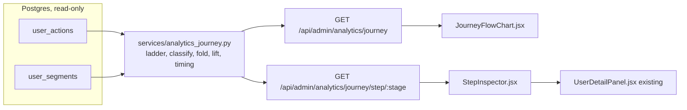

# Admin Journey view: replacing the Funnel tab with precise drop-off analysis

**Status:** APPROVED by the user 2026-10-30, with one amendment: the Frame band gained the gates between Opened Frame and Finished highlight (Moved framing window, Pressed Export, Opened Spotlight, Spotlight added), and "Took it away" explicitly includes sending a link.
**Decision artifact (mock + research summary):** https://claude.ai/artifact/JJfPADKV5QJQ7XtboxmR4V
**Scope:** admin analytics only. Read-only over existing data in phase 1; aggregates-only rollup in phase 2.
**Supersedes:** [T7465](tasks/investor-analytics/T7465-journey-flow-graph.md) (Journey Flow graph) is absorbed as phase 1 of this design; its approved Sankey direction stands. Overlaps [T7420](tasks/investor-analytics/T7420-activation-funnel-report.md) (see Decisions).

---

## 1. Problem

The admin Funnel tab ([FunnelChart.jsx](../../src/frontend/src/components/admin/FunnelChart.jsx)) draws 24 bars of "distinct users who ever did X" as a share of signed-up users. It is honest since T11010 (no percentage above 100), but it cannot answer the questions an operator actually has:

| Question | Funnel tab today |
|---|---|
| Where do people stop? | Not answerable. A shorter bar says fewer users ever did the later thing, not where anyone stopped. Steps are not nested, so bar deltas are not drop-offs. |
| Did they stop, or have they just not got there yet? | Not answerable. A signup from yesterday and one from June count the same. |
| Are the people who stopped gone, or still visiting and stuck? | Not answerable. |
| How long does each step take? Where is the friction? | Not answerable. `first_at` exists but is never read as a delta. |
| What did the people who stopped do instead? | Not answerable. No paths. |
| Why? Which failures, dialogs, retries, screens correlate with stopping? | Written (failure reasons, impressions, retry bursts, session-exit screen trails) but never read in aggregate. `session_exit` breadcrumbs are written by T7515 and read by nothing. |
| Is the biggest leak shrinking after a deploy? | Not answerable here (T7467 and T14000 give the build filter; nothing shows a per-step trend). |

The dashboard also has the People table's `last_step` badge, which is the furthest FUNNEL_STEPS rank per user. That is the right primitive (furthest stage), hidden in a per-row badge instead of aggregated.

## 2. What good drop-off analysis looks like (research, 2026-10-30)

Synthesised from vendor documentation (Amplitude Funnels and Journeys, Mixpanel Flows, PostHog Paths, Datadog RUM frustration signals) and practitioner guides. Each practice is paired with what it means for this design.

| # | Practice | Source basis | In this design |
|---|---|---|---|
| 1 | **Define stages by user intent and decision points, not by product milestones or URLs.** Keep the headline funnel to 5 to 8 stages; detail belongs in drill-down. | UXCam, Quantum Metric, Metricuno guides | A 14-stage intent ladder (Section 5.1), each stage a predicate over one or more FLOW_EVENTS, drawn in three bands (Get footage in, Make the highlight, Take it away) so the headline still reads as a few phases while every gate inside the editor stays visible. The user chose editor-level granularity on 2026-10-30 because that is where the product spends credits and where most fixes land. The full 24-event list stays the drill-down. |
| 2 | **Use a conversion window and cohort it.** A user is "dropped" only after their window has elapsed; younger users are pending, never blended in. | PostHog conversion metrics, Mixpanel funnel docs, Amplitude FAQ | Every user at their furthest stage is classified as continued, in window, stuck, or gone (Section 5.2). Window defaults to 14 days to match the locked activation definition. |
| 3 | **Separate "stuck but still here" from "gone".** Users still visiting but not progressing are the highest-value population: reachable, and the product is failing them. | Amplitude ("high intent but friction"), practitioner guides | The drop ribbon at each stage is two-toned: stuck (active in the last 14 days) vs gone. Stuck is the number the inspector leads with. |
| 4 | **Prioritise by absolute loss, not percentage.** A 70% drop on 20 users matters less than 25% on 800. | Metricuno, Trackraptor, Startupfundraising guides | A loss ranking strip above the map sorts stages by users lost (stuck + gone), with stuck shown beside it. |
| 5 | **Segment before concluding.** Device, channel, new vs returning cuts most often explain a drop. | Quantum Metric, PostHog breakdown guidance | Per-stage breakdown by platform, origin/campaign, signup build (T14000) and signup month, each row sorted by absolute loss. |
| 6 | **Time between steps is the friction proxy.** Report median and p75 time to the next step and a time-to-convert distribution, not just the rate. | PostHog ("expose both, plus time-to-convert"), Amplitude Journeys, Usermaven | Median, p75 and a 5-bucket histogram (same hour, same day, 2 to 3 days, 4 to 14 days, over 14 days) per stage, from `first_at` deltas. |
| 7 | **Funnels say where; paths say what they did instead.** Send the dropped population to a flow view; look at over-represented behaviours among dropped vs converted (conversion drivers / correlation). Correlation is not causation; label it. | Amplitude conversion drivers, Mixpanel "view as flow", PostHog correlation analysis | "What they did instead": for users who reached stage S, the lift of each side action (tutorial watched, paywall hit, upload failed, dialog shown) among dropped vs continued, restricted to actions after reaching S. Labelled as correlation. |
| 8 | **Pair where with why.** Frustration signals (rage, dead and error clicks, repeated error dialogs, retries) and session replay explain the drop. Normalise by population. | Datadog RUM frustration signals, Qualtrics, Clickport, Metabase dashboard | We have no replay (and the privacy posture rules it out), but we do have failure reasons, dialog and toast impressions, retry bursts, and per-screen dwell plus exit-screen trails. The inspector surfaces all of them per stage; per-user drill-down lands on the existing action-log timeline, which is our replay equivalent. |
| 9 | **Small samples: show counts, intervals or "insufficient data", never a bare percentage.** Wilson intervals for small denominators. | Amplitude significance guidance, practitioner guides | Percentages render only when judged users >= 20; below that the cell shows raw fractions. Wilson 95% lower bound shown in breakdown rows. |
| 10 | **Instrumentation age must be visible.** An event added in August says nothing about June signups. | T7465's own finding | `EVENT_INSTRUMENTED_AT` registry; stages badged "data from YYYY-MM-DD" when the signup window predates them. |
| 11 | **Ordered (sequential) funnels by default; strict order only when exact sequence matters.** | PostHog, Hackle, Usermaven docs | Edges follow ladder order (a user's next reached stage in ladder order), skips allowed and drawn fainter. Time stats come from timestamps and report out-of-order cases separately. |
| 12 | **Drop-off analysis ends in a ranked hypothesis list and a before/after check, not a redesign.** | UXCam, practitioner guides | The build filter (T14000) and, later, T7467's deploy comparison give the before/after; the inspector is the hypothesis generator. No "insights" prose generated by the dashboard. |

Sources consulted: [UXCam](https://uxcam.com/blog/conversion-funnel-analysis/), [Quantum Metric](https://www.quantummetric.com/blog/conversion-funnel-analysis-fix-drop-offs), [Metricuno](https://www.metricuno.com/funnel-drop-off-analysis), [Trackraptor](https://trackraptor.com/blog/funnel-drop-off-analysis-fix-leaks), [Amplitude Journeys](https://amplitude.com/docs/analytics/charts/journeys/journeys-understand-paths), [Amplitude conversion drivers](https://amplitude.com/docs/analytics/charts/funnel-analysis/funnel-analysis-identify-conversion-drivers), [Amplitude funnel FAQ](https://www.amplitude.com/docs/faq/funnel-analysis), [Mixpanel Flows](https://docs.mixpanel.com/docs/reports/flows), [PostHog Paths](https://posthog.com/docs/product-analytics/paths), [PostHog conversion metrics](https://posthog.com/pocket-guides/data-stack/conversion-metrics), [Datadog frustration signals](https://docs.datadoghq.com/real_user_monitoring/browser/frustration_signals/), [Metabase session frustration dashboard](https://www.metabase.com/dashboards/session-frustration-signals), [Vexo on Sankey for user flows](https://www.vexo.co/blogs/sankey-diagrams-for-user-flows), [Usermaven funnels](https://usermaven.com/docs/funnels).

## 3. Data we already have, and what each can answer

| Store | Grain | Answers | Cannot answer |
|---|---|---|---|
| PG `user_actions` (user, action, platform, first_at, count) | first touch + lifetime count per action | furthest stage, ladder order, time between first touches, side-action presence, failure reasons (`event:reason`), impression counts (`dialog_impression:slug`), platform of first touch | repeat loops (second game, re-export), order of repeated events |
| PG `user_segments` (acquired_at, origin, signup_build, last_active_at) | per user | cohort, attribution, build, "active in last N days" | |
| PG `user_usage_daily` | per user per day | active-day spine (alternative to last_active_at) | |
| per-user `user_action_log` (action, context, created_at) in user.sqlite | every event with context; `session_exit` rows carry last_screen, per-screen dwell, screen trail | exit screen, dwell on the screen they got stuck on, retry bursts, repeat transitions | anything in aggregate without a sweep (epic directive: raw events never leave the per-user DBs) |
| `analytics.sqlite` (T13930, per-writer shards, schema evolved by `PRAGMA user_version`, step 2 reserved for rollups) | aggregates | the only legal home for new aggregate state | |

Binding constraints carried from the [investor-analytics epic](tasks/investor-analytics/EPIC.md): in-house only, aggregates only, zero new Postgres state, extend `record_milestone` rather than build a parallel system. Phase 1 below is pure read. Phase 2 writes aggregates to analytics.sqlite only.

## 4. Target UX: the Journey tab

Replaces the Funnel sub-tab in [AnalyticsDashboard.jsx](../../src/frontend/src/components/admin/AnalyticsDashboard.jsx). One screen, four layers, read top to bottom, drilled left to right.

```
+-----------------------------------------------------------------------------------+
| Filters: Signups [last 90d v]  Origin [all v]  Build [all v]  Platform [all v]     |
|          Conversion window [14d v]   Inactive after [14d v]   [x] exclude test     |
+-----------------------------------------------------------------------------------+
| LOSS RANKING   1. Started -> nothing  29 lost (9 still visiting)                   |
|                2. Add footage        20 lost (8 still visiting)   3. Clipped 7 ... |
+-----------------------------------------------------------------------------------+
| JOURNEY MAP (Sankey)                                                               |
|  [Get footage in]     Signed up -> Started -> Add footage -> Footage landed -> Clipped |
|  [Make the highlight] Opened Frame -> Moved framing window -> Pressed Export -> Exported|
|       -> Opened Spotlight -> Spotlight added -> Finished highlight                  |
|  [Take it away]       Watched result -> Took it away (downloaded or sent a link)    |
|  ribbons = continued; peel-offs per node: [amber] stuck  [gray] gone  [hatched] in |
|  window. Skip edges fainter. Partial badge on late-instrumented nodes.             |
|  Side strip: Money  Hit paywall -> Opened buy -> Purchased (same classification)   |
+-----------------------------------------------------------------------------------+
| STEP INSPECTOR  (click a node)   Add footage                                       |
|  reached 61 | continued 38 | stuck 8 | gone 12 | in window 3      next: Footage    |
|  time to next: median 11 min, p75 1.6 d  [hist: <1h 24 | same day 6 | 2-3d 4 ...]  |
|  Breakdown [Platform | Origin | Build | Signup month]  rows sorted by loss          |
|  What they did instead (lift, dropped vs continued, after reaching this stage)     |
|  Why signals: upload failed: timeout 6 · dialog "File too large" 5 · retry bursts  |
|  Where they left (phase 2): last screen project-manager 70% · dwell p50 2m 10s     |
|  People: 20 stuck (open any -> existing user detail timeline)                      |
+-----------------------------------------------------------------------------------+
```

### Interactions

- Click a node: inspector loads that stage. Click a drop ribbon: inspector loads that stage with the matching outcome pre-selected in the People list. Hover any ribbon: exact count and share of the source node.
- Breakdown tabs re-query only the inspector; the map does not redraw.
- Filters apply to map and inspector together; the conversion window and inactivity threshold are explicit controls so the operator can see how sensitive the stuck/gone split is.
- "People" opens the existing `UserDetailPanel` (per-user milestone timeline, retry bursts, clip phases). Phase 2 adds the session-exit trail rendering to that panel, which costs nothing because the rows already exist.
- Compact/full toggle as in T7465: compact = the 14-stage ladder; full = every FUNNEL_STEPS event as a node, for the deep dive.

### Visual rules

Admin dark palette, purple flow gradient (existing), amber for stuck, neutral gray for gone, hatched outline for in window. Every drop ribbon carries a text label (secondary encoding; colour is never the only signal). Tabular numerals. Hand-rolled SVG, no chart library (project rule, T3560 note). Horizontal scroll on narrow viewports; admin is a desktop surface.

## 5. Definitions (locked for implementation)

### 5.1 Stage ladder (compact)

A stage is a predicate over FLOW_EVENTS; its `first_at` is the minimum over its actions. Lives in `analytics.py` as `JOURNEY_LADDER` next to FUNNEL_STEPS, with a comment stating the inclusion rule (one node per decision a parent makes).

| Stage key | Label | Actions | Why this is a decision point |
|---|---|---|---|
| `signed_up` | Signed up | synthetic, `user_segments.acquired_at` | |
| `started` | Started | `session_started` | came into the app at all |
| `add_footage` | Add footage | `add_game_opened`, `add_clip_opened` | tried to bring film in |
| `footage_landed` | Footage landed | `game_upload_succeeded`, `clip_uploaded` | film durably in R2 |
| `clipped` | Clipped | `clip_created`, `clip_uploaded` | has a play to work with (shared-in games reach this without the two stages above; the skip edge shows it) |
| `frame_opened` | Opened Frame | `framing_opened` | started making a highlight |
| `framed` | Moved framing window | `crop_adjusted`, `framing_point_added` | touched the crop at all. T8510 hard-blocks exporting an unframed clip, so this is a real gate, not a nicety |
| `export_pressed` | Pressed Export | `export_started` | committed credits. The gap from Moved framing window is hesitation at the credit gate (the inspector pairs it with `paywall_shown`). Client beacon, badged |
| `exported` | Exported | `export_completed` | first render landed (the working video; the activation event per T7460). The gap from Pressed Export is render failure or abandoned waiting (`export_failed:*`) |
| `spotlight_opened` | Opened Spotlight | `overlay_opened` | accepted the overlay offer (T8520 "Add Spotlight") |
| `spotlight_added` | Spotlight added | `overlay_players_assigned` | picked a player to follow. The gap from Opened Spotlight is the player picker |
| `finished` | Finished highlight | `overlay_exported` | the shareable video exists. "Finish Now" reaches it straight from Exported with no spotlight; that is a skip edge, drawn fainter, never a drop |
| `watched` | Watched result | `result_viewed` | saw the value (partial: instrumented T10010) |
| `took_away` | Took it away | `video_downloaded`, `share_completed` | downloaded the file or sent a link; value realised outside the app |

Bands (display only, no semantics): Get footage in = `signed_up` to `clipped`; Make the highlight = `frame_opened` to `finished`; Take it away = `watched`, `took_away`.

Considered and left in full mode, with the reason: `highlight_made_*` (fires at the make-highlight seam immediately before Frame opens; no separate decision), Annotate open (not instrumented until T7455 ships; it then becomes a stage between Footage landed and Clipped), `speed_segment_created`, `overlay_color_set`, `overlay_shape_set` (polish inside a stage, not gates), `gallery_viewed` and `move_succeeded` (publishing to Highlight Reels is in-app, not taking it away), `invite_sent`, `share_viewed` (the recipient's action, not the parent's). Promotion rule: a full-mode event becomes a stage when the gap it would split carries more than 5% of its band's loss for two consecutive months.

Money mini-ladder, rendered as a side strip with the same classification: `paywall_shown` -> `buy_modal_opened` -> `credit_purchased`. It is not in the main ladder because a purchase can happen from any stage.

### 5.2 Outcome classification

For each user, furthest stage S = highest ladder index reached. Then, with conversion window W (default 14 days) and inactivity threshold I (default 14 days):

```
continued   : user reached a stage after S            (never true for furthest, by definition;
                                                        used per-edge: reached S and reached S+k)
in_window   : now - first_at(S) <  W                   (pending; not judged)
stuck       : now - first_at(S) >= W  and  last_active_at >= now - I
gone        : now - first_at(S) >= W  and  last_active_at <  now - I
```

`first_at(signed_up)` is `acquired_at`. `last_active_at` is `user_segments.last_active_at` (bumped by `record_milestone` and `update_session`; already indexed). Judged = continued + stuck + gone. Continue rate = continued / judged. Loss = stuck + gone.

Conservation (unit-tested): at each node, reached = continued + in_window + stuck + gone, and reached(S) = sum of inflow edges into S.

### 5.3 Edges

Edge from S to the next stage the user reached in ladder order (ordered-funnel semantics). Skips are allowed and drawn fainter. This replaces T7465's "sort by first_at" fold: timestamp ordering produces backward ribbons from batched or beaconed writes and makes the graph unreadable, and the ordered semantics is the industry default (Section 2, row 11).

### 5.4 Timing

For users who continued from S to T: delta = first_at(T) - first_at(S). Report median, p75, and buckets `<1h`, `same day`, `2-3d`, `4-14d`, `>14d`. Negative deltas (reached T before S, possible for shared-in or direct-upload paths) are counted and shown as "out of order: n", never silently clamped.

### 5.5 Side-action lift ("what they did instead")

Among users who reached S (and are judged), for each non-ladder action A with `first_at(A) >= first_at(S)`:

```
p_dropped   = users dropped at S with A   / users dropped at S
p_continued = users continued past S with A / users continued past S
lift        = p_dropped / p_continued
```

Shown only when both groups have >= 5 users with A; sorted by lift; labelled "correlation, not cause". Candidate actions: tutorial watched events, `paywall_shown`, `*_failed:*` (grouped by base event and by reason), `dialog_impression:*`, `toast_impression:*`, `overlay_*`, `framing_point_added`, `draft_saved`, `preview_started`.

### 5.6 Small-N and honesty rules

- Percentages render only when judged >= 20; otherwise the cell shows `k / n`.
- Breakdown rows show the Wilson 95% lower bound of the continue rate beside the point estimate.
- Nodes whose first action in `EVENT_INSTRUMENTED_AT` is younger than the signup window start are badged partial with the date.
- `watched` (`result_viewed`, T10010) and `export_pressed` (`export_started`, fired from exportStore) are client beacons; their nodes always carry a "client beacon" note. `exported` is server-side and is the number to trust when the two disagree.
- No invented zeros: a stage with no instrumented data in the window renders "no data", not 0.

## 6. Architecture

### 6.1 Phase 1 (pure read of Postgres)



**Service** `app/services/analytics_journey.py`: pure functions over fetched rows so the fold is unit-testable without Postgres. `fetch_population(filters)` runs the two queries; `classify(user_rows, ladder, now, W, I)` returns per-user (furthest, outcome, per-stage first_at, platform); `fold_map`, `loss_ranking`, `step_breakdown`, `time_to_next`, `side_action_lift` consume that.

**Queries.** One population query (same joins and `_test_exclusion` as `analytics_funnel`), one `user_actions` query for the window's users. Row volume today: ~5k users x ~15 to 60 action rows (impressions and reasons inflate it) = up to 300k rows worst case. Two options, recommend the second:

1. Python fold over all rows. Simple; ~0.5 to 1 s at the worst case. Acceptable for admin, cache 60 s in-process keyed by filter tuple.
2. SQL pre-aggregation for the map: per user, a stage bitmask (`bit_or(1 << rank)` via a CASE generated from `JOURNEY_LADDER`, the same technique `_build_last_step_rank` already uses) plus `MIN(first_at)` per stage via `FILTER`, grouped by `(bitmask, outcome_bucket, platform, origin, signup_build, signup_month)`. Output is at most a few thousand pattern rows regardless of user count; Python then folds patterns, not users. The inspector queries the same shape filtered to users who reached S. This keeps the admin page fast at 50k users with no cache.

**Endpoints** (`routers/admin.py`, plain `def` per T8000 pattern, `_require_admin()`):

- `GET /analytics/journey?from&to&origin&build&platform&exclude_test&window_days=14&inactive_days=14&steps=compact|full`
  -> `{ nodes:[{key,label,reached,continued,in_window,stuck,gone,partial_from}], edges:[{from,to,users,skip}], loss:[{stage,lost,stuck,gone,judged}], money:{...}, meta:{window_days,inactive_days,from,to,computed_at} }`
- `GET /analytics/journey/step/{stage}?...same filters...&by=platform|origin|build|cohort_month`
  -> `{ stage, counts:{...}, next:{stage,median_s,p75_s,buckets:{...},out_of_order}, breakdown:[{key,reached,continued,in_window,stuck,gone,rate,rate_lb}], instead:[{action,label,p_dropped,p_continued,lift,n_dropped,n_continued}], why:{failures:[{event,reason,users}],impressions:[{slug,users}]}, people:{stuck:[{user_id,email,platform,last_active_at}],gone:[...],in_window:[...]} }` (people capped at 200 per outcome, same email masking as `list_users`).

**Frontend**: `JourneyTab.jsx` (filters + loss strip + map + inspector), `JourneyFlowChart.jsx` (SVG, extends the T7465 mock renderer with two-tone plus hatched drops and a money side strip), `StepInspector.jsx`, `adminStore` actions `fetchJourney`, `fetchJourneyStep`. `FunnelChart.jsx` removed from the dashboard once the Journey tab is signed off on staging; `UserTable`'s `FunnelSummary` strip and `last_step` badge are untouched in phase 1 (they can adopt the ladder later; see Decisions).

### 6.2 Phase 2 (aggregates-only rollup into analytics.sqlite)

Unlocks the questions only the per-user event log can answer. Follows T7400's sweep pattern and lands as schema step 2 of `analytics_store.py` (reserved there for exactly this).

| Table | Columns | Source | Answers |
|---|---|---|---|
| `rollup_exit_screen` | run_id, stage, last_screen, users | each user's most recent `session_exit` row joined to their furthest stage | "People stuck at Add footage last left from project-manager 70% of the time" |
| `rollup_stage_dwell` | run_id, stage, screen, p50_s, p75_s, users | dwell maps from `session_exit` rows | "They spent a median 2 min on Annotate before leaving" |
| `rollup_retry_burst` | run_id, stage, action, users | existing `_detect_retry_bursts` over `user_action_log` | "8 of the 20 stuck users hammered upload 3+ times in a minute" |
| `rollup_transition` | run_id, from_stage, to_stage, cohort_month, users | full event order, repeat loops included | second game, re-export, return visits (T7465's deferred v2) |
| `rollup_meta` | run_id, computed_at, users_swept, users_failed | | freshness and honesty |

Sweep: admin-triggered (`POST /api/admin/analytics/journey/rollup`), in-process, opens each user DB through the JIT seam primitive exactly as `backfill_posters` does (never an out-of-process sweep; CLAUDE.md migration section). Users whose DB cannot open are counted in `users_failed`, never skipped silently. Full rebuild per run.

**Shard semantics (new since T7400 was written):** `analytics_store` is per-writer sharded and readers sum shards. Summing is wrong for a rebuilt rollup (two machines, two runs, double counts). Rollup tables therefore carry `run_id`; the reader takes the newest `computed_at` across shards and reads only that run. Document this in `analytics_store.py` when adding step 2.

Inspector gains a "Where they left" panel reading these tables, with `computed_at` printed and a Refresh button.

### 6.3 Phase 3 (precision ceiling: instrumentation)

Not part of this design's tasks; listed so the ceiling is explicit.

- `annotate_opened` does not exist ([T7455](tasks/investor-analytics/T7455-editor-open-event-coverage.md)); until it does, "Footage landed -> dropped" cannot split "never entered Annotate" from "entered and bailed".
- `framing_opened` / `overlay_opened` fire once per page-load session via the quest bridge (T7455 / T11175 fix the emission path). First-touch semantics are still correct for the ladder.
- Dead and rage taps are not instrumented. The cheapest honest addition later is a `capability`-kind impression from `uiTelemetry.recordUiImpression` on a detected dead tap (3+ taps in 1 s with no state change), which the "Why signals" panel would pick up with no backend change.

## 7. Implementation plan (proposed tasks)

| ID | Task | Tier | Layers | Depends on | Replaces / touches |
|---|---|---|---|---|---|
| T14010 | Journey map replaces the Funnel tab: ladder constants, outcome classification, `/analytics/journey`, loss ranking, two-tone Sankey, window and inactivity controls, compact/full toggle, partial badges | M (this doc is the design; no Architect) | Backend + Frontend | none | supersedes T7465 (archive it with a pointer here); keeps its mock as the visual reference |
| T14020 | Step inspector: `/analytics/journey/step/{stage}`, breakdowns, timing, side-action lift, failure reasons and impressions, people list, drill to `UserDetailPanel`; render the existing `session_exit` trail in `UserDetailPanel` | M | Backend + Frontend | T14010 | |
| T14030 | Exit-screen, dwell, retry-burst and transition rollup (analytics.sqlite schema step 2, run_id semantics, admin-triggered sweep) + "Where they left" panel | L (new persisted aggregate state, sweep) | Backend + Frontend | T14010, T14020; coordinates with T7400 on step numbering | T7400's `rollup_action_weekly` becomes step 3 or ships in the same step; decide at T7400's start |

Files (phase 1): `app/analytics.py` (JOURNEY_LADDER, EVENT_INSTRUMENTED_AT), `app/services/analytics_journey.py` (new), `app/routers/admin.py` (two endpoints), `tests/test_analytics_journey.py` (fold conservation, classification edges at W and I boundaries, skip edges, out-of-order timing, lift thresholds, small-N suppression, partial flags, filters), `components/admin/JourneyTab.jsx`, `JourneyFlowChart.jsx`, `StepInspector.jsx` plus tests, `AnalyticsDashboard.jsx`, `stores/adminStore.js`. No migration on any track in phase 1 (grep-provable: no `_SCHEMA_DDL` diff, no migrations file). Knowledge doc: `backend-services.md` (admin router patterns, request concurrency); update at Stage 7.

## 8. Risks

| Risk | Mitigation |
|---|---|
| Stuck/gone split is sensitive to I; a 15-day-idle parent looks "gone" in off-season | Both thresholds are visible controls with the defaults printed on the map; season context stays with T7430. |
| `last_active_at` is bumped by any request, including passive ones, so "stuck" can include users who only opened the app | That is the definition of stuck (visiting, not progressing). The inspector's dwell and exit-screen panel (phase 2) tells the two apart. |
| Row volume of `user_actions` grows with impressions and reasons | Option 2 (SQL bitmask pre-aggregation) bounds the Python fold; measure on staging before choosing option 1. |
| Ordered-funnel edges hide genuine out-of-order paths | Out-of-order counts are reported per edge in timing; full mode shows every event. |
| Operators read lift as cause | Label on the panel; minimum n on both sides; no sorting by lift when n < 5. |
| Rollup double-counts across writer shards | `run_id` + newest-run reader rule (Section 6.2); unit test with two shards. |
| The Funnel tab's existing consumers (UserTable strip, label-derived keys) break when FunnelChart is removed | Phase 1 removes only the dashboard usage after staging sign-off; the T11010 label-key trap is documented and the strip keeps its own keys. |

## 9. Decisions (taken by the user, 2026-10-30)

1. **Supersede T7465 with T14010.** T7465's approved Sankey direction is kept; the fold changes to ladder order, the drop splits three ways, and the window controls are explicit. T7465's PLAN.md row is marked SUPERSEDED with a pointer here.
2. **Shrink T7420** to per-cohort activation rate + benchmarks + CSV. Its stall distribution and inter-stage medians are the inspector's counts and timing.
3. **Ladder membership: editor gates are stages.** The user asked for the steps between Opened Frame and Exported, and anywhere else users are lost. Result: 14 stages (Section 5.1). Overlay joins the ladder as Opened Spotlight and Spotlight added, with Finished highlight as the shareable-video stage; "Finish Now" is a skip edge. Sending a link is part of Took it away.
4. **Default thresholds** 14 days for both the conversion window and the inactivity threshold, with both exposed as controls.
5. **Phase 2 right after phase 1.** T14030 follows T14020 without waiting for a phase-1 finding.
