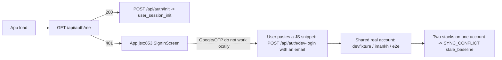

# T11500 Design: Dev account picker on local stacks (no sign-in wall)

**Status:** DRAFT (awaiting user approval)
**Author:** Architect Agent
**Task file:** [T11500-dev-account-picker.md](T11500-dev-account-picker.md)
**Approved:** (pending)

Tier L (new router + new service + two new scripts + frontend wall + tooling, 4 layers).
Knowledge docs: `.claude/knowledge/backend-services.md`, `.claude/knowledge/persistence-sync.md`.

---

## 0. Corrections to the task sketch (verified against code, 2026-11-02)

The design follows the code where the task sketch differs.

| Sketch says | Code says | Effect on design |
|---|---|---|
| `_test_seams_enabled()` at `storage.py:163` | `storage.py:262`; allowlist `("dev","development","local","test")` | Same gate, line moved |
| Auth wall at `App.jsx:897` | `App.jsx:853` (`if (!isAuthenticated) return <SignInScreen />;`) | Same seam |
| `dev_login` at `auth.py:1110` | `auth.py:1199-1279`; `_issue_session_cookie` at `auth.py:428` | Same |
| Clone must increment `game_ref_counts`; "the copy script skips that increment today" | **`game_ref_counts` has been dead since T6770.** Nothing in `app/` reads or writes it (only `pg.py` DDL + v002 migration). The live ref set is Postgres `game_storage_refs` (one row per user, profile, hash; `has_remaining_refs`/`get_ref_holders` read it) plus each profile's SQLite `game_storage` (the sweep's Phase-2 authoritative recount). `copy_user_between_envs.py:238-252` **already copies `game_storage_refs`**. | No `game_ref_counts` work. The clone copies `game_storage_refs` (re-keyed to the new user) and the copied profile.sqlite carries the matching `game_storage` rows. The "far-future expiry" is set once **on the template** in both stores, so PG and SQLite never disagree. AC "game_ref_counts keeps them from being swept" is restated in section 7. |
| Routes at `/api/dev/accounts` | `RequestContextMiddleware` (`db_sync.py:882-916`) returns **401** for any unauthenticated path not in `AUTH_ALLOWLIST_PREFIXES` (`db_sync.py:671`). The picker calls these routes while logged out. | Mount under the already-allowlisted `/api/auth/` prefix: `/api/auth/dev-accounts`. Then a logged-out call reaches routing, so prod and staging answer a true 404 (route absent), not a 401. Open question Q1. |

---

## 1. Current State ("As Is")



```pseudo
initSession():                                   # utils/sessionInit.js:219
    GET /api/auth/me
    401 -> setSessionState(false) -> App renders <SignInScreen/>   # App.jsx:853

dev_login(email|user_id):                        # auth.py:1199, async def, blocking on the loop
    404 if APP_ENV == production; X-Test-Mode required on staging
    resolve an EXISTING user -> set_current_user_id -> invalidate_user_cache
    -> user_session_init (R2 download, inside an UNAUTHENTICATED request: the middleware
       does no write tracking or sync for it) -> _issue_session_cookie
```

Limitations:
- Every local test starts with a manual snippet.
- The reachable accounts are either too full or empty.
- Sharing one account across containers produces CAS `stale_baseline` conflicts. Each container's backend is a separate process with its own loaded-from version for the same R2 object.

---

## 2. Target State ("Should Be")

```mermaid
sequenceDiagram
    participant B as Browser (Vite DEV)
    participant FE as sessionInit + devAccounts.js
    participant MW as RequestContextMiddleware
    participant R as dev_accounts router
    participant S as account_clone service
    participant PG as dev Postgres
    participant R2 as R2 (dev/ prefix)

    B->>FE: load (optional ?dev_account=full)
    alt URL has dev_account (DEV only)
        FE->>R: POST /api/auth/dev-accounts/full
    else no param
        FE->>MW: GET /api/auth/me -> 401
        FE->>R: GET /api/auth/dev-accounts (allowlisted, unauthenticated)
        R-->>FE: 200 {presets, stack_id} (404 outside dev)
        FE-->>B: render DevAuthWall -> DevAccountPicker
        B->>R: click card -> POST /api/auth/dev-accounts/{preset}
    end
    R->>PG: template lookup (upload/full)
    R->>S: clone_account_for_dev(template -> new user_id)
    S->>R2: copy_object users/{tpl}/... -> users/{new}/... ; verify set + db-version + media + game videos
    S->>PG: ONE txn: INSERT users(is_test_account) + game_storage_refs re-keyed
    R-->>FE: 200 + Set-Cookie rb_session (new user)
    FE->>FE: clearProfileHeader(); location.replace(url without dev_account)
    B->>MW: GET /me 200 -> POST /api/auth/init (authenticated, tracked) -> user_session_init
```

```pseudo
POST /api/auth/dev-accounts/{preset}          # plain def (threadpool): blocking PG + R2 copy
    _require_dev_accounts_enabled()           # 404 outside dev/development/local/test
    stack   = current_stack_id()              # DEV_STACK_ID or "host", validated [a-z0-9._-]+
    user_id = generate_user_id()              # uuid4, so every pick gets a new R2 prefix and CAS baseline
    email   = dev_account_email(preset, stack, utcnow, user_id)
    if preset == EMPTY:
        create_user(user_id, email, verified_at=now, is_test_account=True)
    else:
        tpl = get_user_by_email(TEMPLATE_EMAILS[preset]) or 409 template_missing
        clone_account_for_dev(...)            # AccountCloneError -> 500 clone_failed, nothing left behind
    return _issue_session_cookie(user_id, {user_id, email, preset, dev_account: true})
```

Non-goals:
- No reset or reuse of accounts. Picking again is the reset.
- No highlight reel in Full (waits on T11300).
- No change to `dev_login`, `test-login`, or the real sign-in.
- No staging/prod exposure.
- No rewrite of profile ids inside clones (see Risk R6).

---

## 3. Key design decisions and alternatives

**D1. The POST does not run `user_session_init`. The reload's `/api/auth/init` does (deviates from the sketch, Q2).**
`dev_login` runs init inside the handler because a client that already holds an `X-Profile-ID` makes the middleware skip session_init. Here the frontend clears `rb_profile_id` (`clearProfileHeader()`, `sessionInit.js:355`) before the reload. So the normal `initSession` sends `POST /api/auth/init` with `{}` under the new cookie, and that is a fully authenticated, write-tracked, synced request.

Running init inside the POST would happen in an unauthenticated request (`db_sync.py:884-891` calls `call_next` with no tracking). For the empty preset, the user.sqlite and profile.sqlite created there would never be marked pending or uploaded until some later write. That is the reactive-durability gap CLAUDE.md warns about, made worse by `uvicorn --reload` restarts during testing. Deferring also keeps the POST free of SQLite writes. A pick made while another dev account is logged in (direct link) then cannot attribute SQLite writes to the old session.

The cost: a JIT-migration 503 shows up on the reload's init rather than on the click. That path is already handled.

*Alternative (sketch):* factor a `_dev_session_login(user_id)` helper out of `dev_login`. Rejected for the reason above. `_issue_session_cookie` is reused unchanged.

**D2. Route prefix `/api/auth/dev-accounts` (Q1).** See section 0. The task's gating test, "routes 404 with APP_ENV=staging and production", is then true end to end for logged-out callers. The allowlist is not touched.

**D3. Gating has three layers, copying T4120 `test_seams`.**
1. `main.py` mounts the router only when `_test_seams_enabled()`. Mechanical prerequisite: move the existing block (`main.py:311-319`) into `def _mount_dev_only_routers(app: FastAPI) -> None`, called once at import. It mounts `test_seams` and `dev_accounts`. This makes the mount decision testable on a fresh `FastAPI()` without re-importing `main`.
2. Every handler re-checks first, with `_require_dev_accounts_enabled()`, which raises 404 before any side effect.
3. The frontend calls these routes only when `import.meta.env.DEV`, so production bundles contain neither the code nor the strings.

**D4. Clone = server-side R2 `copy_object` of the template's user prefix, plus one Postgres transaction.**
- Order: R2 copy + all verifies first, then PG (`users` row + `game_storage_refs`) in one transaction. The `users` row is what makes an account loginable. If any step before that commit fails, nothing loginable exists.
- On failure: purge the new `{env}/users/{new_id}/` prefix (best effort, CRITICAL log naming the prefix if the purge itself fails) and raise.
- Game videos (`{env}/games/{hash}.mp4`, `storage.r2_global_key`) are never copied. The clone adds one extra check the script lacks: HEAD each referenced game hash. A swept or never-copied shared video then fails loudly at pick time, not as a black player.

**D5. Templates are prepared once and are a fixed point of session init.**
The builder drives each template through the app's own seam: `ensure_user_database` / `ensure_database` (JIT migration to head), the trims, then `user_session_init`, so `archive_completed_projects` archives the finished project. Every write goes through the CAS sync path: `sync_db_to_r2_explicit` / `sync_user_db_to_r2_explicit` must return `SyncResult.OK`. The builder does not use the `edit-user-db.py` `max(local, r2)+1` blind upload, which is not CAS.

Invariant, asserted by the builder: running `user_session_init` again on the finished template causes no profile/user DB writes. So a clone's first login lands in exactly the template's state.

**D6. Every pick gets a new uuid4 user_id. Isolation comes from that, never from coordination (task decision 1).**
The R2 key is new, so `_OWN_UPLOAD_VERSIONS`, the CAS baseline, and every per-(user, profile) cache start empty on every machine. No process can hold a stale baseline for a key it has never seen.

**D7. The extraction is a mechanical move, then a contract change (Refactoring Rules 2 and 3).**
The moved code `sys.exit(1)`s. `SystemExit` is a `BaseException`, so inside a request it would escape FastAPI's exception handlers. The service must raise `AccountCloneError` before the endpoint calls it. That is a separate commit from the move.

**D8. Account email: `dev+<preset>+<stack>+<yyyymmddThhmmss>-<6hex>@reelballers.local` (Q3).**
The sketch's format plus the first 6 hex characters of the user_id, so two same-second picks on one stack can't collide on `users.email UNIQUE`. `<stack>` is limited to `[a-z0-9._-]+` (task.sh `sanitize` output). That makes `+<stack>+` an exact-match delimiter for cleanup, so `reel-task-foo` never matches `reel-task-foo-2`. Templates use `dev-template+<preset>@reelballers.local`. The `dev-template+` prefix never matches the `dev+` cleanup pattern, and cleanup additionally hard-refuses it.

Alternatives considered and rejected:
- **Reuse one account per stack and preset.** Contradicts user decision 1, and needs a reset path.
- **Clone by downloading and re-uploading bytes in the backend.** Slower and pointless. `copy_object` is in-bucket and preserves `db-version` metadata.
- **Rewrite profile ids in clones.** The profile id is embedded in R2 keys, the user.sqlite registry, PG refs and share rows. That is invasive, and T7800 alias clones already share profile ids with their source in the same env without issue.
- **A strategy/registry per preset.** Three presets, two code paths (create vs clone). An explicit `if` is clearer and greppable.

---

## 4. Implementation Plan ("Will Be")

Order is foundation before consumer. Each step is its own commit (`T11500: ...`).

### Step 2: Extract clone logic into `app/services/account_clone.py`

**2a. Characterization tests first, against the unmodified script** (`tests/test_t11500_account_clone_characterization.py`, using the `FakeR2` style from `test_t6150_copy_verification.py`, extended with `copy_object` and `delete_objects`):
- `copy_r2_objects` mirrors every key under the destination prefix, purges stale destination keys, and refuses (exits) on an empty source.
- `verify_r2_copy` passes on a faithful mirror and fails on missing/extra keys or a db-version mismatch.
- The `game_storage_refs` copy block re-keys `user_id` and keeps `profile_id`, `blake3_hash`, `game_size_bytes` and `storage_expires_at` (`pg_conn` fixture, `register_test_user_ids`).

Together with the existing `test_t6150_copy_verification.py` and `test_t8630_round2/3/4.py`, these must pass before and after the move.

**2b. Mechanical move (no behavior change).** Move verbatim into the service:
- `_MEDIA_REF_TABLES`, `_list_keys`, `_db_version`, `_profile_id_from_key`, `verify_r2_copy`, `verify_media_refs`.
- The body of `copy_r2_objects`, re-signatured to take a client: `copy_user_objects(r2, bucket, user_id, src_prefix, dst_prefix, dry_run, dst_user_id=None)`.
- The refs block, as `copy_game_storage_refs(src_cur, dst_cur, src_user_id, dst_user_id) -> int`.

The script keeps `load_env`, `get_r2_client(config)`, `get_pg_conn`, `alias_user_id`, `delete_destination_user`, the users/segments/actions/credits mirror, and `main()`. It re-imports the moved names, so `cu.verify_media_refs` etc. still resolve and existing tests run unchanged. Logger: `logging.getLogger(__name__)` (caplog sees it).

**2c. Fail-loud contract.** `class AccountCloneError(Exception)` (with `reason: str`, `details: list[str]`) replaces every `sys.exit(1)` in the service. The script's `main()` catches it, logs, and `sys.exit(1)`. `test_t6150` assertions change from `SystemExit` to `AccountCloneError`, with the same conditions. One new test checks that `main()` maps it to exit code 1.

**2d. Dev-to-dev clone composition** (new, in the service):

```python
def clone_account_for_dev(*, r2, bucket: str, env: str, template_user_id: str,
                          new_user_id: str, new_email: str) -> CloneResult
    # copy_user_objects(src=env, dst=env, dst_user_id=new_user_id)
    # verify_r2_copy + verify_media_refs + verify_game_videos_present(r2, bucket, env, hashes)
    # with get_pg(): INSERT users(user_id, email, verified_at, is_test_account=TRUE)
    #                copy_game_storage_refs(cur, cur, template_user_id, new_user_id); commit
    # on any failure: purge_user_prefix(r2, bucket, env, new_user_id); raise AccountCloneError
def verify_game_videos_present(r2, bucket: str, env: str, hashes: set[str]) -> None
def purge_user_prefix(r2, bucket: str, env: str, user_id: str) -> int
@dataclass class CloneResult: user_id: str; objects_copied: int; game_hashes: frozenset[str]; seconds: float
```

`auth_db.create_user` gains `is_test_account: bool = False` (additive keyword argument, used by the empty preset). The clone's `users` INSERT stays inside its own transaction with the refs, because `game_storage_refs.user_id REFERENCES users`.

### Step 3: `scripts/build_dev_account_templates.py`

CLI: `--preset upload|full|all` (default all), `--source-email imankh+devfixture@gmail.com`, `--rebuild`, `--check`.
- Dev only: refuse unless `APP_ENV == "dev"`.
- Runs in-process with the app modules (`sys.path` insert of `src/backend`, like the copy script) so it uses the app's R2/PG clients, the JIT seam and the CAS sync.

Per preset:
1. **Template exists and no `--rebuild`:** run assertions only and print the summary. Exit non-zero on drift. This is the idempotent path, and `--check` is the same thing.
2. **`--rebuild`:** delete the old template using `delete_user.py`'s `delete_one_postgres` + `purge_user_storage`, by exact template email. Then build under a new user_id, so no live process can hold a stale baseline for it.
3. **Build:**
   - `clone_account_for_dev(fixture -> template)`.
   - Open it through the seam (migrates to head).
   - Choose one ready game G whose `{env}/games/{hash}.mp4` HEADs OK. For Full, G must also have an exported, published final video; otherwise try the next game, or fail naming the reason.
   - Trim: delete other games, raw_clips, projects, working/final videos and their R2 objects; drop extra profiles from the user.sqlite registry together with their R2 prefixes and PG refs; set `storage_expires_at = 2099-12-31T00:00:00+00:00` on G's SQLite `game_storage` row **and** its PG `game_storage_refs` row.
   - Construct the Full states:
     - Framing: `working_clips` rows, `working_video_id IS NULL`.
     - Spotlight: `working_video_id` set, `current_mode='overlay'`, `final_video_id IS NULL`.
     - Finished: `final_video_id` set, `final_videos.published_at` set.
     - About 6 `raw_clips` on G.
     - A second profile that owns a game: prefer one of the fixture's other-profile games; else copy G with `materialization._copy_game` + `auth_db.upsert_game_storage_row` + `insert_game_storage_ref_pg_only` (Q5).
   - `user_session_init(template)` (archives the finished project), then sync every touched DB and require `SyncResult.OK`.
   - Delete the local `user_data/<template_uid>` copy so no stale local baseline lingers on the host.
4. **Assert and print** per preset (each line is a query result):
   - profile count, games, raw_clips, project states, refs rows.
   - R2 object count and bytes, with a ceiling (initial value: 80 objects) so a clone stays "seconds".
   - `verify_media_refs` OK; game video HEAD OK.
   - Fixed point: a second `user_session_init` produces no writes.

The pure assertion function `assert_preset_state(preset, conns_by_profile, pg_refs) -> list[str]` (failures) is unit-tested against synthetic SQLite.

### Step 4: Dev-only router `src/backend/app/routers/dev_accounts.py`

```python
class DevAccountPreset(str, Enum): EMPTY = "empty"; UPLOAD = "upload"; FULL = "full"
TEMPLATE_EMAILS: dict[DevAccountPreset, str]   # UPLOAD/FULL -> dev-template+<preset>@reelballers.local
router = APIRouter(prefix="/api/auth/dev-accounts", tags=["dev-accounts"])

def current_stack_id() -> str                       # os.getenv("DEV_STACK_ID") or "host"; invalid -> 500
def dev_account_email(preset: DevAccountPreset, stack_id: str, now: datetime, user_id: str) -> str

@router.get("")
def list_dev_accounts() -> dict
    # {"stack_id": str, "presets": [{"id","label","description","available": bool,
    #   "unavailable_reason": str|None}]}
    # available = template users row exists (one PG query) and R2_ENABLED for upload/full.
    # Unavailable reason text: "templates not built: run scripts/build_dev_account_templates.py"
    #   or "R2 disabled on this backend".

@router.post("/{preset}")
def create_dev_account(preset: DevAccountPreset) -> JSONResponse
    # 200 + rb_session cookie; 409 {"code":"template_missing"|"r2_disabled", "detail"};
    # 500 {"code":"clone_failed","detail","reason"} + logger.critical
```

Both handlers are plain `def` (blocking PG/R2 runs off the loop, per T6200/T9130).
- Mount via `_mount_dev_only_routers` (D3).
- Log one line per pick: `[DevAccounts] preset=… stack=… user_id=… objects=… seconds=…`.
- No SQLite writes in the handler (D1).

### Step 5: Frontend

| File | Change |
|---|---|
| `src/frontend/src/utils/devAccounts.js` (new, DEV-only) | `DEV_ACCOUNT_PARAM = 'dev_account'`; `probeDevAccounts()` returns `{presets, stackId}` only on HTTP 200, else `null` (404, 401, network error); `loginAsDevPreset(preset)` POSTs with `rbNonDataWrite: true` (T6020 auth-gesture marker), then on 200 calls `clearProfileHeader()` and `location.replace(currentUrlWithout(DEV_ACCOUNT_PARAM))`, and on failure throws with the backend `detail`; `loginFromUrlParam()` |
| `src/frontend/src/stores/devAccountStore.js` (new) | `{presets, stackId, error, pendingPreset, useRealSignIn}`; actions `setFromProbe`, `pick(preset)` (the gesture), `showRealSignIn()` (memory only) |
| `src/frontend/src/utils/sessionInit.js` | (a) at the top of `initSession`: `if (import.meta.env.DEV && hasParam)` dynamic-import `devAccounts` and `loginFromUrlParam()`. Success navigates away. Failure strips the param, records `error`, and continues. (b) In the `!userId` branch, before `setSessionState(false)`: `if (import.meta.env.DEV)` await `probeDevAccounts()` into the store. `isCheckingSession` stays true until then, so the SignInScreen never flashes. |
| `src/frontend/src/components/DevAuthWall.jsx` (new, container) | Reads the store. If `presets` is set and `useRealSignIn` is false, renders `DevAccountPicker`; otherwise `<SignInScreen/>` |
| `src/frontend/src/components/DevAccountPicker.jsx` (new, view) | Props only: three cards (label, one-line contents, "creates a new account"), disabled card plus reason when unavailable, pending state on the clicked card, error banner, "Use the real sign-in screen" link. Styled per UI style guide. |
| `src/frontend/src/App.jsx:853` | `const DevAuthWall = import.meta.env.DEV ? lazy(() => import('./components/DevAuthWall')) : null;`, then `if (!isAuthenticated) return DevAuthWall ? <Suspense fallback={null}><DevAuthWall/></Suspense> : <SignInScreen/>;` |

A production build replaces `import.meta.env.DEV` with `false`. Rollup drops the branches, so the dynamic imports never become chunks. A production build pointed at a dev backend therefore never probes and shows the real sign-in.

### Step 6: Tooling

- **`scripts/task.sh`:**
  - `start_stack` passes `-e DEV_STACK_ID="$cn"` on both `docker exec` calls.
  - `up`'s `docker run` adds `-e DEV_STACK_ID="$cn"` so manual and in-container starts (`dev-verify.sh`) are tagged too.
  - `stack` prints the three links under `open:` (`http://localhost:$FRONTEND_PORT/?dev_account=<preset>`).
  - `nuke`, before `down`, if the container is running: runs `cleanup_dev_accounts.py --env dev --stack "$cn" --yes` inside the container. On failure or a stopped container it prints a loud WARN with the manual command and nuke continues (Q4).
- **`.devcontainer/container-stack.sh`:**
  - `export DEV_STACK_ID="${DEV_STACK_ID:-container-$(hostname)}"`, with a WARN line when the fallback is used. Accounts made that way are reclaimed only by `--older-than`.
  - Extract its `DATABASE_URL` host rewrite into a sourced `.devcontainer/dev-db-url.sh`, so nuke's in-container cleanup reuses it rather than duplicating it.
- **`scripts/dotask_cli.py` `bring_up_stack`:** print the same three links after `stack ready:` (the line `land` step 1 shows). Extend `test_stack_starts_the_group_stack_waits_and_prints_offset_urls`.
- **`scripts/cleanup_dev_accounts.py` (new):** `--env dev` only; `--stack <id>` and/or `--older-than 7d`; dry-run unless `--yes`.
  - Selects with a LIKE prefilter, then a strict Python regex `^dev\+(empty|upload|full)\+[a-z0-9._-]+\+\d{8}T\d{6}-[0-9a-f]{6}@reelballers\.local$`, AND `is_test_account`.
  - Hard-refuses any `dev-template+` email.
  - Deletes through `delete_user.py`'s `delete_one_postgres` (removes `game_storage_refs`, sessions, audit row) + `purge_user_storage`, committing each user's PG phase before its storage phase (the T8630 round 3 ordering).
- **`scripts/ci_policy.py`:** route `scripts/build_dev_account_templates.py` and `scripts/cleanup_dev_accounts.py` to `backend`; backend tests import them. Otherwise CI fails with `UnclassifiedPath`.
- **Docs:**
  - `src/frontend/e2e/helpers/realAuth.js`: new `loginAsDevPreset(pageOrContext, preset)`. No 5xx retry: a clone 500 is real. It returns `{user_id, email, preset}`. `loginAsRealUser` is unchanged.
  - `.claude/skills/drive-app-as-user/SKILL.md` and `src/frontend/CLAUDE.md` "Testing Auth Bypass": document the presets.

### Step 7: Live check on a dotask stack

On a `dotask land` stack, open each printed link and confirm it lands without the sign-in screen, in the described state.

Then pick `full` in two containers at once and edit in both. Expect no `[SYNC_CONFLICT]` in either `backend.log`.

Then run `task.sh nuke` and confirm the stack's accounts and R2 prefixes are gone and the templates are intact (`build_dev_account_templates.py --check`).

---

## 5. Contracts and consumers

| Contract | Producer | Consumers |
|---|---|---|
| `GET/POST /api/auth/dev-accounts[/{preset}]` | `dev_accounts.py` | `devAccounts.js`, `realAuth.loginAsDevPreset`, skill doc |
| `DEV_STACK_ID` env | `task.sh` (`docker run` / `exec`), `container-stack.sh` | `dev_accounts.current_stack_id`, `cleanup_dev_accounts.py --stack` |
| Email grammar (D8) | `dev_account_email` | cleanup regex. A backend test pins that one generated email matches the cleanup regex (imports both). |
| `account_clone` API | service | `copy_user_between_envs.py`, `dev_accounts.py`, `build_dev_account_templates.py` (3 consumers, so the abstraction is warranted) |
| Template emails | `TEMPLATE_EMAILS` | builder (imports the constant), cleanup refusal |
| `?dev_account=` param | `devAccounts.js` | `task.sh`, `dotask_cli.py` links |

No schema change: `users.is_test_account` already exists. No migration. No change to the CAS/sync machinery.

---

## 6. Verification (Stage 3 tests, written red-first)

Backend: `tests/test_t11500_dev_accounts.py` (uses `pg_conn`, `register_test_user_ids`, FakeR2 injected via monkeypatch of the router's R2 getter).

| Test | Proves | Red reason before the code |
|---|---|---|
| `_mount_dev_only_routers` on fresh `FastAPI()` with `storage.APP_ENV` in `staging`, `production`, `prod`: no route; TestClient GET and POST give **404**. With `dev`/`local`/`test`: mounted. | Layer 1 gating | Function/route absent |
| `RequestContextMiddleware._is_allowlisted` is true for `/api/auth/dev-accounts` | Logged-out callers reach routing (prod 404, not 401) | Guards D2 against a future path move |
| Handlers called directly under staging/production raise 404, and spies show `create_user` / `clone_account_for_dev` never called | Layer 2, no side effect | Handlers absent |
| Two POST `empty` calls give two 200s with distinct `user_id`; each has a `users` row, `is_test_account`, an email matching the cleanup regex with `DEV_STACK_ID`; each `Set-Cookie rb_session` validates (`validate_session`) to its own user | Distinct user per pick, cookie minted | Absent |
| Two POST `upload` calls against a seeded template (PG row + refs; FakeR2 template prefix) give distinct ids; each clone prefix mirrors the template; refs re-keyed with the same expiry; the template's keys and rows are unchanged | Clone isolation, refs protection | Absent |
| POST `full` with no template gives 409 `template_missing`; `users` count unchanged | No silent fallback | Absent |
| FakeR2 drops one object during copy, or a game video HEAD misses: 500 `clone_failed`; no `users` row; new prefix purged | Never a half-made account | Absent |
| Cleanup selection: given emails for stacks `a`, `a-2` and a template, `--stack a` selects only stack `a`'s; template refused even with `--older-than 0d` | nuke safety | Script absent |

Frontend (Vitest):
- `utils/devAccounts.test.js`: probe 200 gives presets; 404, 401 and network error give `null`. A successful login clears `rb_profile_id` and navigates without the param. A failed login records the error and does not navigate.
- `components/DevAuthWall.test.jsx`: presets set shows the picker; `null` shows SignInScreen; the "real sign-in" link shows SignInScreen; an unavailable card is disabled and shows its reason.

Harness: `scripts/test_dotask_cli.py` stack test asserts `?dev_account=full` in the output.

Non-CI evidence:
- `npm run build`, then `grep -r "dev-accounts" dist/assets` finds nothing.
- The builder's `--check` summary.
- The step 7 live drive.

---

## 7. Acceptance criteria mapping

| AC | Evidence |
|---|---|
| Local stack shows the picker; staging/prod and prod builds unchanged | gating tests + DevAuthWall test + bundle grep |
| Each preset lands in its described state | builder assertions + fixed-point check + step 7 drive |
| Every pick has a distinct user_id; no `stale_baseline` | distinct-id tests + two-container drive log check |
| Full has two profiles (reel deferred to T11300) | builder assertion |
| nuke/cleanup remove dev accounts, never templates | cleanup selection test + step 7 |
| Links log in with one click | dotask_cli test + drive |
| **Restated:** shared game videos never copied; the clone holds `game_storage_refs` rows (PG) and `game_storage` rows (its SQLite) with the template's far-future expiry, so the sweep's holder check keeps the video. `game_ref_counts` is retired (T6770) and is not involved. | upload-clone test (refs re-keyed, no `games/` copy) + builder expiry assertion |
| Red-to-green proof | section 6 |

---

## 8. Risks

| # | Risk | Mitigation |
|---|---|---|
| R1 | The fixture's dev data references a game video absent from `dev/games/` (the copy script never copies global games) | The builder HEADs each candidate game and skips or fails with the reason. Each clone re-HEADs (D4). |
| R2 | Template drift: someone dev-logins as a template and edits it, so every later clone changes | `--check` detects drift. Rebuild uses a new user_id. Optional: refuse `dev-login` for `dev-template+` emails (Q6). |
| R3 | Template DB-version bump done wrong: blind `max+1` upload clobbers a concurrent writer | The builder writes only through `sync_*_explicit` (CAS) and requires `OK`; a conflict fails the build. Rebuild never reuses a user_id. |
| R4 | Clone count grows; each one is a sweep holder of G's hash. When the fixture's own ref expires, Phase-2 opens every holder profile. | nuke cleanup plus `--older-than 7d`. Far-future expiry on templates and clones keeps them out of Phase 1. Clone size is ceiling-asserted. |
| R5 | Templates fall below head after future migrations | JIT seam migrates each clone at its first `/api/auth/init` (one upload, its own key). `--check` re-runs the seam on templates. |
| R6 | Profile ids are shared between template and all clones | Same as the T7800 alias-clone precedent. All per-user state is keyed by (user_id, profile_id) or by user-prefixed R2 keys. The reviewer greps for profile-id-only keyed caches. |
| R7 | Clone latency: copy is serial `copy_object` | Template object ceiling. Optionally parallelize `copy_user_objects` with a small thread pool later (not in scope). |
| R8 | `R2_ENABLED=false` local backend | Clone presets report unavailable with a reason; empty still works. |
| R9 | Partial failure leaves an orphan R2 prefix (purge failed) | No `users` row exists, so it can't log in. A CRITICAL log names the prefix. The manual `delete_user.py`-style purge is documented in the error. |
| R10 | Direct link while another dev account is logged in | POST writes no SQLite (D1). The old session's middleware does an init/read at most, which is harmless. |
| R11 | Credits differ between presets | Clones get the 80 upfront welcome credits on first init. Only `empty` also gets the 8 `new_account_bonus` (its profile is created at init). The template's ledger is never copied. (Q7) |

---

## 9. Open questions for the user

- [ ] **Q1** Route path `/api/auth/dev-accounts` (recommended: already allowlisted, gives a true 404 outside dev) instead of the sketch's `/api/dev/accounts`, which would answer 401 to a logged-out prod caller and need a new allowlist entry?
- [ ] **Q2** Skip `user_session_init` inside the POST and let the reload's authenticated `/api/auth/init` run it (recommended, D1), instead of copying `dev_login` exactly?
- [ ] **Q3** Add `-<6hex>` to the email timestamp so two same-second picks can't collide?
- [ ] **Q4** Confirm the deletion scope (Data Safety Rules). `task.sh nuke` deletes, without prompting, only `dev+<preset>+<that container>+…@reelballers.local` accounts with `is_test_account`, plus their R2 prefixes and refs. `cleanup_dev_accounts.py --older-than` is dry-run unless `--yes`. Templates are never deleted except by `build_dev_account_templates.py --rebuild`. Should a cleanup failure warn and continue (recommended) or block nuke?
- [ ] **Q5** If the fixture has no second-profile game usable in dev, may Full's second profile get a copy of game G (same video, owned row in profile 2)?
- [ ] **Q6** Also make `dev-login` refuse template emails, to prevent drift? (Recommended: no, out of scope; `--check` detects drift.)
- [ ] **Q7** Is it acceptable that clone presets start with 80 credits and `empty` with 88?
