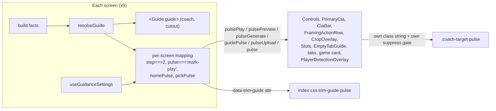
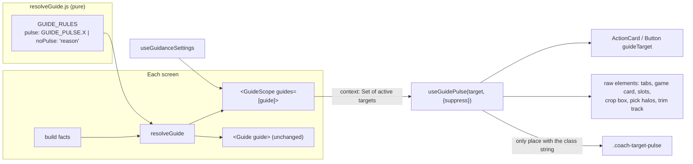

# T12730 Design: Centralize the guide's CTA handling (one pulse path)

**Status:** APPROVED 2026-10-14 (user: "take all of your recommendations"; every section 10 question resolved to its recommendation, see section 10). Split into Epic F of the Deploy Candidate milestone: `deploy-candidate-2026-10-13/f-one-pulse-path/EPIC.md`.
**Author:** Architect Agent
**Epic:** [F. One pulse path for the guide](deploy-candidate-2026-10-13/f-one-pulse-path/EPIC.md) (T12730 to T12770)
**Scope examined:** working tree on `master` @ 858af9c69 plus the uncommitted Upload-game fix
(`resolveGuide.js`, `ProjectManager.jsx`, `EmptyTabGuide.jsx`, `resolveGuide.homePulse.test.js`).

## 1. Recommendation in one paragraph

Each `GUIDE_RULES` entry names its pulse target with a constant (`pulse: GUIDE_PULSE.PLAY`) or
carries `noPulse: '<reason>'`. Each screen wraps its tree in `<GuideScope guides={[guide]}>`, a
React context that applies the Guidance on/off gate once and exposes the set of active targets.
A control opts in by naming its target: shared primitives (`ActionCard`, `Button`) take a
`guideTarget` prop; raw elements call `useGuidePulse(GUIDE_PULSE.X, { suppress })`. The hook is
the only code that knows the `coach-target-pulse` class. React keeps owning `className`; the
greppable link between a sentence and its control is the constant name, which appears in the
rule and at the control. Screens keep building their own facts (they own that state); they
stop owning pulse props, class strings and `coachEnabled &&` gates.

## 2. Current state



### Evidence and findings (verified against code)

| # | Finding | Evidence |
|---|---|---|
| E1 | 12 sites hard-code `coach-target-pulse`, each with its own gate | grep `coach-target-pulse` in `src/` (Controls:69, PlaybackControls:238, PrimaryCta:53/77, CtaBar:48, ProjectManager:515/1986, EmptyTabGuide:124, Slots:71, AnnotateModeView:1302, FramingActionRow:57, CropOverlay:670, PlayerDetectionOverlay:217) |
| E2 | Focus maps step numbers to controls | `FocusModeView.jsx` 786 (step 1/3 -> box), 836/936 (step 2 -> Play), 1085 (step 5 or `pulse==='credits'` -> Generate), 1110 (step 4 -> Preview) |
| E3 | A second pulse mechanism exists for trim | `FocusModeView.jsx:915` `data-trim-guide={guide?.pulse}` + `index.css:382-398` `trim-guide-pulse` |
| E4 | `PlaybackControls pulsePlay` is dead and ungated | `AnnotateModeView.jsx:673` reads `guide.pulse==='mark-play'` in review mode, but `reviewing` makes `annotate.review` (pulse null) win, so it is always false; it also lacks `coachEnabled` |
| E5 | `CtaBar` action `pulse` field has no caller | grep `pulse:` over `src/**/*.jsx` finds only test fixtures |
| E6 | Landscape cockpit pulses with Guidance OFF | `CropOverlay.jsx:591-592`: when `guidePulse` is undefined (FocusCockpit), the ring follows `focusPointCount===0` with no Guidance gate |
| E7 | Several Annotate gates duplicate rule ordering | `!isSourceExpired`, `!showAnnotateOverlay` (1286, 1302): `annotate.expired` / `annotate.editor` / `annotate.choice` already outrank `portrait` and `mark-play` |
| E8 | "Tap Try again" names a control that does not exist | `GUIDE.focus.failed`, `GUIDE.overlay.failed`; grep finds no "Try again" button. The re-run control is the primary export CTA |
| E9 | Pulse continues after "Got it" | pulse gates read only `coachEnabled`; `acked` only hides the FloatingCoach |
| E10 | Overlay has two concurrent guide channels | `OverlayModeView.jsx:488` job guide and `:495` / `SpotlightPickGuide.jsx:38` pick guide, resolved separately |
| E11 | Reduced motion drops the cue entirely on most targets | `index.css:415` sets `animation:none`; only Controls/PlaybackControls/CropOverlay add a static `ring-2 ring-amber-400` |
| E12 | The Focus coach is not mounted in fullscreen, but Play still pulses there | `FocusModeView.jsx:717` vs `:936` |

## 3. Target state



### Pseudocode

```js
// components/instructions/guideTargets.js (pure, no React; resolveGuide imports it)
export const GUIDE_PULSE = {          // value = the element's data-testid where one exists
  PLAY: 'play-button',
  MARK_PLAY: 'annotate-mark-play-button',
  EXPORT: 'primary-cta',
  // ... full list in the Q4 audit table
};
export const GUIDE_PULSE_CLASS = 'coach-target-pulse';
```

```jsx
// components/instructions/GuideScope.jsx
const NONE = new Set();
const GuidePulseContext = createContext(NONE);       // outside any scope: nothing pulses

export function GuideScope({ guides, children }) {   // innermost scope wins
  const { coachEnabled } = useGuidanceSettings();    // THE Guidance gate
  const key = coachEnabled ? guides.map(g => g?.pulse ?? '').join('|') : '';
  const active = useMemo(() => new Set(key.split('|').filter(Boolean)), [key]);
  return <GuidePulseContext.Provider value={active}>{children}</GuidePulseContext.Provider>;
}

export function useGuidePulse(target, { suppress = false } = {}) {
  const active = useContext(GuidePulseContext);
  const targets = Array.isArray(target) ? target : [target];
  return !suppress && targets.some(t => active.has(t)) ? GUIDE_PULSE_CLASS : '';
}
```

```jsx
// Primitive: never pulse a control the user cannot press now.
function ActionCard({ guideTarget, disabled, locked, className = '', ...props }) {
  const pulse = useGuidePulse(guideTarget, { suppress: disabled || locked || props['aria-disabled'] });
  return <button className={`${BASE} ... ${className} ${pulse}`} disabled={disabled} ... />;
}

// Screen
<GuideScope guides={[guide]}> ... <ActionCard guideTarget={GUIDE_PULSE.MARK_PLAY} .../> ... </GuideScope>

// Raw element with busy state
const ring = useGuidePulse(GUIDE_PULSE.CROP_BOX, { suppress: isDragging || isPlaying || chromeHidden });

// Rule
{ id: 'focus.progress.play', ..., step: 2, pulse: GUIDE_PULSE.PLAY }
{ id: 'focus.progress.export', ..., noPulse: 'Progress: nothing to press.' }
```

`index.css` keeps the keyframes and gains one reduced-motion rule (static 2px amber ring instead
of `animation: none`), so every target keeps a visible cue without motion.

## 4. Design decisions

### Q1. How pulse is applied: Option B (scoped hook), not Option A (DOM applier)

| Criterion | A: one component adds the class to `querySelectorAll(rule.pulseSelector)` | B (recommended): `GuideScope` context + `useGuidePulse` / `guideTarget` |
|---|---|---|
| React owns className | No. React rewrites `className` when a prop changes and silently drops a `classList.add`; a data-attribute variant survives re-render but not remount, so it needs a subtree MutationObserver and re-apply loop | Yes. Class is part of render output |
| Where it runs | Needs a mounted applier. FloatingCoach is absent in fullscreen (E12), after "Got it" (E9), and for inline guides (Finished, Share, ready panels) | Wherever the scope is; independent of the coach host |
| Multi-target | Selector can match many, but pick halos only exist when pulsing (SVG rects cannot take the box-shadow), so the overlay must render them anyway | Natural: each halo / slot / retry button calls the hook |
| Suppression (disabled, locked, busy, pending, dragging) | `:disabled` and `[aria-disabled]` can be read from DOM; busy/pending/dragging/fullscreen cannot, so per-site data attributes come back | Primitives suppress disabled/locked automatically; busy states pass `suppress` at the control |
| Reduced motion | CSS either way | CSS either way |
| Greppability (Rule 6) | The control file never mentions the guide; finding why something pulses means matching a selector string | `GUIDE_PULSE.PLAY` appears in the rule and at the control; grep finds both |
| Tests | DOM + observer timing in jsdom | Pure render: wrap in `GuideScope`, assert class |

Cost of B: shared views (`Controls`, `PrimaryCta`, `ActionCard`, `Button`) read a context, a small
departure from props-only views. Precedent: `InstructionCoach`, `EmptyTabGuide`'s `Footer` and
`PartialTabGuide` already read Guidance state. The read is one `useContext` (no store
subscription per button), because the Guidance gate lives in `GuideScope`, not in the hook.

### Q2. Where the resolved guide lives: React context per screen, not `guideFocusStore`

A zustand store would need each screen to publish its guide from an effect (setting another
store during render is not allowed): a one-frame lag, cleanup on unmount, and a race when two
guide owners are mounted (Home under GameDetailsModal, ShareModal over the Finished viewer,
Overlay's two channels). Context is computed in the same render, is scoped to the subtree
(portaled modals inherit it), and needs no cleanup. `guideFocusStore` keeps its one job (acked
rules). Nothing here is persisted; `coachEnabled` stays the only stored guidance value.

The coach, cutout and inline `<Guide>` already read one object from one `resolveGuide` call per
render, so they stay on the explicit `guide` prop. Only the pulse moves to the scope. Overlay
passes both channels: `<GuideScope guides={[overlayJobGuide, pickGuide]}>` (union of targets).
Nested scopes: innermost wins, so a modal's guide never inherits the screen's pulses.

### Q3. Focus step numbers

`step` stays as display data for the numbered chip ("Step 2 of 5"). Focus rules gain explicit
targets (drag/keep -> `CROP_BOX`, play -> `PLAY`, preview -> `PREVIEW`, generate/credits ->
`EXPORT`). `FocusModeView` stops interpreting `step` and `pulse === 'credits'`. Landmine: the
`focus()` helper derives `phase` as `step ?? pulse`; the trim rules (step null) must get an
explicit `phase: 'split' | 'adjust'` so `data-phase` and the coach re-measure key do not change.

### Q4. Invariant and per-rule audit

Unit test (AC2): every rule has exactly one of `pulse` (a value of `GUIDE_PULSE`) or `noPulse`
(non-empty reason string). Second test (AC1 static half): every `GUIDE_PULSE` key used by a rule
appears as `GUIDE_PULSE.<KEY>` in at least one non-test source file outside `instructions/`
(Vitest `import.meta.glob(..., { query: '?raw', eager: true })`), so a target cannot be named
without a consumer. Convention for "tap one of several": pulse the first item (the existing
`first-game` precedent).

Status column: **keep** = today's behavior; **add** = new pulse (behavior change, step C4);
**no** = documented `noPulse`.

| Rule | Status | Target / noPulse reason |
|---|---|---|
| annotate.expired | no | Nothing on this screen re-uploads the video. (Verify no in-screen re-upload control at implementation.) |
| annotate.choice | add | `CHOICE_NOW` (`highlight-choice-now`) |
| annotate.editor | add | `PLAY_EDITOR_DONE` (`play-editor-done`). See open question 2 |
| annotate.review | add | `SHARE_PLAYS` (`annotate-share-plays`) |
| annotate.selected.generating | no | Progress: nothing to press. |
| annotate.progress.brilliant / spotlight / preview / published / portrait | keep | `PORTRAIT_SLOT` (`annotate-highlight-slot-portrait`) |
| annotate.selected.none | add | `HIGHLIGHT_SLOT` (both orientation slots; the copy names no orientation). Slots render inside a `display: contents` group, so each slot pulses, never the container |
| annotate.has-plays.many / .one | add | `FIRST_PLAY` (first row of the plays list; new testid) |
| annotate.watch.playing / progress.watch | keep | `MARK_PLAY` (`annotate-mark-play-button`) |
| upload.choose | no | The dropzone fills the modal and the cutout already isolates it; a pulse on a panel that size reads as an alert. |
| upload.submit | add | `UPLOAD_SUBMIT` (`upload-submit`) |
| upload.failed | add | `UPLOAD_RETRY` (Retry on every failed tile: `UploadingGameTile` and the failed `GameTile`) |
| home.games.empty | keep (C0) | `UPLOAD_GAME` (`home-upload-game`; AC5) |
| home.games.uploading / no-plays / plays | keep | `FIRST_GAME` (`home-first-game`) |
| home.games.finished | keep | `TAB_PUBLISHED` (`home-tab-published`) |
| home.clips.unfinished | add | `FIRST_CLIP` (first draft card; new testid) |
| home.clips.all-done / clips.empty / finished.empty | no | Names a destination two steps away (Games tab, then a game); T12620 decided these do not pulse. |
| home.finished.first / finished.many | add | `FIRST_FINISHED` (first Finished card; new testid) |
| focus.credits / focus.progress.generate / generate.advanced | keep | `EXPORT` (`primary-cta`) |
| focus.failed | add | `EXPORT`: re-running the export is the retry. See open question 4 (copy) |
| focus.progress.export / focus.finishing | no | Progress: nothing to press. |
| focus.ready | add | `FOCUS_ADD_SPOTLIGHT` (`focus-choice-primary`). See open question 1 |
| focus.rendered | no | Silent rule (T12470): no guide is shown. |
| focus.progress.drag / keep | keep | `CROP_BOX` (crop rectangle; new testid `focus-crop-box`) |
| focus.progress.play | keep | `PLAY` (`play-button`) |
| focus.progress.trimSplit | keep (mechanism changes in C5) | `TRIM_TRACK` (`.segment-track` in `SegmentLayer`) |
| focus.progress.trimAdjust | keep (mechanism changes in C5) | `TRIM_ADJUST` (speed/trash buttons inside the track) |
| focus.progress.watchPreview | no | Watching; "Back to full video" is optional. (Today: `step 4 && !previewing` is false here.) |
| focus.progress.preview | keep | `PREVIEW` (`framing-preview-toggle`) |
| overlay.failed | add | `EXPORT`. Same copy issue as focus.failed |
| overlay.progress | no | Progress: nothing to press. |
| overlay.ready | add | `OVERLAY_FINISH` (`overlay-choice-primary`) |
| overlay.pick.done | add | `EXPORT` ("Tap Add spotlight") |
| overlay.pick.first / at-marker | keep | `PICK_BOX` (one halo per selectable detection box, as today) |
| overlay.pick.away | no | The action is the coach's own "Go to moment" button. |
| overlay.pick.next | no | Transient confirmation: nothing to press. |
| overlay.pick.none / not-outlined | no | A drag on the stage, not a press; the stage is already the anchor. |
| overlay.text | no | Typing and a timeline drag, not a press. |
| finished.viewer | add | `GET_LINK` (Get link control in `PublishLinkFlow`; new testid if missing) |
| finished.done | no | The action is the coach's own "Turn off guidance" button. |
| share.modal | add | `SHARE_SUBMIT` (ShareModal's Share button; new testid if missing) |

### Q5. Commit sequence (strangler-fig)

Each commit stays under ~200 lines of meaningful diff. C2-C3 are behavior-preserving; C0, C4-C6
are behavior changes with red-before-green tests. Every subject starts `T12730:`. Test paths
are under `src/frontend/src/` unless marked e2e; "new" files are created in that step.

| # | Kind | Content | Guarding tests (curated) |
|---|---|---|---|
| C0 | behavior (AC5) | Commit the WIP Upload-game fix as is | `components/instructions/resolveGuide.homePulse.test.js`, `components/ProjectManager.guidePulse.test.jsx` (red on base for the empty-tab case) |
| C1 | tests only | Characterization: Playwright spec (section 6) green on C0; add any missing DOM-level case to the screen tests below. Record what it cannot prove (exact visuals) | e2e `T12730-guide-pulse.spec.js` (new) |
| C2 | facade, additive | `guideTargets.js`, `GuideScope.jsx` + unit test; rules switch to `GUIDE_PULSE` constants; Focus rules get targets and explicit trim `phase`; existing `guide.pulse === '...'` comparisons in screens updated to constants in the same commit (values change). Comparison test: each `GUIDE_STATES` entry's `pulse` equals a hand-reviewed table of today's targets | `instructions/GuideScope.test.jsx` (new), `instructions/resolveGuide.states.test.js`, `resolveGuide.homePulse.test.js`, `resolveGuide.pickPulse.test.js`, `resolveGuide.job.test.js`, `modes/FocusModeView.guidedSteps.test.jsx`, `modes/AnnotateModeView.cta.test.jsx` |
| C3a | move: Home | `ProjectManager` + `GameDetailsModal` wrap `GuideScope`; `Button` gains `guideTarget`; tab, game card, both Upload buttons use it; delete `homePulse`, `pulseUpload`, `SegmentedTabButton pulse` | `ProjectManager.guidePulse.test.jsx`, `resolveGuide.homePulse.test.js`, `components/shared/Button.guideTarget.test.jsx` (new), e2e Home case |
| C3b | move: Annotate | `AnnotateModeView` scope; `ActionCard` gains `guideTarget`; Slots use the hook; delete `pulsePortrait`, inline mark-play class, dead `PlaybackControls pulsePlay` (E4). Keep only the non-redundant `annotateFullscreen` suppress; drop gates E7 proves redundant | `AnnotateModeView.cta.test.jsx`, `modes/AnnotateModeView.frameClip.test.jsx`, `components/shared/ActionCard.test.jsx`, `modes/annotate/components/HighlightOrientationSlots.pulse.test.jsx` (new), `instructions/resolveGuide.annotate.test.js`, e2e Annotate case |
| C3c | move: Focus (split if >200) | `FocusModeView` scope around the whole view (mobileFs too); `Controls`, `PrimaryCta`, `ExportButtonView`, `FramingActionRow`, `CropOverlay` (`guidePulse` becomes boolean `guided`) use target/hook; delete step mapping | `components/Controls.test.jsx`, `components/ExportButtonView.test.jsx`, `modes/focus/FramingActionRow.test.jsx`, `modes/focus/overlays/CropOverlay.test.jsx`, `FocusModeView.guidedSteps.test.jsx`, `modes/FocusModeView.handoffGuide.test.jsx`, e2e Focus case |
| C3d | move: Overlay | `OverlayModeView` scope with both channels; `PlayerDetectionOverlay` halos via hook; delete `pickPulse`; `CtaBar` `pulse` field becomes `guideTarget` (E5) | `modes/overlay/overlays/PlayerDetectionOverlay.pulse.test.jsx`, `modes/overlay/components/SpotlightPickGuide.t12350.test.jsx`, `resolveGuide.pickPulse.test.js`, `components/shared/CtaBar.test.jsx`, e2e Overlay case |
| C4a | behavior (AC1, AC2) | Rules invariant test lands red; fill Annotate + Home rows marked "add" | `instructions/guideRules.pulse.test.js` (new), per-control tests for each new target |
| C4b | behavior | Fill Focus / Overlay / Finished / Share rows marked "add"; invariant goes green | same + `instructions/resolveGuide.finished.test.jsx`, `instructions/finishedDone.test.jsx`, `CtaBar.test.jsx` |
| C5 | behavior (visual) | Trim pulse moves to the hook (`SegmentLayer` track and buttons); delete `data-trim-guide` + `trim-guide-pulse` CSS. Reduced-motion static ring in CSS; delete per-site `ring-2 ring-amber-400` pulse rings | `FocusModeView.guidedSteps.test.jsx` (trim cases rewritten to class assertions), `modes/focus/layers/SegmentLayer.test.jsx` |
| C6 | behavior (open question 5) | Cockpit ring follows Guidance via the hook (FocusCockpit resolves a new `focus.cockpit.drag` rule and provides the scope) | `CropOverlay.test.jsx`, `modes/focus/cockpit/__tests__/FocusCockpit.test.jsx`, e2e `T10840-focus-landscape-cockpit.qa.spec.js` run once |
| C7 | guard (AC3) | Raw-source test: `coach-target-pulse` only in `guideTargets.js` and `index.css`; removed prop names (`pulsePlay`, `pulsePreview`, `pulseGenerate`, `pulseUpload`, `pulsePortrait`, `guidePulse`, `homePulse`, `pickPulse`) absent from non-test source. Manual Rule 7 grep over `src/`, `src/frontend/e2e/`, `scripts/` recorded in the PR | `instructions/guidePulse.guard.test.js` (new; would be red before C3, green after C6) |

## 5. Files

| File | Change |
|---|---|
| `components/instructions/guideTargets.js` (new) | `GUIDE_PULSE`, `GUIDE_PULSE_CLASS` |
| `components/instructions/GuideScope.jsx` (new) | `GuideScope`, `useGuidePulse` |
| `components/instructions/resolveGuide.js` | `pulse` constants, `noPulse` reasons, Focus targets, explicit trim phase, `tid(GUIDE_PULSE.X)` reuse for anchors that are the same element |
| `index.css` | reduced-motion static ring; delete trim-guide block (C5) |
| `components/shared/ActionCard.jsx`, `components/shared/Button.jsx` | `guideTarget` prop with automatic disabled/locked suppression |
| `components/PrimaryCta.jsx`, `components/shared/CtaBar.jsx`, `components/ExportButtonView.jsx`, `components/Controls.jsx` | replace `pulse*` props with `guideTarget` |
| `modes/annotate/components/PlaybackControls.jsx` | delete dead `pulsePlay` |
| `components/ProjectManager.jsx`, `components/shared/EmptyTabGuide.jsx`, `components/GameDetailsModal.jsx`, `components/UploadingGameTile.jsx`, GameTile | scope, targets |
| `modes/AnnotateModeView.jsx`, `modes/annotate/components/HighlightOrientationSlots.jsx`, `HighlightChoiceCard.jsx`, `PlayEditorFooter.jsx`, `ClipListItem.jsx` | scope, targets |
| `modes/FocusModeView.jsx`, `modes/focus/FramingActionRow.jsx`, `modes/focus/overlays/CropOverlay.jsx`, `modes/focus/layers/SegmentLayer.jsx`, `modes/focus/cockpit/FocusCockpit.jsx`, `screens/FocusScreen.jsx`, `components/FocusPublishActionBar.jsx` | scope, targets |
| `modes/OverlayModeView.jsx`, `modes/overlay/overlays/PlayerDetectionOverlay.jsx`, `screens/OverlayScreen.jsx`, `components/OverlayPublishActionBar.jsx` | scope, targets |
| `components/DraftReelPreview.jsx` (+ `PublishLinkFlow`), `components/ShareModal.jsx` | scope around the inline guide's action area, targets |
| tests listed in Q5 + `e2e/T12730-guide-pulse.spec.js` | new / updated |

All paths are under `src/frontend/src/` except the e2e spec. No backend, schema, persistence or
migration change.

## 6. Playwright check (`src/frontend/e2e/T12730-guide-pulse.spec.js`)

One test per screen, each driving one guide state and asserting
`expect(locator).toHaveClass(/coach-target-pulse/)`, then turning Guidance off and asserting
`page.locator('.coach-target-pulse')` has count 0. Reuse `helpers/realAuth.js`,
`helpers/gameDetails.js`, `helpers/annotateClips.js`, `helpers/framingDraft.js`,
`helpers/overlayDraft.js`.

| Screen | State | Asserted element |
|---|---|---|
| Home | new account, empty Games tab (AC5) | `[data-testid="home-upload-game"]` |
| Annotate | game open, nothing marked | `[data-testid="annotate-mark-play-button"]` |
| Focus | clip open, no focus point; then after one drag | crop box, then `[data-testid="play-button"]` |
| Overlay | pick walk parked on moment 1 (detections routed if needed) | `[data-testid="pick-box-pulse"]` count > 0 |
| Finished viewer (after C4b) | not yet shared | Get link control |

The Home, Annotate, Focus and Overlay cases are written in C1 against today's code and must stay
green through C3; the Finished case lands with C4b.

## 7. What stays per-screen, and why

- **Fact-building.** Facts come from state the screen owns (regions, crop keyframes, uploads,
  pick walk). Centralizing them would make the guide module reach into every screen's state
  (breaks MVC and single ownership). `homeFacts` / `annotateFacts` stay as pure builders.
- **Where the coach mounts.** Floating vs inline, fullscreen exclusions, `phaseKey`, and Focus's
  numbered chip are layout decisions of each screen.
- **Which element is the target.** Declared at the control (`guideTarget={GUIDE_PULSE.X}`), so
  reading a control tells you whether it can pulse.
- **Busy-state suppression** that is not "disabled" (crop drag/play/preview, slot `pending`,
  export in flight, Annotate fullscreen) passes `suppress` at the control. Disabled/locked is
  automatic in the primitives.
- **Overlay's two channels** (job vs pick walk) stay two resolutions; merging them would change
  which message wins and is a separate product decision.

## 8. Non-goals

Copy changes (except as decided in open question 4); unrelated attention rings (`CollectionPlayer
shareRing`, `TransportRail ring`, `usePulseHighlight` lane pulse, quest pulses); moving the coach,
cutout or "Got it" logic; merging Overlay's guide channels; changing rule order.

## 9. Risks

| Risk | Mitigation |
|---|---|
| Changing `pulse` values breaks string comparisons and tests | C2 updates every `guide.pulse === '...'` and test literal to constants in the same commit; grep `pulse === '` and `pulse).toBe('` |
| A screen forgets `GuideScope`, so its pulses silently vanish | Consumer invariant test plus one e2e case per screen; context default is "nothing pulses" (fails visibly in tests, never pulses wrongly) |
| Focus phase drift for trim rules | Explicit `phase` on trim rules; `resolveGuide.states.test.js` asserts phases |
| Controls shared by Overlay pulse unexpectedly | Targets are scoped: Overlay's scope never contains `PLAY` |
| Mocked controls in `FocusModeView.guidedSteps.test.jsx` encode the old prop API | C3c renders real `Controls` / `FramingActionRow` where feasible; where a mock remains, the component's own test proves which target it consumes and the e2e proves the join |
| Pulse after "Got it" (E9) and under a blocking modal | Preserved as today; called out so review does not treat it as a regression |
| Visual changes from C5 (trim animation unified, reduced-motion ring everywhere) | Separate commit; human check of the trim track in Stage 6 |
| Per-render cost of a context read in every `Button`/`ActionCard` | One `useContext`; the Guidance store subscription lives once in `GuideScope` |

## 10. Open questions for the user

**Resolved 2026-10-14, all to the recommendation** (decision artifact:
https://claude.ai/artifact/6TC43NGvgRsPZ8NBHG8TFG): 1 = pulse Add spotlight; 2 = pulse Done;
3 = pulse the first item; 4 = pulse the export CTA AND change the copy to "Tap {action} to try
again." in this epic; 5 = the cockpit ring follows Guidance; 6 = static amber ring for reduced
motion on every target; 7 = yes, the removed-prop grep covers `src/`, `e2e/` and `scripts/`, and
tests may still assert the class name.

1. **focus.ready** names two controls ("Add a spotlight ... or tap Finish without spotlight").
   Recommend pulsing Add spotlight (the primary card). Pulse Finish without spotlight instead?
2. **annotate.editor**: pulse Done (recommended, satisfies AC1) or `noPulse` because Done is the
   last of three steps and a pulse may invite skipping the trim and rating?
3. **"Tap one of several"** (has-plays, unfinished clips, Finished): recommend pulsing the first
   item, matching `first-game`. OK?
4. **"Tap Try again"** names no real control (E8). Recommend pulsing the primary export CTA and
   changing the copy to "Tap {action} to try again." in this task. Or keep copy and file it?
5. **Landscape cockpit** pulses with Guidance off (E6). Recommend making it obey Guidance (C6).
   Or exempt it?
6. **Reduced motion**: recommend a static amber ring on every target (today most targets show
   nothing). OK?
7. **AC3 "including e2e/"**: read as "the grep for removed pulse props covers `e2e/` and
   `scripts/`"; tests and e2e specs may still assert on the class name. Correct?
