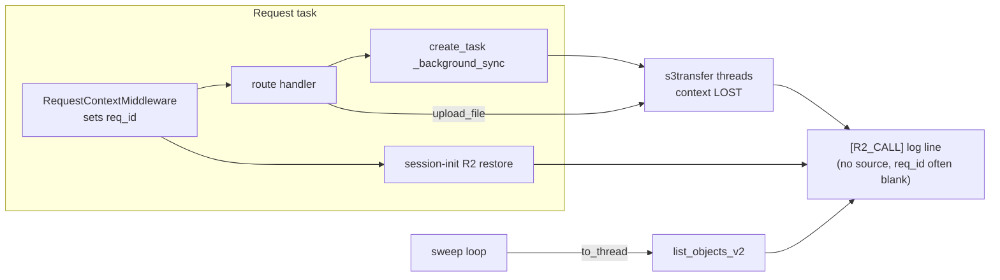
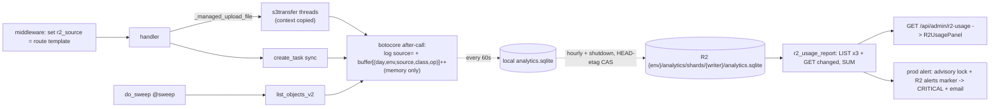

# T13930 Design: Attribute R2 operations to app activity

**Status:** APPROVED 2026-10-29 by the user with every Open Question at its default (see sec 10).
T13930 implements Units 1a + 1b + 2; Unit 3 (admin view) is T13931 and Unit 4 (alert) is T13932.
**Task:** [T13930-r2-usage-attribution.md](T13930-r2-usage-attribution.md)
**Tier:** L (new store, new background loops, 3 layers: backend, admin frontend, R2 layout)
**Knowledge docs:** backend-services.md, persistence-sync.md (T4310/T4315/T6390), modal-gpu.md
**Revision examined:** branch `feature/T13930-attribute-r2-operations-app` (clean, == master at dispatch)

---

## 1. Summary

Tag every server-side R2 call with a `source`. Count calls in memory inside the existing botocore
hook, with no I/O there. Flush the counts once a minute into a local `analytics.sqlite`. Upload that
file to R2 once an hour and on graceful shutdown. Each machine writes its own **per-writer shard**
(`{APP_ENV}/analytics/shards/{writer_id}/analytics.sqlite`), and only that machine writes it. A
reader lists the shards and sums them, so machines never write the same object and CAS conflicts
can only come from anomalies. A read-only admin section shows the merged picture across all three
env prefixes. An hourly production-only alert uses the T8670 advisory-lock shape for dedup. Its
"already alerted" marker is stored in R2, not Postgres.

There is a prerequisite landmine. **boto3's managed transfers (`upload_file`, `download_file`,
`upload_fileobj`) run the actual S3 calls on s3transfer worker threads, and those threads do not
inherit ContextVars.** Every per-user DB sync and every media upload/download goes through these
calls. Without a fix they would all count as `untagged`. The fix is a context-copying executor
behind three small storage helpers (§4.1.4). It is the first unit to land.

---

## 2. Current behavior (evidence)

| Fact | Evidence |
|---|---|
| One choke point: every app-side boto3 client registers `before-call.s3` / `after-call.s3` hooks. `_after` logs `[R2_CALL] client= op= status= elapsed_ms= [req_id=]`. | `storage.py:197-226`. Registered for `default` (`:254`), `sync` (`:294`), `transfer` (`:331`). No other `boto3.client(` in `app/` outside `modal_functions/` (grep). |
| `_after` returns early if `_r2_t0` is missing from the botocore context. | `storage.py:211-213` |
| ContextVar precedent: `req_id`, `method`, `path` are set at the top of `RequestContextMiddleware.dispatch`, before auth and before `call_next`. | `db_sync.py:721-733`, `user_context.py:28-38` |
| Starlette routing happens INSIDE `call_next`, so the route template is unknown when dispatch starts. The middleware itself issues R2 calls before `call_next` (session-init cold path restores user/profile DBs) and after it (`_background_sync` via `asyncio.create_task`). | `db_sync.py:802-1342` |
| Managed transfers are used for DB sync and media: `client.upload_file` / `download_file` / `upload_fileobj` at `storage.py:398,403,637,724,778,1416,1580,1727,3090,3095,3129`, plus `services/credit_backfill.py:85`. s3transfer runs each S3 request on its own `concurrent.futures.ThreadPoolExecutor` (`s3transfer/futures.py:402-434`, `BoundedExecutor`), which does not copy contextvars. So **today `req_id` is already missing from every `[R2_CALL]` line for these calls.** | grep, installed s3transfer source |
| Background issuers: sweep loop (`sweep_scheduler.py:116`, `do_sweep` via `to_thread`, lists through `migrations._get_profile_ids` at `migrations/__init__.py:686`). Export worker (`export_worker.py:136`, run by `BackgroundTasks`). Poster warmer `do_warm` tasks (`poster_warmer.py:121,189`). Pending-share materializer on a raw `threading.Thread` (`session_init.py:346`). SIGTERM shutdown sync (`main.py:395-506`). `cleanup.py` and `reconciliation_alert.py` make no R2 calls (grep: no storage imports). | grep |
| Single uvicorn worker per Fly machine. `auto_stop_machines = "suspend"` keeps memory across suspends. No volume, so the rootfs is reset on machine restart. `kill_timeout = 30`. APP_ENV values are `production` / `staging` / `dev`. | `Dockerfile:23`, `fly.production.toml` |
| In prod, SIGTERM goes to `_graceful_shutdown`, a signal handler that ends in `sys.exit(0)`. The lifespan `_shutdown_event` runs only on the dev/uvicorn-managed path (`IS_DEV`). | `main.py:543-546, 593-605` |
| `drip.sqlite` is NOT in code. T7230 only plans it ("If-Match etag-asserted upload"). The only implemented R2 CAS is the per-user HEAD-compare-then-PUT on `x-amz-meta-db-version`, under a per-key process lock (`storage.py:1207-1314`). It is specific to profile/user DBs and cannot be reused for an arbitrary key. | grep, T7230 task file |
| `botocore==1.35.0`. Its S3 model predates PutObject `IfMatch` (added later in 2024), so a native conditional PUT is not available without a dependency bump or header injection. | `requirements.txt:16`. **Unverified** against the gz model file, so treat it as an assumption. The design does not depend on it. |
| No moto in the image. Existing R2 test doubles (`FakeR2` in `test_t4050_durable_sync.py` and others) REPLACE the client, so the botocore hooks never fire. They cannot prove counting. | grep |
| Alert precedent: `reconciliation_alert.py` uses session-level `pg_try_advisory_lock(8670)` plus a Postgres `reconciliation_alert_runs` marker row, and sends a CRITICAL log plus `send_admin_update_email` to `get_admin_emails()`. | `reconciliation_alert.py:22-66, 180-338` |
| Admin UI precedent: a `CollapsibleSection` in `AdminScreen.jsx` with an on-demand fetch in `adminStore.js` (T10270 `UploadFailuresPanel`). | `AdminScreen.jsx:241-250`, `adminStore.js:394-430` |

### Current flow



---

## 3. Target behavior and non-goals

**Target**
1. Every `[R2_CALL]` line carries `source=`. Request sources are `"{METHOD} {route path template}"` and never contain ids.
2. Every call increments `(day UTC, env, source, op_class, op)` in memory. The hook does no I/O.
3. Counts survive in `analytics.sqlite` shards on R2, with an upload cost that is bounded and self-reported (`analytics_store`).
4. Admins see per-source daily Class A/B for 30 days, today's top sources, and billing-cycle-to-date Class A against the 1M free tier, bucket-wide (all three env prefixes).
5. An alert fires once per period, not once per machine, when a source crosses a daily Class A threshold or the cycle projects past the free tier.

**Non-goals (explicit)**
- **Modal containers' own R2 calls** are not counted (out of process, separate boto3 clients, and they need a Modal redeploy). Backend calls that start or poll Modal jobs are counted. Follow-up proposal: OQ-6.
- **Presigned-URL traffic** is not counted: browser uploads (including multipart `UploadPart`, which is Class A), browser playback, and server-side `httpx` fetches of presigned URLs (`games.py:4128,4309`, `downloads.py:1083,1280,1592`, `clips.py:2774,3035,3120`, `projects.py:1106,1377`, `shares.py:1106,1168`). The admin view must say so: "server-side boto3 calls only". Follow-up: OQ-6.
- Per-env buckets, Cloudflare GraphQL cross-check: out of scope (task file).
- T7400's rollup tables: not built. The store is shaped so T7400 can add them (§4.3.2).
- No Postgres schema change, no Postgres rows (user directive). The advisory lock writes no data.

---

## 4. Recommended design

### 4.1 Source tagging

#### 4.1.1 New leaf module `app/r2_usage.py`

No app imports, so `storage.py`'s hook can import it without cycles. It holds:

- `class R2Source(str, Enum)`: the background literals. `UNTAGGED="untagged"`, `UNMATCHED="unmatched"`, `SWEEP="sweep"`, `EXPORT_WORKER="export_worker"`, `POSTER_WARMER="poster_warmer"`, `PENDING_SHARE="pending_share_materialize"`, `SHUTDOWN_SYNC="shutdown_sync"`, `ANALYTICS_STORE="analytics_store"`, `R2_USAGE_ALERT="r2_usage_alert"`. String literals live next to their use, so they are greppable.
- `_current_r2_source: ContextVar[str]` with default `"untagged"`. The default *is* the untagged signal. There is no fallback logic.
- `get_r2_source()` and `set_r2_source(s)`. Plain set is used only where the caller owns a fresh context, i.e. the middleware.
- `r2_source_scope(source)`: a context manager that sets the source and resets the token in `finally`. It doubles as a decorator for both sync functions and coroutine functions. Background work uses this so the value cannot leak to later work on the same thread or task.
- `route_source(app, scope) -> str` (§4.1.2), the op-class table (§4.2), and `UsageBuffer` (§4.2).

#### 4.1.2 Request path: route template resolved in the middleware

In `dispatch`, next to `set_current_path(path)` (`db_sync.py:733`):

```python
set_r2_source(route_source(request.app, request.scope))
```

`route_source` does what Starlette's router would do, ahead of time. It walks `app.router.routes` and calls `route.matches(scope)`:

```python
partial = None
for route in app.router.routes:
    match, _ = route.matches(scope)
    if match is Match.FULL:   return _label(scope["method"], route)
    if match is Match.PARTIAL and partial is None: partial = route   # 405 case
return _label(scope["method"], partial) if partial else R2Source.UNMATCHED
# _label: APIRoute/Route -> f"{method} {route.path_format}"; Mount -> f"{method} {route.path}/*"
```

Why resolve it in the middleware instead of reading `scope["route"]` after routing:
- R2 calls happen before `call_next` (session-init restore), inside the handler, and after it (background sync). Only a value set before `call_next` reaches all three, because `call_next`'s inner task and `create_task` copy the context at creation. A value set later inside the handler (for example by an app-level dependency) never propagates back to the middleware's post-handler sync.
- The middleware is `BaseHTTPMiddleware`. ContextVars set inside the app do not flow back out (`db_sync.py:5-10`).

Behavior:
- **404 / unmatched paths** become the literal `unmatched`. The raw path is never used, so scanner noise cannot add ids or unbounded cardinality.
- **405** uses the template of the first PARTIAL match.
- **WebSocket** scopes never pass through this middleware and stay `untagged`. Today websockets make no R2 calls; if one starts, `untagged` will show it.

Cost: one regex scan per request, the same work Starlette repeats moments later, roughly 0.1 ms for a few hundred routes. *Alternative:* resolve lazily on the first R2 call by storing a pending-resolution object in the ContextVar. That saves the scan for the many requests with no R2 call, but adds a mutable shared object. It is not worth it unless measurement shows otherwise.

#### 4.1.3 Background literals

Each literal is set where the work starts, with a one-line decorator or `with` block. All edits are local:

| Issuer | Where | Literal | Edit |
|---|---|---|---|
| Expiry sweep | `sweep_scheduler.do_sweep` | `sweep` | `@r2_source_scope(R2Source.SWEEP)` on `do_sweep`. The decorator goes on the unit of work, not the loop, so the AC test can call `do_sweep()` directly. **Shared with g-t13920-2:** one import plus one decorator line, and no change to the `do_sweep` body or signature. Merge risk is minimal. |
| Export worker | `export_worker.process_export_job` | `export_worker` | decorator (async). It runs under `BackgroundTasks` in the request task, so the scope token reset matters. Without the decorator it would inherit an ambiguous export route template. |
| Poster warmer | both `do_warm` closures (`poster_warmer.py:121,189`) | `poster_warmer` | `set_r2_source(...)` next to the existing `set_current_user_id` lines. Each `do_warm` is its own `create_task` with its own context, which is the existing pattern. |
| Pending-share thread | `session_init._materialize_pending_shares_for_user` | `pending_share_materialize` | decorator. **Do not** "fix" this by running the thread under `copy_context().run`. That would also propagate `user_id` into a thread that runs context-free today and flip T4315's structural foreign-user guard (`get_user_db_connection`, persistence-sync.md T4315) from lenient to enforcing. Set only `r2_source`. |
| SIGTERM sync | `main._graceful_shutdown` | `shutdown_sync` | Run the body inside `contextvars.Context().run(...)` with the source set. A signal handler executes inside whatever frame or task it interrupted, so it must not mutate that context. |
| Store upload/download | analytics store loop | `analytics_store` | §4.3 |
| Usage alert | alert loop | `r2_usage_alert` | §4.5 |
| `auto_export_game` | — | none | Called from the sweep, it inherits `sweep`. Called from `games.py:2295` BackgroundTasks, it inherits that route. Both are correct attributions. |
| Admin backfills (`admin.py:1661,1727`) | — | none | `create_task` from the route inherits the route template, which is correct. |
| `cleanup`, `reconciliation_alert` | — | none | No R2 calls. If one is added later it shows as `untagged`. |

#### 4.1.4 ContextVar propagation rules (landmine table)

| Mechanism | Copies context? | Consequence |
|---|---|---|
| `asyncio.create_task`, `asyncio.to_thread` | yes (snapshot) | inherits |
| Starlette `run_in_threadpool` (sync endpoints/deps), `BackgroundTasks` | yes / same task | inherits. Already relied on by `get_current_user_id()` in sync handlers. |
| `run_coroutine_threadsafe` | uses the calling thread's context | inherits from the worker thread |
| `loop.run_in_executor`, `ThreadPoolExecutor.submit`, `threading.Thread` | **no** | `untagged` unless the work sets a literal. `bootstrap.py:249` already uses `ctx.run`. |
| **s3transfer (`upload_file`/`download_file`/`upload_fileobj`)** | **no** | **Must fix.** See below. |
| signal handler | runs in the interrupted context | fresh `Context()` (above) |

**s3transfer fix:** add a private subclass to `storage.py`:

```python
class _ContextPropagatingExecutor(concurrent.futures.ThreadPoolExecutor):
    def submit(self, fn, /, *args, **kwargs):
        ctx = contextvars.copy_context()          # per submit: a Context can't be entered twice concurrently
        return super().submit(ctx.run, fn, *args, **kwargs)
```

It is passed as `executor_cls` to `s3transfer.manager.TransferManager`. `BoundedExecutor` instantiates it for both the submission executor and the request executor. A submission task runs under the caller's copied context, so the request tasks it submits copy that same context. Three storage helpers (`_managed_upload_file`, `_managed_download_file`, `_managed_upload_fileobj`) replace the 11 call sites listed in §2 plus `credit_backfill.py`. **They must mirror `boto3/s3/inject.py` exactly**, so callers and `utils/retry.py:88-101` see the same exception types:
- `upload_file` and `download_file` go through `boto3.s3.transfer.S3Transfer(manager=...)`, which wraps errors in `S3UploadFailedError`.
- `upload_fileobj` calls `TransferManager.upload(...).result()` and raises raw `ClientError`.

The default `TransferConfig()` is unchanged. A side effect: `req_id` starts appearing on these `[R2_CALL]` lines too.

*Alternative rejected:* `TransferConfig(use_threads=False)`. It serializes multipart parts and would regress large uploads and downloads (`transfer` client, 1GB+ files).

### 4.2 Counting at the hook (hot path, no I/O)

The `_after` change:

```python
op = getattr(model, "name", "?")
source = get_r2_source()
record_r2_call(op, source)        # BEFORE the _r2_t0 early return: counting never depends on timing state
... existing elapsed calc (still guarded by t0) ...
logger.info(f'[R2_CALL] client={label} op={op} status={status} elapsed_ms={ms} source="{source}"{req_id_suffix}')
```

- `record_r2_call` computes the UTC day, looks up `OP_CLASS`, and does `buffer[(day, APP_ENV, source, op_class, op)] += 1` under a `threading.Lock`. That is roughly a microsecond of work. There is no SQLite access, no R2 call, and no allocation beyond the dict key.
- **Recursion cannot happen.** The hook only touches memory, and nothing reacts to an increment. The store's own uploads go through the same hook and land in the buffer under `analytics_store`. They become durable in the *next* scheduled upload, and they are excluded from the "dirty" test (§4.3.5), so they cannot keep scheduling new uploads.
- **Every status is counted.** Cloudflare bills 404 HEADs and failed PUTs. A connection error that never got a response fires `after-call-error`, not `after-call`, so it is not counted (it probably never reached R2).
- **Known undercount:** botocore's *internal* retries happen inside one `after-call` (that is how elapsed already "spans retries"). The `default` and `sync` clients have `max_attempts: 0`. The `transfer` client uses botocore defaults, so its internal retries undercount. App-level retries (`retry_r2_call`) are separate API calls and are counted. Acceptable for attribution; documented.

**Op to class table** (`OP_CLASS` dict in `r2_usage.py`, botocore operation names, per Cloudflare R2 pricing):

| Class | Operations |
|---|---|
| **A** | `ListBuckets`, `CreateBucket`, `ListObjects`, `ListObjectsV2`, `PutObject`, `CopyObject`, `CreateMultipartUpload`, `UploadPart`, `UploadPartCopy`, `CompleteMultipartUpload`, `ListMultipartUploads`, `ListParts`, `PutBucketCors`, `PutBucketLifecycleConfiguration`, `PutBucketEncryption` |
| **B** | `HeadObject`, `GetObject`, `HeadBucket`, `GetBucketCors`, `GetBucketLocation`, `GetBucketLifecycleConfiguration`, `GetBucketEncryption` |
| **free** | `DeleteObject`, `DeleteObjects`*, `DeleteBucket`, `AbortMultipartUpload` |
| **unclassified** | any op missing from the table. Logged at WARNING once per op name per process. **Never guessed into A or B** (no silent fallback). |

\* Cloudflare documents deletes as free but does not name the batch `DeleteObjects` (used at `storage.py:2203,2246,2294`). Mapped to free; the implementor confirms against current Cloudflare docs. Note that `r2_set_object_metadata_global` uses `CopyObject`, which is Class A.

`UsageBuffer` follows the `_DailyCounterBuffer` pattern (`analytics.py:69-121`): `increment`, `drain()` (swap under lock), and `restore(drained)` to re-merge on a failed flush. Memory is bounded by the number of distinct keys: routes × ops × days still in the buffer, a few hundred.

### 4.3 `analytics.sqlite` store (`app/services/analytics_store.py`)

#### 4.3.1 Layout and writer identity

- Local file: `USER_DATA_BASE.parent / "analytics_data" / "analytics.sqlite"`. It must be a sibling of `user_data/`, never inside it. User-iteration code globs and lists directories there (`_graceful_shutdown` globs, `_get_profile_ids` local fallback, account purge rmtree), and an `analytics/` directory could be mistaken for a user id.
- R2 key: `{APP_ENV}/analytics/shards/{writer_id}/analytics.sqlite`. It is env-prefixed like every non-`games/` object, so staging and prod state never mix (T7230 note).
- `writer_id = ANALYTICS_WRITER_ID env override or FLY_MACHINE_ID or f"local-{socket.gethostname()}"`. Fly machine ids survive in-place rolling deploys, so a machine keeps its shard across deploys. A new machine gets a new shard; old shards stay readable as history.
- Journal mode is the default rollback journal (not WAL). There is one connection (`check_same_thread=False`) guarded by a store `threading.Lock`. Upload bytes come from `conn.serialize()` (Python 3.11), which gives a consistent snapshot with no file-copy race and no WAL-checkpoint question (avoids the T5920 class of bug).

#### 4.3.2 Schema and its evolution (not one of the 3 migration tracks)

```sql
-- step 1 (PRAGMA user_version = 1)
CREATE TABLE IF NOT EXISTS r2_ops_daily (
  day      TEXT NOT NULL,   -- UTC 'YYYY-MM-DD'
  env      TEXT NOT NULL,   -- APP_ENV of the issuing process
  source   TEXT NOT NULL,   -- route template or R2Source literal
  op_class TEXT NOT NULL,   -- 'A' | 'B' | 'free' | 'unclassified'
  op       TEXT NOT NULL,   -- botocore operation name
  count    INTEGER NOT NULL,
  PRIMARY KEY (day, env, source, op)
);
CREATE TABLE IF NOT EXISTS store_meta (key TEXT PRIMARY KEY, value TEXT NOT NULL);
-- writer_id, created_at, last_upload_at
```

- The schema lives in `analytics_store.py` as an ordered `_SCHEMA_STEPS = {1: [...]}` list, applied by `_ensure_schema(conn)` from `PRAGMA user_version` upward. It is **not** in `_SCHEMA_DDL`, not a `migrations/{track}` file, and not run by the JIT seam. Same rule as T7400/T7230.
- **Evolution is additive-only**: `CREATE TABLE/INDEX IF NOT EXISTS`, no data rewrites. **T7400 adds its rollup tables as step 2** with no rework. If older code opens a newer shard (rollback), it leaves `user_version` alone and uses only the tables it knows. Readers must tolerate a shard with a missing table (lower version) by checking `sqlite_master`.
- Retention: on each local flush, delete `r2_ops_daily` rows older than 90 days (OQ-5). Size estimate: about 200 rows/day/shard × 90 days × ~80 B ≈ 1.5 MB.
- T7400 note: T7400's admin-triggered rollup would land in the shard of whichever machine ran it, and its readers pick the newest `computed_at`. That decision belongs to T7400 and is only noted here.

#### 4.3.3 Lifecycle

`start_analytics_store_loop()` and `stop_analytics_store_loop()` are called from the lifespan, the same shape as `reconciliation_alert`. The task runs entirely under `r2_source_scope(ANALYTICS_STORE)`. All blocking work goes through `asyncio.to_thread`, which inherits the source.

```mermaid
stateDiagram-v2
  [*] --> UNCONFIRMED: process start
  UNCONFIRMED --> CONFIRMED: GET shard ok (adopt bytes+ETag) / 404 (fresh, expected=None) / R2 disabled
  UNCONFIRMED --> UNCONFIRMED: GET error -> keep counts in buffer, backoff (60s..1h)
  CONFIRMED --> CONFIRMED: every 60s local flush; every 3600s upload-if-dirty (CAS ok)
  CONFIRMED --> FROZEN: CAS conflict -> CRITICAL, stop uploading
  FROZEN --> FROZEN: local flush continues; hourly CRITICAL reminder (zero R2 calls)
  FROZEN --> [*]: restart re-adopts R2 copy
```

- **Baseline first (rule 7, restore side).** The local file is opened and written only after its R2 baseline is confirmed. The startup GET of its own shard replaces any local file *before* the connection opens, so there is never a live-connection file swap (the T4310 MAJOR-2 / T6160 WAL landmine). Until then, counts stay in the in-memory buffer.
- **R2 disabled** (tests, offline dev): the baseline counts as confirmed against the local file and uploads are no-ops. The report reads the local shard (§4.4).

#### 4.3.4 Flush cadence and the CAS upload

- **Local flush, every 60s:** `drained = buffer.drain()`. In one transaction, `INSERT ... ON CONFLICT(day,env,source,op) DO UPDATE SET count = count + excluded.count`. If that fails, `buffer.restore(drained)` and log ERROR. Set `dirty_gen += 1` iff `drained` contains any key whose source is not `analytics_store`.
- **Upload, every 3600s and at shutdown, iff `dirty_gen > uploaded_gen` and the state is CONFIRMED:**
  1. Under the store lock: `snapshot = conn.serialize()` and `snap_gen = dirty_gen`.
  2. `HEAD key`. Proceed only if (404 and `expected_etag is None`) or `ETag == expected_etag`. Anything else is a **conflict**. That includes an existing object while `expected_etag is None`, because an unconfirmed baseline against real content must refuse (T4315 BLOCKING-2 parity).
  3. `PUT key Body=snapshot Metadata={analytics-writer: writer_id/pid, analytics-written-at: iso, analytics-schema: N}`. On success: `expected_etag = resp.ETag`, `uploaded_gen = snap_gen`, update `store_meta.last_upload_at`.
  4. A transient PUT/HEAD failure leaves things dirty and is retried at the next hourly tick. That is not a conflict, and there is no tight retry loop.
- The process lock serializes HEAD+PUT inside one process. Across processes, HEAD-then-PUT is detect-not-prevent, the same as the T4310 primitive. With per-writer keys, a second process on the same key is already the anomaly being detected.
- *Optional hardening (not recommended now):* inject `If-Match` on the PUT via a `before-sign.s3.PutObject` handler, which makes the check atomic and drops the HEAD. That depends on unverified R2 conditional-PUT support and on botocore. Skipped for now.

#### 4.3.5 CAS conflict behavior (refuse, CRITICAL, no merge, no blind retry)

On conflict:
- Log CRITICAL: `[ANALYTICS_STORE_CONFLICT] key=… expected_etag=… found_etag=… found_writer=<analytics-writer from the HEAD metadata> this_writer=…`. The writer identity comes from the same HEAD that decided the conflict (T6390 pattern, no extra R2 calls).
- Switch to **FROZEN**. No further HEAD or PUT calls, no merge, no overwrite.
- **In-memory counts are not discarded.** Local flushes keep folding them into the local file, so this process's counts stay correct locally and keep appearing in `[R2_CALL]` logs. They are just not durable.
- An hourly CRITICAL reminder is emitted as a log line only, with zero R2 calls. The admin view shows the shard's `last_upload_at` age, so a frozen shard looks stale.
- **Data-loss bound:** everything since the last good upload is lost when the process restarts, because restart re-adopts the R2 copy (restore-if-newer semantics, no merge). That is bounded by process uptime after the conflict.
- How a conflict can arise: two live processes sharing a `writer_id`, i.e. two dev servers on one hostname without `ANALYTICS_WRITER_ID`, or a test pointed at a real bucket. On Fly, a machine's old process (SIGTERM upload) and new process (startup GET) run one after the other on the same VM, so they never overlap.

#### 4.3.6 Shutdown flush and crash loss

- **Prod (SIGTERM):** `_graceful_shutdown` calls `analytics_store.final_flush_blocking(timeout_s=5)` *after* the user DB loops, because user data takes priority within `kill_timeout=30`. **Landmine:** the signal handler runs on the main thread, which may have been interrupted *while holding* the buffer or store lock (a sync boto call on the event-loop thread, e.g. `create_profile`'s inline sync). `threading.Lock` is not reentrant, so the shutdown path must use `acquire(timeout=…)`. On timeout it logs ERROR and skips, which risks losing at most the last hour.
- **Dev (lifespan):** `stop_analytics_store_loop()` performs the same final flush. A `_final_flush_done` guard makes the two paths idempotent.
- **Loss bounds:** graceful shutdown loses about 0 (only the final PUT's own self-count). A hard crash or OOM restart on Fly loses up to 1h of counts (rootfs reset; time since the last upload). Fly suspend loses 0 (memory preserved).

#### 4.3.7 The store's own R2 cost (counted under `analytics_store`)

| Item | Per writer | Notes |
|---|---|---|
| Hourly upload (dirty only) | ≤ 24 PUT (A) + 24 HEAD (B) / day | An idle machine uploads nothing, because self-ops are excluded from dirty. |
| Shutdown upload | 1 PUT + 1 HEAD per graceful stop | assume ≤ 6/day on a heavy deploy day |
| Startup baseline | 1 GET (B) per boot, plus backoff GETs only while R2 errors | |
| **Worst case** | **≤ 30 Class A/day ≈ 900/month per writer** | |

With ≤ 10 concurrently existing writers (prod 2, staging 2, dev ≤ 6), the worst case is **≈ 9,000 Class A/month, about 0.9% of the 1M free tier**. Report and alert reads are in §4.4 and §4.5. **Total store-attributable worst case ≈ 14k Class A/month (≈ 1.4%)**, apart from pathological admin-view refreshing, which the cache bounds at ≤ 13k/month per machine.

### 4.4 Combining machines and the admin view (read side)

`app/services/r2_usage_report.py`, `load_merged_usage()`:
1. For each env in `R2_USAGE_ENVS = ("dev", "staging", "production")` (plus the current `APP_ENV` if it is not listed), call `ListObjectsV2 Prefix={env}/analytics/shards/`. That is one Class A per env, since shard counts fit one page.
2. For each listed shard whose ETag differs from the in-process per-shard cache, `GetObject`. Then `sqlite3.connect(":memory:").deserialize(bytes)` (no temp files) and `SELECT` rows within the window.
3. Sum `count` grouped by `(day, env, source, op_class)` across shards. Return shard freshness too (writer, env, LastModified, schema version).
4. Cache the merged result in-process with a 10 min TTL, shared with the alert. The cached `generated_at` is shown in the UI.

With R2 disabled, read only the local shard.

**Endpoint:** `GET /api/admin/r2-usage` (`_require_admin()`; a thin route in `admin.py`, logic in the service). Response:

```json
{
  "generated_at": "...", "coverage": "server-side boto3 calls only; excludes Modal and presigned-URL traffic",
  "cycle": {"start": "2026-10-18", "end": "2026-11-17", "class_a": 0, "class_b": 0,
            "free_tier_class_a": 1000000, "projected_class_a": 0},
  "daily": [{"day": "...", "env": "...", "source": "...", "class_a": 0, "class_b": 0, "free": 0}],
  "today_top": [{"env": "...", "source": "...", "class_a": 0, "class_b": 0}],
  "shards": [{"env": "...", "writer": "...", "last_modified": "...", "schema": 1}]
}
```

`daily` covers the last 30 UTC days. `today_top` holds the top 10 by Class A. The cycle covers all envs because Cloudflare bills per bucket/account, not per env.

**Frontend:** `adminStore.fetchR2Usage()` is an on-demand gesture (T10270 precedent, never on mount) and stores the raw payload. A new `components/admin/R2UsagePanel.jsx` is presentational and derives everything at render:
- a cycle bar (Class A vs 1M) with the coverage caveat,
- the "Today top sources" list,
- a 30-day table of env × source totals (A/B) with a per-day expansion,
- `untagged` and `unmatched` rows highlighted, since they are fix-me signals,
- a shard freshness list that flags shards older than 2h.

It mounts in `AdminScreen.jsx` as `<CollapsibleSection title="R2 Usage">`.

**Decision: per-writer shards merged at read** (answers question a).

| Option | Clobber-safe | Conflicts routine? | Extra infra | Read cost | Verdict |
|---|---|---|---|---|---|
| **Per-writer object keys, merged at read** | yes, single writer per key | no, only anomalies | none | 3 LIST + changed-shard GETs | **Recommended** |
| One shared object, per-machine rows, CAS | only with re-pull-merge-retry | yes, two machines uploading hourly would collide often | none | 1 GET | Rejected. Routine conflicts would trigger CRITICAL, or need auto-merge, which rule 7 forbids. |
| Single-writer election (PG advisory lock leader) | yes | no | followers must ship counts to the leader via R2 deltas (more Class A), Postgres (forbidden), or internal HTTP over 6PN (new infra) | 1 GET | Rejected: complexity, and every non-leader channel violates a directive or costs more |
| Per-machine *per-boot* keys | yes | never | none | unbounded shard growth (every dev `--reload`) | Rejected |

### 4.5 Alert (`app/services/r2_usage_alert.py`)

- **Where it runs:** only in `APP_ENV == "production"`, but it evaluates all three env prefixes, because the bucket and the free tier are shared (OQ-2). Staging and dev do not start the loop, so the same data is not alerted three times. Postgres is per-env, so locks could not dedup across envs anyway.
- **Cadence:** a startup delay of 120s, then hourly. A pass runs under `r2_source_scope(R2_USAGE_ALERT)`.
- **Rules (defaults are named constants with env overrides, read at module load):**
  - `R2_ALERT_SOURCE_DAILY_CLASS_A = 20_000`: any `(env, source)` with ≥ 20k Class A on a UTC day. The free-tier pace is about 33k/day. Real user activity measured in T13920 was about 2k/day total. The T13920 sweep ran about 260k/day, so it would have crossed this within about 2h, and the alert would fire within about 4h counting upload lag.
  - Cycle: `R2_FREE_TIER_CLASS_A = 1_000_000`, `R2_BILLING_CYCLE_START_DAY = 18` (the cycle in the 2026-10-29 alert ran Oct 18 to Nov 17; OQ-3). Alert when cycle-to-date Class A ≥ 50% of the free tier, **or** when elapsed ≥ 2 days and the linear projection exceeds the free tier.
- **Dedup across machines** (the T8670 shape, with the marker moved off Postgres):
  1. `pg_try_advisory_lock(13930)` on one held connection gives mutual exclusion. Busy means `skipped_locked`. The lock writes no data. Release explicitly, and force-close on unlock failure, copying `_finish_pass` (`reconciliation_alert.py:266-337`).
  2. `load_merged_usage()`, then compute candidate keys: `"{day}|source_daily|{env}|{source}"` and `"{cycle_start}|cycle_half"` / `"{cycle_start}|cycle_projection"`. If there are none, the result is `silent` and the marker is never read.
  3. `GET {production}/analytics/r2_usage_alerts.json` → `{"sent": {key: iso}}`. On 404, treat it as empty. Drop keys already sent. If nothing is left, the result is `skipped_already_sent`.
  4. CRITICAL log line, then email via `get_admin_emails()` + `send_admin_update_email` (the same channel as reconciliation). Email failures are swallowed.
  5. Write the marker with the new keys, pruning keys older than the previous cycle. Use the same HEAD-etag check plus PUT. If the marker write fails, log CRITICAL ("may re-alert"). That is the same deliberate tradeoff as T8670: a rare loud duplicate beats a silent alarm.
- Each new day re-alerts a sustained hot source, once per day. Each cycle alerts at most once per cycle rule.
- **Alert read cost:** with 2 prod machines that each evaluate hourly, 3 LIST × 2 × 24 × 30 ≈ 4,320 Class A/month, plus changed-shard GETs (Class B). The marker GET/PUT happens only when something crosses a threshold.
- *Alternative:* a Postgres marker table (exact T8670 parity). Rejected by default because it adds Postgres schema plus a Migration agent for analytics plumbing, against the no-new-Postgres directive (OQ-1). *Alternative:* an R2 `last_evaluated_at` marker so only one machine computes per hour. That saves about 1.4k Class A/month net but adds a PUT every hour and more code. Not worth it.

### Target flow



---

## 5. Files and contracts affected (foundation before consumer)

| Unit | File | Change | Est. LOC |
|---|---|---|---|
| **1a** context propagation | `app/storage.py` | `_ContextPropagatingExecutor` + 3 managed-transfer helpers; switch 11 call sites | +60 / -15 |
| | `app/services/credit_backfill.py` | use helper | ~2 |
| | `tests/r2_fake_transport.py` (NEW) | real boto3 client + `_register_r2_timing`, with HTTP replaced by a `before-send.s3` handler serving an in-memory object map (PUT/GET/HEAD/ListObjectsV2/DELETE, ETag, `x-amz-meta-*`, request log). Exercises the real serialize/sign/event/parse pipeline and works across threads. Reusable. | ~140 |
| **1b** tagging + counting | `app/r2_usage.py` (NEW) | R2Source, ContextVar, scope, `route_source`, OP_CLASS, UsageBuffer | ~170 |
| | `app/storage.py` | hook: `record_r2_call` + `source=` | +8 |
| | `app/middleware/db_sync.py` | `set_r2_source(route_source(...))` in `dispatch` | +3 |
| | `sweep_scheduler.py` / `export_worker.py` / `poster_warmer.py` / `session_init.py` / `main.py` (`_graceful_shutdown`) | literals | +2 / +2 / +4 / +2 / +6 |
| **2** store | `app/services/analytics_store.py` (NEW) | schema, baseline, flush, CAS upload, freeze, loop, final flush | ~230 |
| | `app/main.py` | start/stop in lifespan; `final_flush_blocking` in `_graceful_shutdown` | +12 |
| **3** report + view | `app/services/r2_usage_report.py` (NEW) | list/merge/cache/payload | ~150 |
| | `app/routers/admin.py` | `GET /r2-usage` | +20 |
| | `src/frontend/src/stores/adminStore.js`, `components/admin/R2UsagePanel.jsx` (NEW), `screens/AdminScreen.jsx` | fetch + panel + section | +20 / ~150 / +10 |
| **4** alert | `app/services/r2_usage_alert.py` (NEW) | loop, lock, rules, marker, email | ~170 |
| | `app/main.py` | start/stop | +6 |
| Stage 7 | `.claude/knowledge/backend-services.md`, `persistence-sync.md` | new loops/store, s3transfer context landmine, store outside the per-user CAS machinery | docs |

Contracts:
- `[R2_CALL]` gains `source="…"` (inserted before `req_id=`; no parser in repo, grep-verified).
- New admin endpoint.
- New R2 keys `{env}/analytics/shards/*` and `production/analytics/r2_usage_alerts.json`. **No Postgres DDL, no migration file, no `_SCHEMA_DDL` diff** (grep-provable).

**Reviewable size:** about 1,000 production LOC plus about 800 test LOC, which is well over the ~200-line unit rule. Land it as **four sequenced units**: 1a then 1b (the incident-catcher on its own, since sources appear in logs immediately), then 2, then 3, then 4. Units 3 and 4 depend on 2's shard format, and 4 reuses 3's `load_merged_usage`. Splitting into tasks is OQ-4.

---

## 6. Verification: acceptance criteria mapped to tests

All counting tests run the **production path**: a real boto3 client with the real `_register_r2_timing` hooks, and only the HTTP send replaced (`tests/r2_fake_transport.py`). Each test patches `storage.get_r2_client` / `get_r2_sync_client` / `get_r2_transfer_client` and `storage.R2_ENABLED`. The buffer is global, so assertions use before/after deltas.

| AC | Test (file::name) | Asserts | How red is observed |
|---|---|---|---|
| Every `[R2_CALL]` carries `source=` | `test_t13930_r2_source_tagging.py::test_call_outside_any_context_logs_source_untagged` | a `head_object` with no context logs `source="untagged"` | **base revision**: the line has no `source=` (AssertionError on caplog) |
| route sources use templates, no ids | `…::test_route_request_logs_route_template_not_raw_path` | `POST /api/profiles/{pid}/intro/image` via TestClient. Every `[R2_CALL]` line inside the request has `source="POST /api/profiles/{profile_id}/intro/image"`, and none contains the literal profile id | base: no `source=` |
| (1a landmine) | `…::test_managed_transfer_carries_source_into_transfer_threads` | `upload_bytes_to_r2_global` (`upload_fileobj`) inside `r2_source_scope("x")` logs `source="x"` and `req_id` | base: no `source=`. Against 1b-without-1a: `source="untagged"`. Also: `test_managed_helpers_preserve_exception_types` (S3UploadFailedError / ClientError unchanged, characterization; green before and after) |
| route write increments (today, env, template, A, PutObject) | `…::test_route_write_increments_template_putobject` | after the intro-image request, the delta for `(today, APP_ENV, template, "A", "PutObject")` equals the fake's PUT count during the request, which is ≥ 1, and the `untagged` delta is 0 | red against the Unit-1b interface stub (buffer exists, middleware not yet wired): counts land under `untagged`. A missing module or ImportError is **not** accepted as red. |
| sweep lists count under `sweep` | `test_t13930_sweep_source.py::test_do_sweep_lists_count_under_sweep` | `get_all_users_for_admin` patched to one user. Fake answers ListObjectsV2. `do_sweep()` called directly. `ListObjectsV2` delta under `sweep` ≥ 1, under `untagged` 0. Robust to T13920's list-once change. | without the decorator: counted under `untagged` |
| `route_source` edge cases | `test_t13930_r2_source_tagging.py::test_route_source_full_partial_mount_unmatched` | FULL, 405 PARTIAL, Mount, 404 give `unmatched` | stub returning raw path / `untagged` |
| op class mapping | `…::test_op_class_table_and_unclassified_warns` | Put/List are A, Head/Get are B, Delete is free, an unknown op is `unclassified` with one WARNING | stub mapping |
| CAS: conflict refuses + CRITICAL | `test_t13930_analytics_store.py::test_upload_refuses_on_etag_conflict_and_logs_critical` | baseline confirmed at E1. The fake object is overwritten (foreign writer, E2). `upload_if_dirty()` returns CONFLICT, the fake saw **no PUT**, R2 still holds the foreign bytes, there is a CRITICAL `[ANALYTICS_STORE_CONFLICT]` naming the foreign writer, the state is FROZEN, a second call makes **zero** R2 requests, and local counts are retained | red against an interface stub that does an unconditional PUT (the clobber CAS exists to prevent): the fake sees a PUT and the foreign bytes are overwritten |
| | `…::test_unconfirmed_baseline_refuses_existing_object` | startup GET errored and the object exists, so it refuses (T4315 BLOCKING-2 parity) | same stub |
| | `…::test_first_upload_creates_shard_and_round_trips_counts` | 404 then create; downloaded bytes contain the counted rows | — (green path) |
| own cost bounded + visible | `…::test_idle_store_does_not_reupload_its_own_ops` | after one dirty upload, a tick with only `analytics_store` increments makes zero R2 requests | red against a stub where any increment marks dirty: a second PUT |
| | `…::test_store_ops_visible_under_analytics_store` | after a second genuinely-dirty upload, the uploaded shard contains `analytics_store` PutObject/HeadObject rows | stub that skips self-counting |
| | `…::test_shutdown_flush_times_out_on_held_lock` | `final_flush_blocking(timeout_s=0.1)` with the lock held returns and logs ERROR (signal-handler landmine) | stub with a blocking acquire hangs; the test uses a thread with a join timeout |
| admin view: per-source daily A/B, 30 days | `test_t13930_r2_usage_report.py::test_admin_r2_usage_merges_shards_across_writers_and_envs` | two prod shards + one staging shard in the fake, so `daily` sums across writers per env/source. A 31-day-old row is excluded. `today_top` is sorted. Cycle total is correct. Non-admin gets 403. | base: 404 (route absent, through real routing) |
| | `src/frontend/src/components/admin/R2UsagePanel.test.jsx` | from a fixture: renders env/source rows with A/B, highlights `untagged`, shows the cycle vs 1,000,000 and the coverage caveat | stub panel rendering nothing |
| alert fires once, not per machine | `test_t13930_r2_usage_alert.py::test_source_over_threshold_alerts_once_across_two_passes` | (real Postgres `pg_conn` fixture, real advisory lock, R2 fake for shards + marker) Two sequential passes (machine 1, machine 2) give exactly one CRITICAL and one email. The marker holds the key. | stub pass that ignores the marker: two alerts |
| | `…::test_concurrent_pass_skips_when_lock_held` | lock held in another session → `skipped_locked`, no alert | — |
| | `…::test_next_day_realerts` / `test_below_threshold_silent` / `test_cycle_projection_alerts_once_per_cycle` | | stub |

Curated local set: the five new test files plus regression guards for the touched corner:
- `test_t4050_durable_sync.py`, `test_t4310_r2_cas_conflict.py`, `test_performance.py::TestR2SyncSkipHead` (storage sync helpers are touched by 1a),
- `test_t5190_intro_upload_consent.py` (route used in the AC test),
- existing sweep tests (`grep sweep_scheduler tests/`),
- `test_t8670_reconciliation_alert.py` (lock-pattern neighbor),
- `UploadFailuresPanel.test.jsx` (admin screen neighbor).

Lint: ruff on touched backend files, frontend lint on touched files. Branch CI is the full sweep.

**Post-deploy check** (record in the Progress Log): prod logs show `source=` on `[R2_CALL]`. After about 1h, a `production/analytics/shards/{machine}/analytics.sqlite` exists per machine. The admin view shows nonzero `sweep` rows. The `untagged` total is under 1% of calls; anything above that names the next issuer to tag.

---

## 7. Failure behavior

| Failure | Behavior |
|---|---|
| Increment on the hot path throws (bug) | The hook catches it, logs ERROR, and never breaks the R2 call (logging hooks must not fail requests). There is no silent default; the error is loud. |
| R2 down at boot | State stays UNCONFIRMED. Counts stay in memory, with GET backoff up to 1h. Nothing is written locally or uploaded. |
| Local flush SQLite error | `restore(drained)`, log ERROR, retry next tick. |
| Upload transient error | Stays dirty and is retried at the next hourly tick. |
| CAS conflict | FROZEN, CRITICAL, hourly reminder, loss bounded by uptime (§4.3.5). |
| Shard schema newer than the code (rollback) | Known tables are used, `user_version` is not downgraded. |
| Report: one shard GET fails | Merge the others and return `shards[i].error = "unreadable"`. The UI shows a partial total; it never silently presents it as complete. |
| Postgres down for the alert | The lock is unobtainable, so the pass errors, logs, and retries in 1h. |
| Alert marker write fails | CRITICAL "may re-alert" (accepted, as in T8670). |

## 8. Risks

1. **The s3transfer swap (1a) touches every DB sync and media transfer.** Mitigations: mirror `inject.py` exactly, the exception-type characterization test, and the existing sync suites in the curated set. It is behavior-preserving apart from context.
2. **Merge with g-t13920-2** in `sweep_scheduler.py`. Our edit is one decorator plus one import. Land after T13920, or rebase trivially.
3. **Accuracy is a lower bound** (Modal, presigned, botocore-internal retries on `transfer`). The UI states the coverage; this is not billing reconciliation.
4. **Dev writer-id collisions** (same hostname) produce CRITICAL in dev. This is intended visibility; `ANALYTICS_WRITER_ID` fixes it.
5. **Route-resolution cost** of about 0.1 ms per request. If `[REQ_TIMING] overhead_ms` moves measurably, switch to lazy resolution (§4.1.2).

## 9. Open questions (each with a recommended default)

1. **Alert dedup marker location.** R2 object `production/analytics/r2_usage_alerts.json` (no Postgres), or a Postgres marker table for exact T8670 parity (needs migration + `_SCHEMA_DDL` + Migration agent)? **Default: R2 object.** The advisory lock stays Postgres and writes no data.
2. **Alert scope.** Run only in production but evaluate all three env prefixes, since the bucket and free tier are shared? **Default: yes.**
3. **Billing cycle anchor.** Cycle-to-date from day 18 (from the 2026-10-29 alert), configurable via `R2_BILLING_CYCLE_START_DAY`. Confirm the anchor, or would you prefer calendar month? **Default: 18.**
4. **Delivery split.** Land as four sequenced units under T13930, or keep Units 1a+1b+2 in T13930 and file the admin view (3) and alert (4) as T13931/T13932? **Default: split into follow-up tasks.** Each stays under the reviewable-size rule, and 1a+1b ships attribution to logs fastest.
5. **Thresholds and retention.** 20,000 Class A per (env, source, day); cycle alert at ≥ 50% or projected > 1M after day 2; keep 90 days of daily rows. **Default: as stated, env-overridable.**
6. **Coverage gaps.** File follow-ups for (a) Modal functions returning their op counts in job results, credited as `modal:{function}`, and (b) counting server-side `httpx` presigned fetches via a shared response event hook? Browser presigned traffic stays uncounted. **Default: file both follow-ups, not in this task.**

## 10. Decisions (user approval 2026-10-29) and implementation deltas

All six Open Questions were approved at their defaults:
1. Alert marker: R2 object (T13932). 2. Alert runs in production only and evaluates all three env
prefixes (T13932). 3. Billing cycle anchored on day 18, `R2_BILLING_CYCLE_START_DAY` (T13931/T13932).
4. Split: T13930 = Units 1a+1b+2; admin view -> T13931; alert -> T13932. 5. Thresholds and 90-day
retention as stated. 6. Follow-ups filed: T13933 (Modal op counts), T13934 (server-side presigned
`httpx` fetches).

**Unit 1a mechanism changed during implementation (same intent, smaller blast radius).** The design
proposed three `_managed_*` helpers replacing 11 call sites. 17 existing test files fake `upload_file` /
`download_file` / `upload_fileobj` on stand-in clients, so routing call sites through new helpers would
have bypassed those doubles. Instead, `storage._bind_context_transfers(client)` (called from
`_register_r2_timing`, so only real app clients get it) rebinds those three methods ON THE CLIENT
INSTANCE with copies of boto3 1.35's `inject.py` bodies that differ only in the executor
(`_ContextPropagatingExecutor`). Call sites and `credit_backfill.py` are unchanged; exception types are
pinned by `test_managed_helpers_preserve_exception_types`. The CRT transfer path is skipped (awscrt is
not installed; boto3 only picks CRT on optimized EC2 instance types).

Other deltas: the store uses the short-timeout `sync` client (bounded shutdown flush); `store_meta`
holds only `writer_id` and `created_at` (shard freshness comes from R2 `LastModified`, sec 4.4);
`R2Source.R2_USAGE_ALERT` is added by T13932.
