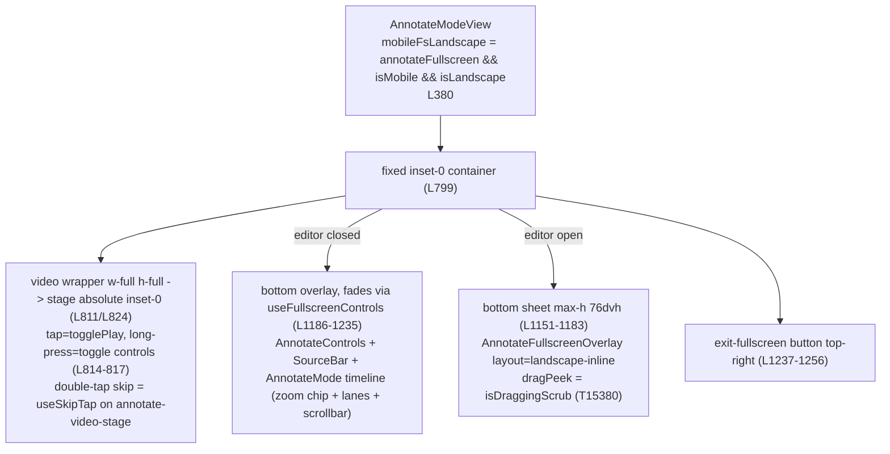

# T15370 Design: Annotate landscape fullscreen side-strip layout (controls beside the video, not on it)

**Status:** Approved (owner, 2026-11-09)
**Author:** Architect Agent
**Approved:** owner, 2026-11-09 -- took the recommendation on all five open questions

Base: master `5b4ff56d6` (T15380 merged). Line numbers are from that revision.

## Current State ("As Is")

### Data Flow


### Current Behavior
```pseudo
landscape fullscreen on a phone:
    video fills the whole screen (absolute inset-0)
    controls, Video 1 of 2 bar, zoom chip, lanes, scrollbar stack on TOP of the picture, bottom-up
    they fade 3 s after the last interaction, playing or paused (T15380 AC4)
    Mark/Edit play opens a bottom sheet up to 76% of the height
    while a trim handle is dragged, the sheet shows only the trim row (T15380 drag-peek, ONE tree)
```

### Measured stack (844x390, from code)
| Layer over the picture | Height |
|---|---|
| gradient top padding `pt-10` | 40 |
| AnnotateControls row | ~48 |
| SourceBar compact (`coarse-pointer:min-h-[52px]`, SourceBar.jsx:125) | 52 |
| zoom chip row (44px buttons, TimelineBase.jsx:439-451) | 46 |
| lanes: video row 32 + clips 48 + 8 (AnnotateTimeline.jsx:104) | 88 |
| MobileScrollbar `mt-2 mb-3 min-h-[44px]` (TimelineBase.jsx:703) | 64 |
| **Total** | **~338 of 390 = 87-88% of the picture** |

### Limitations
- Paused with controls up, only ~12% of the picture is visible; Edit play leaves ~24%.
- The fix so far (T15380) only hides things; it does not give controls their own space.

## Target State ("Should Be")

A 16:9 picture at full height on an 844x390 screen is 693px wide, leaving 75px of black on each side.
The strips (56px left, 72px right) fit in that black, so **they cost the picture nothing**. Only the
bottom timeline costs picture height. Controls never sit on the picture.

### Layout at 844x390 (Playwright; `env()` = 0)
```
Paused or playing (Edit play closed)                Edit play open (timeline hidden, sheet from right)
+----+--------------------------------+------+       +----+--------------------------+-------------+
| [x]|                                |[MARK]|       | [x]|                          | trim row    |
|    |                                |[ 1x ]|       |    |                          |[====|===|=] |
| <5 |       picture 530 x 298        |[1/2] |       |    |   picture 693 x 390      | name [____] |
| |< |       (nothing on top)         |      |       | |< |   (left 74% visible,     | * * * * *   |
| >  |                                |      |       | >  |    middle always clear)  | Details  v  |
| >| |                                |      |       | >| |                          |             |
| 5> |                                |      |       |    |                          |[Delete][Done]
+----+--------------------------------+[3x] |       +----+--------------------------+-------------+
|    | Film|=====playhead lane=====   |      |        56px                            264px + right inset
|    | Play|[##]  [###]    [#]  lane  |      |
+----+--------------------------------+------+
 56px        center column 716px        72px          While a trim handle is dragged the sheet
             timeline zone ~92px                       shrinks to just the trim row (top-right).
```

### Picture visible (computed from the layout rules; Playwright will measure)
| State | Today (844x390) | Target 844x390 | Target 812x334 | Target real iPhone (insets 47/47/21) |
|---|---|---|---|---|
| Playing, controls hidden | 100%, 693x390 | 100%, 530x298 | 100%, 430x242 | 100%, 492x277 |
| Paused, controls showing | ~12% | **100%**, 530x298 | 100%, 430x242 | 100%, 492x277 |
| Edit play open | ~24% | **74%** of 693x390 | 75% of 594x334 | 69% of 622x350 |
| Trim handle dragged | ~82% | ~96% | ~95% | ~94% |

Honest trade-off: while just watching, the picture is ~58% of today's full-bleed area (530x298 vs
693x390), but it is never covered. With the full scrollbar kept (Open Question 2) it would be
452x254.

### Target Behavior
```pseudo
landscape fullscreen on a phone (useIsCockpit(): mobile && landscape):
    container = CSS grid: [left strip 56] [center] [right strip 72]; center = picture over timeline
    shell pads env(safe-area-inset-left/right/bottom) on both sides (Focus D7)
    left strip (top->bottom): Exit fullscreen | Back 5 s | Frame back | PLAY | Frame fwd | Fwd 5 s
    right strip: Mark play / Edit play (primary) | Speed | Source chip "1/2" (2+ videos) | ... | Zoom 3x/1x (bottom)
    timeline zone: the existing AnnotateMode lanes, no zoom-chip row, no scrollbar row
    nothing auto-hides: there is nothing over the picture to hide
    tap picture = play/pause; double-tap left/right half = skip (unchanged)
    Mark/Edit play -> side sheet from the right, over the right strip; timeline zone hides
    trim drag -> same sheet element shrinks to the trim row (dragPeek, ONE tree)
    source chip -> side sheet "Videos" holding the existing SourceBar
    rotate to portrait -> T15380 portrait layout, same <video> element, no remount
```

## Implementation Plan ("Will Be")

### Copy vs extract: copy (recommended)
Annotate's needs differ from Focus in every component that could be shared: TransportRail has no skip
buttons and a Back-to-home button; CockpitSheet has a header X (Annotate must close through
`closeWithCommit`, which the X cannot reach), a dimming scrim (Annotate must not dim the picture),
fixed `w-80` and fixed rail offsets, and no peek state. CockpitTimelineStrip is a keyframe strip with
no zoom; Annotate keeps its own lanes. Extracting now would mean parameterising all of that and
editing `modes/focus/cockpit/*` while g-t15340-1 is live in Focus. This is the 2nd use, so the rule
"abstract on the 3rd duplication" says copy. Reuse as-is only `useIsCockpit()` (hooks/useIsMobile.js:116),
which is already shared. **No edits to FocusModeView.jsx or `modes/focus/**`.**

### Files to Modify
| File | Change |
|---|---|
| `modes/annotate/cockpit/AnnotateTransportStrip.jsx` (new) | Left strip, modelled on TransportRail.jsx. 44px buttons, 52px Play. `simplified` hides frame-step (T11860); `editorOpen` hides the skips (T8960 parity). Play keeps `data-testid="annotate-play-button"`. |
| `modes/annotate/cockpit/AnnotateActionStrip.jsx` (new) | Right strip: Mark/Edit play (`handleAddClipWithSportPrompt`, `data-testid="annotate-mark-play-button"`, which is only mounted windowed today, AnnotateModeView.jsx:1442), SpeedControl, source chip, zoom toggle. |
| `modes/annotate/cockpit/AnnotateSideSheet.jsx` (new) | Copied from CockpitSheet.jsx. No header and no scrim. `absolute` inside the shell (never `fixed`, Focus D6). Width `calc(264px + env(safe-area-inset-right))`, right-anchored. `peek` prop: `inset-y-0` vs `top-0 h-auto`, a class change on the SAME element. |
| `modes/AnnotateModeView.jsx` | Replace the `mobileFsLandscape` branch (L1149-1257) with the grid. Container class (L799). Drop long-press handlers in landscape (L815-817). Remove the floating exit button (moves into the left strip). |
| `modes/annotate/components/AnnotateFullscreenOverlay.jsx` | `landscape-inline` (L735): `border-t max-h-[76dvh]` -> `h-full border-l`; the sheet now owns the height. dragPeek logic unchanged. |
| `modes/annotate/components/AnnotateControls.jsx` | Export `SpeedControl` and add `menuPlacement` ('up' default, 'left' for the strip). Existing behaviour unchanged. |
| `components/timeline/TimelineBase.jsx`, `modes/annotate/AnnotateTimeline.jsx`, `AnnotateMode.jsx` | Additive `hideScrollbar` prop (default false). Zoom chip is dropped with the existing `zoom.hideChip` path (AnnotateTimeline.jsx:227). |
| `components/instructions/resolveGuide.js` | `data-full-bleed-video` loses its last setter: remove it and the `:not()` in `EDITOR_VIDEO` (L37), so the editor guide cuts the now-visible picture out of the shade. Add the two strips to `ANNOTATE_PLAYER` keep-clear (L33). |
| `hooks/useTimelineZoom.js` | Additive `setZoom(pct)` (clamped 100-500) for the 1x side of the toggle. |
| `config/displayNames.js` | `ANNOTATE_COCKPIT` strings: exit, videos sheet title, zoom labels. |
| `hooks/useFullscreenControls.js` | **No change.** Landscape stops reading `fsControls.isVisible`; the hook stays for portrait and playback. |

### Pseudo Code Changes
```pseudo
// AnnotateModeView.jsx
  const mobileFsLandscape = mobileFs && isLandscape          // unchanged name; == useIsCockpit() inside fullscreen
- container: `fixed inset-0 z-[100] bg-gray-900` + (landscape ? '' : ' flex flex-col')
+ container: landscape
+   ? `fixed inset-x-0 top-0 h-dvh z-[100] bg-black grid grid-cols-[56px_minmax(0,1fr)_72px]
+      grid-rows-[minmax(0,1fr)_auto] overflow-hidden` + style env(safe-area-inset-left/right/bottom)
+   : today's classes
  children, IN THIS ORDER (a `false` slot keeps sibling positions, so the video
  wrapper never remounts on rotation; NEVER wrap it in a landscape-only div):
+   {mobileFsLandscape && <AnnotateTransportStrip className="row-span-2" .../>}
    <video wrapper>   landscape: 'col-start-2 row-start-1 relative min-h-0' (was 'w-full h-full')
                      tap = togglePlay; long-press handlers only when !mobileFsLandscape
    {!mobileFsLandscape && <in-flow controls + timeline/>}            // portrait, unchanged
+   {mobileFsLandscape && !showAnnotateOverlay &&
+      <div className="col-start-2 row-start-2"><AnnotateMode ... zoom={{...timelineZoomProps, hideChip:true}} hideScrollbar/></div>}
+   {mobileFsLandscape && <AnnotateActionStrip className="col-start-3 row-span-2" .../>}
+   {mobileFsLandscape && showAnnotateOverlay &&
+      <AnnotateSideSheet peek={isDraggingScrub}>                      // always the same element while open
+        <AnnotateFullscreenOverlay layout="landscape-inline" dragPeek={isDraggingScrub} .../></AnnotateSideSheet>}
+   {mobileFsLandscape && videosSheetOpen && <AnnotateSideSheet><SourceBar {...sourceBar}/></AnnotateSideSheet>}
-   old bottom overlay, old bottom sheet, floating exit button

// AnnotateActionStrip.jsx (zoom toggle)
  label = timelineZoom > 100 ? '3x' : '1x'
  onClick: timelineZoom > 100 ? zoom.setZoom(100) : zoom.resetZoom()   // resetZoom = current default, 300 on phone
  // setZoom(pct) is a new additive export of hooks/useTimelineZoom.js (clamped; it has none today)
  hidden when zoom.hideChip (fresh game, T11860)
```
Order: Annotate lanes prop and SpeedControl export first (foundation), then the strips and sheet,
then the AnnotateModeView branch, then resolveGuide. Each step keeps master green.

## Risks
| Risk | Mitigation |
|---|---|
| **Rotation remounts `<video>`** (playback stops, the multi-video A/B refs re-attach) | Grid on the existing container, `false` slots before and after the video wrapper, no new wrapper. Unit test: flip the matchMedia mock and assert the same `<video>` node. |
| **One-tree rule** (T15380): remounting ClipScrubRegion mid-drag drops pointer capture | AnnotateSideSheet is one element whose class changes on `peek`; the overlay keeps its single `landscape-inline` tree. Unit test: start a drag, flip `dragPeek`, the scrub node is the same instance and `onDragEnd` fires. |
| Gestures: double-tap skip / tap-to-play / long-press | Strips sit outside `annotate-video-stage`, so useSkipTap's halves are the picture's halves. Long-press "toggle controls" is removed in landscape because there is nothing to toggle. Strip buttons stop click propagation. |
| Notch / home bar (`env()`); headless can't emulate it | Copy Focus D7 padding on both sides and the bottom. Unit-assert the inline style. Real-device iOS check in both rotations is a **human** criterion. |
| Keyboard over the name input (iOS landscape keyboard is ~55% of the height) | Name is the 2nd row of a top-anchored, `overflow-y-auto` sheet (~y 90-134), above the keyboard. `h-dvh` doesn't shrink for the keyboard on iOS; the sheet scrolls. Real-device check. |
| `transform` on the sheet traps `fixed` descendants | AddDetailsPopup and SourceBar's 4+ list already portal to body (AddDetailsPopup.jsx:66, SourceBar.jsx:281). Rule: anything `fixed` inside the sheet must portal. |
| Trim precision in a 240px-wide scrub row (was ~820px) | Frame-step stays on the left strip during edit. Sheet width is Open Question 3. |
| Guide card placement changes once the picture gets a cutout | `e2e/guide-no-overlap.spec.js` at 844x390 is in the relevant set. |

## Test Plan
**Unit (Vitest, matchMedia mocked to mobile + landscape):**
- `AnnotateModeView.landscapeCockpit.test.jsx`: strips render, the old bottom overlay doesn't; same
  `<video>` node across a portrait<->landscape flip; Mark play opens the side sheet and hides the
  timeline zone; source chip opens Videos; zoom toggle 1x<->3x calls the zoom hook; `simplified` hides
  frame-step and zoom.
- `cockpit/__tests__/AnnotateSideSheet.test.jsx`: `peek` keeps the child instance; env() padding;
  no scrim.
- `AnnotateFullscreenOverlay.*` landscape-inline tests stay green (footer, cutFromChip, noSaveButton,
  dragPeek).

**Playwright, new `e2e/T15370-annotate-landscape-cockpit.qa.spec.js` (template: T10840 spec), at 844x390 and 812x334:**
- `scrollHeight <= innerHeight`.
- Picture rect = the object-contain box from `video.videoWidth/Height` inside the element rect.
  Coverage = area(picture ∩ union of `[data-cockpit-strip]`, timeline zone, sheet rects) / area(picture).
  Assert 0% paused, 0% playing, <= 40% with Edit play open (and the picture centre is uncovered),
  <= 10% during a real handle drag (mouse down/move on `scrub-start-handle`).
- Every `button` in both strips is >= 44x44.
- Double-tap the left and right halves -> currentTime -5/+5. Zoom toggle -> lanes width 3x.
  Source chip -> pick video 2.
- `setViewportSize(393x852)` -> T15380 portrait layout, no console error.
- Regression set: T11150, T7920 (landscape-inline), guide-no-overlap, T10840 (untouched, sanity).

## Acceptance Criteria (replace the draft)
1. [ ] At 812x334 and 844x390 in landscape fullscreen Annotate, the page does not scroll and strips, timeline and buttons cover 0% of the picture, paused and playing (rect-overlap measurement).
2. [ ] With Edit play open, at least 60% of the picture is visible and its centre point is uncovered; while a trim handle is dragged, at least 90% is visible.
3. [ ] Every button in both strips is at least 44x44 px; Play is at least 52 px.
4. [ ] Left strip has Exit, Back 5 s, Frame back, Play, Frame forward and Forward 5 s; right strip has Mark/Edit play, Speed, the source chip (2+ videos only) and the zoom toggle; each does what its windowed twin does.
5. [ ] Double-tap on either half of the picture still skips 5 s; the zoom toggle switches the timeline between 1x and 3x; the source can be switched from the chip.
6. [ ] Trimming via the side sheet commits once on release (T10610 contract) and the drag survives the peek collapse (no remount).
7. [ ] Rotating to portrait and back keeps the same video element (no reload) and restores the T15380 portrait layout with no console error.
8. [ ] (human) On a real iPhone in both landscape directions, Play and Mark play are not under the notch or home bar, and the name field stays visible with the keyboard open.

## Open Questions
- [x] **1. Permanent strips, or let them fade while playing?** Permanent means a smaller picture while
  watching (530x298 instead of 693x390), but it never jumps in size and never gets covered.
  Fading means the picture is full size while playing and shrinks back when paused.
  *Recommend: permanent.* It is the "permanent bar" you asked for, and a picture that resizes on
  every pause is disorienting.
- [x] **2. Timeline scrollbar in landscape?** With no scrollbar the picture is 530x298; you move along
  the timeline by scrubbing, skipping, or tapping 1x to see the whole game. Keeping the full scrollbar
  makes the picture 452x254 (812x334: 352x198).
  *Recommend: no scrollbar.* Both are one prop, so this is cheap to reverse.
- [x] **3. Edit-play sheet width.** At 264px: 69-75% of the picture visible, trim row 240px. At 320px:
  57-65% (fails the 60% bar on a real iPhone), trim row 296px. *Recommend: 264px.*
- [x] **4. Landscape zoom is a 1x/3x toggle** (the 100-500% stepper stays in portrait and on desktop).
  *Recommend: yes.* A stepper does not fit in a 72px strip at 44px targets.
- [x] **5. Mute button:** today's landscape bar has one; the strips drop it (phone volume keys still
  work). *Recommend: drop it*; add it to the right strip later if anyone misses it.
