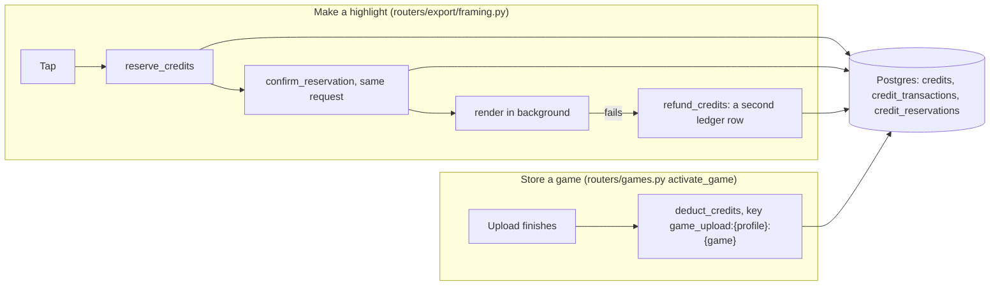
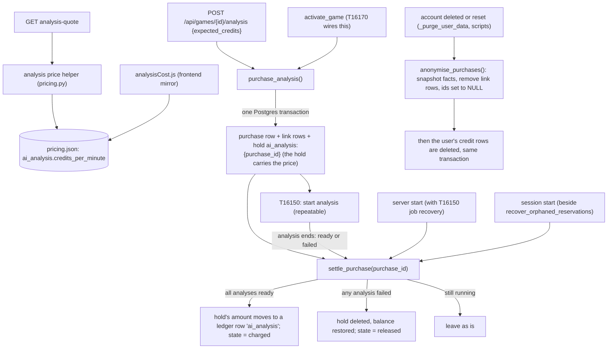
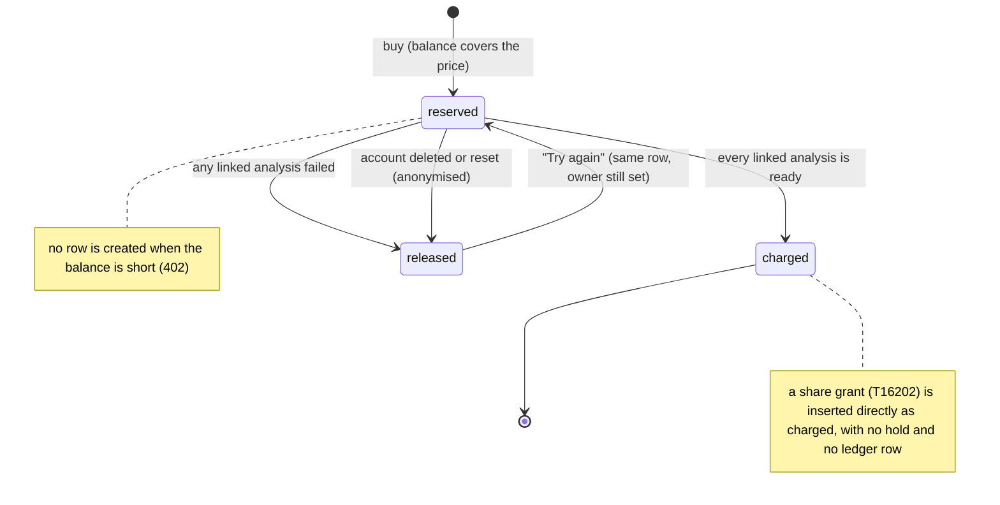

# T16160 Design: AI analysis price and charge

**Status:** APPROVED 2026-11-19 (owner)
**Author:** Architect agent
**Date:** 2026-11-19 (revised twice the same day for the owner's rulings)
**Approved:** 2026-11-19 by the owner (second-round rulings included)
**Task:** [T16160](mark-plays-with-ai/T16160-ai-analysis-price-and-charge.md), epic [AI Coach](mark-plays-with-ai/EPIC.md), task 4 of 10
**Rulings applied:** task file "## Ruling" (owner, 2026-11-19): decisions 1 to 7 and questions 1 to 6; then the owner's second round the same day (ledger, test-account flag, sport, and the one-home rule), listed below
**Examined:** working tree at `36e596884` (read only). No source was changed.

---

## In plain words

Today credits (the app's prepaid currency) pay for two things: storing a game, priced by file size, and making a highlight, priced by the second. AI Coach, the paid option that has a video model mark the plays in a game, has no price, no charge and no record of who bought it. This design adds all three.

What we will build:

- **The price.** 1.5 credits for each minute of video. The length is rounded to the nearest whole minute and the credits are rounded up, so a 90-minute game is 135 credits and a 25-minute game is 38. The smallest price is 2 credits. Only the game's main timeline counts: a second camera angle that overlaps it adds nothing. The rate sits in the one pricing file the app and the server both read.
- **The charge.** When the analysis starts, the credits are set aside: the balance drops, but nothing is written to the parent's credit history as spent. When the result is ready, the set-aside credits are taken. If the analysis does not finish, they go back and the history shows nothing. A parent is never charged twice for the same game, and never more than the price they were shown.
- **The record.** One row per parent per game in the shared database says "this parent has AI Coach on this game" and whether the credits are set aside, taken or returned. The free share (T16202) later adds rows of the same kind that cost nothing.
- **One home for each fact.** The purchase row does not repeat anything another row already knows. How many credits were paid lives with the money (the set-aside row, then the credit history row). How long the video was and which sport it is live on the analysis. The purchase row points at those and holds no copy, so there is nothing that can drift apart.
- **What happens when an account goes.** When an account is deleted or reset, its purchase rows stay but lose every pointer to the person and their videos. At that moment, and only then, the facts that are about to be destroyed (credits paid, date, video length, sport, whether it was one of our test accounts) are written onto the purchase row. What is left is a bare fact that nobody can tie to a person, and the totals stay true.
- **The read-out.** An admin table shows, for each analysis, what the model cost us in dollars and how many credits it earned, and says plainly which purchases it can no longer tie to an analysis.

Two things found in the code that shaped the picks:

1. **A highlight is charged the moment the parent taps and refunded if it fails.** AI Coach is the first thing in the app whose credits stay set aside for minutes.
2. **A safety net built for highlights would give AI Coach away for free.** Every time a parent's session starts on a server, the app returns any set-aside credits older than 60 seconds that do not belong to a running highlight. Decision 7 closes this.

How we will know it worked: the price in the offer is never exceeded by the charge; a failed analysis leaves the balance and the history exactly as they were; buying the same game twice charges once; a deleted account leaves the totals unchanged; and every charged purchase that still has an owner has exactly one matching row in the credit ledger.

Nothing here changes how storage or highlights are charged.

---

## The decisions, as ruled

| # | Decision | Pick | Rejected, in one line |
|---|---|---|---|
| 1 | How the length becomes a price | **B:** nearest minute, credits rounded up | A (every started 40 seconds) and C (every started minute) make a real "90-minute" file cost 136 or 137; D (nearest credit) changes the price at lengths that mean nothing to a parent |
| 2 | When credits move | **A:** hold in the existing `credit_reservations` table, take at ready, release on failure | B (hold on the purchase row) is a second place credits can hide from the ledger's tools; C (charge, then refund) contradicts the approved "Nothing was charged" screens; D (charge only at ready) lets the credits be spent elsewhere first |
| 3 | Where the price and the record live | **A:** rate in `pricing.json`, mirrored py and js helpers with a shared sample file, record in Postgres, price frozen at buying. **Changed by the one-home rule:** the frozen price sits in the hold, not on the purchase row (see "One home for each fact"). | B (server-only price) needs a round trip mid-upload; C (record in the parent's own data) has a background job writing into a synced file; D (rate as an admin setting) breaks the build-time price |
| 4 | What stops a double charge | **A:** one purchase row per (user, profile, game) plus ledger key `ai_analysis:{profile_id}:{game_id}` | B (request id per tap) double charges across two devices; C (key per attempt) removes the ledger as an independent guard |
| 5 | Shape of the tables | **A:** `game_analysis_purchases` plus `game_analysis_purchase_analyses` | B (row per video) spreads the money over several rows; C (array column) has no foreign keys; D (single-video only) contradicts the approved multi-video offer |
| 6 | Server reads a different length than the browser | **B:** buy carries `expected_credits`; never charge more than shown; 409 `price_changed` if the server's price is higher | A (server wins silently) charges more than shown; C (honour within a minute) lets the client shave its own price |
| 7 | Safety net versus AI Coach holds | **A:** hold named `ai_analysis:{purchase_id}`, recovery skips that prefix, `credit_reservations` unchanged | B (new column on the holds table) breaks highlights between a deploy and the manual migration; C (lengthen the 60 seconds) locks highlight credits for hours and still leaks |

## The questions, as ruled

| # | Question | Ruling | Where it lands in this design |
|---|---|---|---|
| Q1 | A video added to a game after AI Coach was bought | Not analysed, not charged in this epic | The purchase covers the analyses it was linked to at buying. Nothing re-prices or re-links later. |
| Q2 | A second camera angle | Only the main timeline is analysed and priced | Price and links use one shared answer from T16150 (contract 6). An overlapping extra angle is not in it. |
| Q3 | One parent, two athlete profiles, same game | A share between a parent's own profiles carries AI Coach free | T16202 scope, note only. In this task two profiles that each buy still make two purchases and two charges; the free route is the share. |
| Q4 | Prompt version changes after a purchase | Never recharges; the parent keeps the paid result | Nothing in the purchase or the ledger key depends on the prompt version. The link rows keep pointing at the analyses that were paid for. |
| Q5 | Deleted or reset accounts | Purchases are anonymised, not purged | Section "Anonymising purchases". |
| Q6 | Acceptance wording for decision 6 | Reworded | Section "Proposed replacement for the task file's Acceptance Criteria". |

## Second round of rulings (owner, 2026-11-19)

| Point | Ruling | Where it lands |
|---|---|---|
| Credit ledger on account deletion | Stays purged. The reconcile counter compares identified charged purchases with the ledger's `ai_analysis` rows. | "The ledger on account deletion" |
| `was_test_account` | Kept | Snapshot column, written only at anonymisation |
| Sport on an anonymised purchase | Kept | Snapshot column, written only at anonymisation |
| **One-home rule** | Persisted state is minimised and no fact lives in more than one place. A value another live row holds is not stored during the purchase's life. If it must outlive its source, it is snapshotted only inside `anonymise_purchases`, at the moment the source is destroyed: NULL until then, and readers take the live source or, failing that, the snapshot. | "One home for each fact". This replaces "`video_seconds` frozen at buying" from the first round and "price frozen on the purchase row" from decision 3. |
| Kept analytics events after deletion | No action | Not in this design |

Size of the whole task: about 700 lines of production code and about 700 of tests, across roughly 21 files (two new tables, one migration). It lands as reviewable slices (see "Order of work").

---

## Current state ("as is")

### How credits move today



```pseudo
highlight tap:
    credits = round_half_up(seconds)                  # highlight_transform.compute_export_credits
    reserve(user, credits, export_id)                 # balance drops, row in credit_reservations
    confirm(user, export_id)                          # SAME request: ledger row "framing_usage", key export:{id}
    start render in background
    on failure: refund(user, credits, export_id)      # ledger row "framing_refund", key refund:{id}

game activation:
    cost = storage formula by size
    debit(user, cost, key "game_upload:{profile_id}:{game_id}")   # idempotent on the key
    short balance -> 402 {message, required, balance}

every cold session start (session_init.py step 5):
    for each of this user's reservations older than 60 seconds:
        if no live export_jobs row in that profile's local SQLite: give the credits back

account deleted or reset (auth.py _purge_user_data, and four scripts):
    delete this user's rows from credit_transactions, credit_reservations, credits
```

### Evidence (verified against code)

| Fact | Where |
|---|---|
| Credits are a Postgres ledger. The balance rule is `balance = sum(ledger) - sum(open reservations)`; the backfill tool depends on it. | `services/credit_ledger.py`, `services/credit_backfill.py:355-382` |
| A highlight reserves and confirms in the same request, then refunds on failure. A reservation never outlives one request today. | `routers/export/framing.py:218-236`, `:451-453`; `credit_ledger.refund_export_charge` |
| **The amount already has one home at a time.** `reserve_credits` writes it on the hold row. `confirm_reservation` reads it from the hold, deletes the hold and writes the ledger row with that amount, in one transaction. Nothing else stores it. | `credit_ledger.py:494-534`, `:537-557` |
| `confirm_reservation` hardcodes the source `framing_usage`, the key `export:{job_id}` and the milestone `credits_consumed`. Its only caller is `framing.py`. | `credit_ledger.py:537-562` |
| `credits_consumed` is read as "made a highlight" by the analytics. | `services/analytics.py:157` (`FIRST_HIGHLIGHT_ACTIONS`), `services/analytics_spend_readiness.py:38` |
| The credit history shows open reservations as pending rows labelled `framing_usage`. It prints a row's `video_seconds` as whole seconds, which would read "5400s" on an AI Coach charge. | `credit_ledger.list_transactions`, `CreditHistoryModal.jsx` `SOURCE_LABELS`, `CreditHistoryModal.jsx:152` |
| `video_seconds` and `profile_id` are optional on both the hold and the ledger row. The hold has its own `created_at`. | `services/pg.py:629-661` |
| Recovery releases any reservation older than 60 seconds with no live export job. | `credit_ledger.recover_orphaned_reservations`, `_has_live_export_job`, `session_init.py:355-362` |
| Storage charge key names the profile because game ids count per profile. | `routers/games.py:1356-1364` (T16690) |
| Highlights are priced `round_half_up(seconds)`; the owner moved them off "round up" on 2026-09-12. | `highlight_transform.py:176-214` (T9750) |
| Storage price is mirrored in two pure helpers held together by a parity test. | `services/storage_credits.py`, `frontend/src/utils/storageCost.js` |
| Pack prices have one source, read by both sides. | `app/pricing.json`, `app/pricing.py`, `frontend/src/config/pricing.js` |
| Game lengths live in the parent's own data; the server's probe at activation is the authority and corrects a wrong browser reading. | `database.py` `game_videos.duration`, `routers/games.py:1281-1295` (T4260) |
| A game can hold several videos. Each has a place on the game's clock (`offset_seconds`) and a `preferred` flag meaning "show this instead of the main camera within its span". There is no stored "main timeline" flag. | `database.py:1679-1695`, `routers/games.py:307-316`, `:959-1005` (T13280, T8900) |
| Game ids never repeat inside one profile. Profile ids are random (`uuid4().hex[:8]`), so a reset account gets new ones. | `database.py:1471` (`AUTOINCREMENT`), `session_init.py:263` |
| Postgres schema head is v050. Postgres migrations run only when an admin triggers them after a deploy. | `migrations/postgres/__init__.py`, CLAUDE.md "Migration System" |
| **Account deletion deletes the whole credit ledger for the user.** `_purge_user_data` deletes the user's rows from `credit_transactions`, `credit_reservations` and `credits` in one transaction. It has three callers: the privacy delete, the test-account reset on login, and `DELETE /api/auth/user`. | `routers/auth.py:128-132`, callers at `auth.py:171`, `auth.py:329`, `privacy.py:261` |
| The ledger is purged on purpose: it is an entitlement record, and a reset account comes back under the **same** `user_id`, so old rows would keep the old balance and block the signup grant (key `signup:{user_id}`). | `auth.py:103-110`, `:124-126`; `.claude/knowledge/backend-services.md:224`, `:232-235` |
| The four scripts delete the same three tables by name. `delete_user.py` also has a sweep that deletes any ledger row whose user no longer exists. `reset_all_accounts.py` clears whole tables, or every row whose owner is not a protected fixture. `copy_user_between_envs.py` deletes the destination's ledger and copies the source's rows across, keys included. | `scripts/delete_user.py:109`, `:129-156`, `:274-291`; `reset-test-user.py:261-262`; `reset_all_accounts.py:51-71`, `:307-314`; `copy_user_between_envs.py:150-152`, `:324-338` |
| Ledger rows cannot be anonymised as the table stands: `user_id` is `NOT NULL`, uniqueness is on (`user_id`, `idempotency_key`), and every reader filters or groups by `user_id`. | `services/pg.py:629-644`; `credit_ledger.py:449-463` |
| There is precedent for a snapshot written only at deletion: `user_segments.was_test_account` is NULL for live rows and set when the account goes; readers prefer the live `users.is_test_account` and fall back to the snapshot. | `analytics.deidentify_user_segments` (`analytics.py:1198-1222`), `privacy.py:303-322` |
| A test reset deletes the account's analytics rows outright; a real deletion keeps them under the opaque `user_id`. | `scripts/reset-test-user.py:253-257` against `privacy.py:313-322` |
| The data export lists the user's ledger rows through one guarded read. | `routers/privacy.py:116-122` |
| The operator scripts already import the app's single-writer helpers at module top and call them inside the script's own transaction. | `scripts/delete_user.py` (`stamp_account_deleted`, `deidentify_user_segments`), backend-services.md "T8630 round 2" |

### Not verified (assumptions this design rests on)

- **T16150 is not built and has no design yet.** This design assumes it provides: a way to create or find the analysis row for a video inside the caller's database transaction, a separate "start the job" call that is safe to repeat, a guaranteed end state (`ready` or `failed`) for every analysis including a deadline for a stuck one, a hook this task can call into when an analysis ends, `cost_usd_micros`, `duration_seconds` and `sport` on the row, one shared answer to "which videos are on the main timeline", and that an analysis row is **not** deleted while a purchase links to it. If T16150's design differs, section "Contracts this task needs from T16150" must be revisited before implementation. The one-home rule makes `duration_seconds` and `sport` on the analysis row load-bearing: they are the only live home of those two facts.
- The name of the epic's feature flag.
- Exactly which analytics tables the admin Journey inspector reads to list an event.
- The Postgres version in production. The uniqueness behaviour this design relies on (NULLs are distinct in a unique index) is the documented default on every supported version; it was not executed here and is pinned by a real-Postgres test (see "Verification").

---

## Limitations today

- No price, no quote, no purchase record, so T16150's stored result cannot be sold and T16170's dialog has nothing to show.
- The reservation code is written for highlights only: its source, its key, its milestone and its recovery all assume a highlight.
- Nobody can see credits earned against model cost.
- Deleting an account removes every trace of what it spent credits on, so any usage total drops when an account leaves.

---

## Decision 1: how the length becomes a price (ruled: B)

The summed length of the game's main-timeline videos is rounded to the nearest whole minute (30 seconds and over rounds up), with a floor of one minute. The price is that number of minutes times 1.5, rounded up. All arithmetic is done on whole numbers (milliseconds and hundredths of a credit) so Python and JavaScript cannot disagree. A video whose length is unknown is refused with a reason and never guessed.

| Length | Minutes shown | Credits |
|---|---|---|
| 0:20 | 1 | 2 |
| 24:40 | 25 | 38 |
| 25:00 | 25 | 38 |
| 45:10 | 45 | 68 |
| 90:00 | 90 | 135 |
| 90:01 | 90 | 135 |
| 90:20 | 90 | 135 |
| 90:40 | 91 | 137 |
| 93:10 | 93 | 140 |

- The minutes shown in the offer times 1.5, rounded up, is always the price, so a parent can check it.
- The smallest charge is 2 credits (one minute). This replaces the task file's "rounded up, minimum 1".
- No special floor for very short videos. The model costs about 9 cents for any video plus about 1.3 cents a minute, so a video under about three minutes loses a few cents; T16150's per-account daily cap bounds it.
- The rate is stored as `1.5` and converted once to hundredths (150) on each side.

Rejected: A (every started 40 seconds), C (every started minute), D (nearest credit); reasons in the table above.

---

## Decision 2: when credits move, and what a failure does (ruled: A)

Use the existing `credit_reservations` table and its three operations (reserve, confirm, release). At the start the balance drops and a hold row appears; the credit history shows it as pending. When the analysis is ready the hold becomes one ledger row with the source `ai_analysis`. On failure the hold is deleted and the balance restored; the ledger never hears of it. There is no `ai_analysis_refund` source.

Also fixed by this decision:

- A result that already exists (a second parent uploading the same video) is charged in the same request, because there is nothing to wait for.
- A game with several videos is charged when all of its analyses are ready and returned in full if any of them fails; the finished ones stay stored, so "Try again" only pays the model for the part that failed.
- The three ledger operations must stop assuming a highlight: confirm takes the source and key from the caller, does not fire `credits_consumed` for an analysis, the pending row gets the right label, and recovery leaves these holds alone (decision 7).
- The hold and the purchase row both say "in progress", so they are written in one database transaction.
- Credits can stay set aside for as long as an analysis runs, so T16150 must guarantee every analysis ends.

Rejected: B (hold on the purchase row), C (charge then refund), D (charge only when ready); reasons in the table above.

---

## Decision 3: where the price and the purchase record live (ruled: A, amended by the one-home rule)

- The rate is `ai_analysis.credits_per_minute` in `app/pricing.json`.
- The formula is one small pure function on each side (`app/pricing.py` and `utils/analysisCost.js`), held together by one file of sample lengths that both test suites read. This is the second mirrored helper, not yet the third that would call for an abstraction. The server's result is the one that is charged.
- The purchase record is a new Postgres table.
- **The agreed price is frozen at buying, in the hold.** The hold's amount is the credits actually taken out of the balance at that moment, so it cannot differ from what was set aside. At ready the same number moves onto the ledger row and the hold is deleted, in one transaction. The purchase row carries no copy. See "One home for each fact".
- "Has AI Coach" is **not** copied into the parent's own data. The screens ask the server (T16170 folds it into the games list in one batched read).

Rejected: B (server-only price), C (record in the parent's own data), D (rate as an admin setting); reasons in the table above.

---

## Decision 4: what stops a double charge (ruled: A)

The purchase table allows one row per (account, profile, game). Buying inserts it; if it is already there in the "set aside" or "taken" state, the call returns it and charges nothing. "Try again" after a failure moves that same row from "returned" back to "set aside" with a conditional update, so of two simultaneous retries exactly one wins. Settlement locks the row, acts only if it is still "set aside", and writes the ledger row under the key `ai_analysis:{profile_id}:{game_id}`. The ledger's own uniqueness on that key is a second, independent guard. The profile is part of every key and every lookup, because game ids repeat across a user's profiles (the T10860 and T16690 lesson).

How the guard behaves once rows can be anonymised is covered in "Anonymising purchases" below.

Rejected: B (request id per tap), C (new ledger key per attempt); reasons in the table above.

### How this meets CLAUDE.md's persistence rules

| Rule | How it is met |
|---|---|
| Every write traces to a named gesture | The buy is the "Add AI Coach" tap (or the pack purchase tap that carries it, epic decision 39). Nothing is bought from an effect or on dialog open. |
| Background results follow an explicit contract | Settlement (take or return) is the analysis job's end, an authorised lifecycle step. Anonymising is part of the account deletion or reset the person or operator asked for. |
| Single write path per datum | One function changes a purchase's state. One function writes the `ai_analysis` ledger row. One function anonymises, and it is the only writer of the snapshot columns. |
| One canonical location per datum | "One home for each fact" below; enforced by a check constraint, not by convention. |
| A writer proves its copy is current or fails loudly | Every state change is a conditional update on the current state; "no row changed" is the refusal, as in `sharing_db.repoint_share_video`. No read-then-write on a balance in application code. |
| R2 version compare-and-swap, restore-if-newer | Not involved: this task writes only Postgres. It reads the game's videos from the parent's own data inside their own request and never writes there. |
| No silent fallbacks | A missing length, a missing hold at settlement, a ledger key that already exists at settlement, or a purchase with no analyses is logged as critical and surfaced in the read-out; nothing is guessed or repaired quietly. |
| Credits gate | While the credit cutover gate is closed, buy returns the existing 503 `credits_unavailable`. |

---

## Decision 5: shape of the new tables (ruled: A)

`game_analysis_purchases`: one row per (account, profile, game), holding who, which game, the state and the source. `game_analysis_purchase_analyses`: one row per (purchase, analysis), nothing else. "Buyers per analysis" and "which purchases to settle when this analysis ends" are joins with real foreign keys; a share grant (T16202) is one more purchase row. There is no `reservation_id` column: the hold is always named `ai_analysis:{id}`. Columns are in "Target state".

Rejected: B (one row per video), C (array column), D (single-video games only); reasons in the table above.

---

## Decision 6: the server measures a different length than the browser did (ruled: B)

The buy request carries the price the parent saw (`expected_credits`). The server works out its own price. If the server's is the same or lower, it charges the server's price and every later screen shows what was really charged, read from the money rows. If the server's is higher, it sets nothing aside and returns 409 `price_changed` with the new price; the parent confirms it. The client's number is never used as the amount, only as a ceiling, so a low number can only cause a refusal. The same guard covers a price change deployed between seeing the offer and tapping.

In the rare "higher" case during an upload, the analysis does not start by itself and the game shows a waiting card with the new price. That card needs one new line of copy from the UX designer, in T16170.

Rejected: A (server wins silently), C (honour the shown price within one minute); reasons in the table above.

---

## Decision 7: telling an AI Coach hold from a highlight hold (ruled: A)

An AI Coach hold is named `ai_analysis:{purchase_id}`. The highlight safety net skips names with that prefix (one constant, used on both sides, pinned by a test). AI Coach holds are reconciled by the purchase service: for each purchase still "set aside", read its analyses and take, return, or leave. `credit_reservations` does not change, which matters because Postgres migrations run only when an admin triggers them after a deploy: a new column named in the export path's SQL would break every highlight in between.

Rejected: B (a `kind` column on the holds table), C (lengthen the 60 seconds); reasons in the table above.

---

## One home for each fact (owner's rule, second round)

The rule: persisted state is minimised, and no fact is stored in two places. Every column this task writes was checked against it. Three columns from the earlier draft are gone (`credits` and `video_seconds` frozen at buying, `settled_at`), one was dropped as unused (`attempt`), and five exist only as snapshots that stay NULL for the whole life of the purchase.

### Every persisted column this task writes

`game_analysis_purchases`

| Column | Single source of truth | Written when |
|---|---|---|
| `id` | this row | buying |
| `user_id`, `profile_id`, `game_id` | this row (it is the only record of who has AI Coach on which game) | buying; set to NULL at anonymisation |
| `status` | this row. It is the entitlement: "set aside", "has AI Coach", or "tried and returned". See the note below the tables. | buying (`reserved`); settlement (`charged` or `released`); "Try again" (`reserved`); anonymisation (`reserved` becomes `released`) |
| `source` | this row | buying (`purchase`); T16202 inserts `share` |
| `granted_by_purchase_id` | this row | T16202 only |
| `created_at` | this row (when the parent first bought) | buying |
| `credits` (snapshot) | live: the hold's `amount` while set aside, then the ledger row's `amount` once taken | **only in `anonymise_purchases`**, copied from the ledger row that is about to be deleted. NULL before, and NULL for a purchase that was never charged. |
| `charged_at` (snapshot) | live: the ledger row's `created_at` | only in `anonymise_purchases`, from the same ledger row |
| `video_seconds` (snapshot) | live: the sum of `duration_seconds` over the linked analyses | only in `anonymise_purchases`, read through the link rows before they are deleted |
| `sport` (snapshot) | live: the `sport` of the linked analyses | only in `anonymise_purchases`, same read |
| `was_test_account` (snapshot) | live: `users.is_test_account` | only in `anonymise_purchases`, read before the users row is deleted |

`game_analysis_purchase_analyses`

| Column | Single source of truth | Written when |
|---|---|---|
| `purchase_id`, `analysis_id` | this row (which analyses a purchase paid for) | buying, and again on "Try again"; deleted at anonymisation |

Rows this task writes in existing tables

| Row and column | Single source of truth | Written when |
|---|---|---|
| hold `job_id` = `ai_analysis:{purchase_id}` | a pointer to the purchase, not a fact | buying |
| hold `user_id` | required by the table; the balance is per user | buying |
| hold `amount` | **this is the home of the agreed price while credits are set aside** | buying |
| hold `created_at` | this row (when this attempt was set aside) | buying |
| hold `profile_id`, `video_seconds` | not written for AI Coach. They exist for highlight recovery and display; recovery skips these holds. | never |
| ledger `amount` | **the home of the agreed price once taken.** Moved from the hold, which is deleted in the same transaction, so the number never exists twice. | settlement |
| ledger `created_at` | this row (when the charge was taken) | settlement |
| ledger `source`, `idempotency_key`, `reference_id` | `ai_analysis`; the key `ai_analysis:{profile_id}:{game_id}` (decision 4); `reference_id` is the purchase id. Identifiers that point at the purchase, not copies of its facts. | settlement |
| ledger `video_seconds` | not written for AI Coach. The length lives on the analyses. | never |

### Why the agreed price has exactly one home

The price must be frozen at buying: the rate can change while an analysis runs, and the parent agreed to a number. The question is only where. The hold already has to carry the amount, because it is the credits removed from the balance, and the ledger row already has to carry it, because it is the charge. A third copy on the purchase row could only ever agree with those two or be wrong. So the price is frozen where the money is: on the hold at buying, moved to the ledger row at ready by the code that does this for highlights today (`credit_ledger.py:543-556`). At every moment exactly one row holds it. When a purchase is returned after a failure, no row holds a price, and none needs to: nothing was charged and a retry is priced afresh.

### How readers get the facts

One query in `services/analysis_purchases.py` returns a purchase with its facts, and every reader (quote, buy response, games list, data export, admin read-out) goes through it:

```pseudo
credits        = live: ledger row's amount (charged) or hold's amount (reserved)   else the snapshot
charged_at     = live: ledger row's created_at                                      else the snapshot
video_seconds  = live: sum of linked analyses' duration_seconds                     else the snapshot
sport          = live: linked analyses' sport                                       else the snapshot
is_test        = live: users.is_test_account                                        else the snapshot

join to the ledger row:  same user_id, source 'ai_analysis', reference_id = purchase id
join to the hold:        job_id = 'ai_analysis:' + purchase id
```

A check constraint makes the two sides exclusive: **while a row has an owner, all five snapshot columns must be NULL.** So "live, else snapshot" never chooses between two real values, and no code path can start keeping a second copy by accident. A share grant (T16202) has no hold and no ledger row; its credits are zero by definition of its source, which T16202 writes into this same query.

All analyses linked to one purchase share one sport, because the buy creates them from the game's one sport. If the links of a purchase ever disagree, that is an internal bug: it is logged as critical and the sport is left NULL, never picked from one of them.

### Note on `status`

`status` is the one place where two rows must agree: a purchase is `reserved` exactly when its hold exists, and a bought purchase is `charged` exactly when its ledger row exists. It is kept as its own column because it is a different fact (the entitlement, where the hold and ledger row are the money), because a share grant has the entitlement with no money rows at all, because it is the row the double-charge guard locks and updates conditionally (decision 4), and because the Q5 ruling keeps it after the money rows are purged. The state and the money rows only ever change together, in one Postgres transaction, in the one settlement function. The reconcile counter exists to prove that pairing holds. The alternative, deriving the state from whether a hold or ledger row exists, is listed under "Open items for the owner".

---

## Anonymising purchases (ruling Q5)

### What the ruling asks

When an account is deleted or clears its data, its purchase rows are kept with every reference to the person and their videos removed: `user_id`, `profile_id`, `game_id` and the link rows to analyses. What analytics needs stays: credits, status, source, timestamps, video seconds, sport and whether it was a test account.

### The rule

```pseudo
anonymise_purchases(cur, user_id):                 # runs in the caller's open transaction, BEFORE the credit rows are deleted
    for every purchase row of this user:
        # 1. snapshot the facts whose sources are about to be destroyed (the only writer of these five columns)
        credits, charged_at = this purchase's ledger row (amount, created_at)      # NULL if it was never charged
        video_seconds, sport = read through the link rows from the analyses
        was_test_account     = this user's users.is_test_account
        # 2. cut the references
        delete its link rows                       # game_analysis_purchase_analyses
        if status is reserved:                     # the account's balance and the hold are being destroyed with it;
            status = released                      # nothing was ever taken, so the row must not read as pending forever
        user_id = profile_id = game_id = NULL
    return the number of rows changed
```

- **One definition, in `services/analysis_purchases.py`.** The app and the scripts call it; nobody else writes the anonymised shape or the snapshot columns. This is the same arrangement as `deidentify_user_segments` and `anonymize_bug_reports`.
- **It must run before the user's credit rows are deleted, in the same transaction.** The ledger row is the source of `credits` and `charged_at`; once it is deleted there is nothing to snapshot. Running first also takes the purchase row lock before the credit rows, the same order as settlement, so the two cannot deadlock. One transaction means a deletion never commits with the ledger gone and the purchases still identified, or the other way round.
- **A charged purchase with no ledger row at this point is an internal bug.** It is logged as critical and its `credits` stay NULL. The deletion still completes: a privacy deletion is never refused. The read-out counts such rows separately.
- **`charged` stays `charged`, `released` stays `released`.** Only `reserved` changes.
- **Nothing is ever un-anonymised.** There is no path back, and no code looks an anonymised row up by owner.

### Where it is called

| Path | Today | With this design |
|---|---|---|
| `routers/auth.py` `_purge_user_data` (privacy delete, test reset on login, `DELETE /api/auth/user`) | deletes the three credit tables | calls `anonymise_purchases` first, then the same deletes. Guarded with `to_regclass` like `upload_failures`, so an environment that has not run the migration yet does not fail the deletion. |
| `scripts/delete_user.py` `delete_one_postgres` | deletes the three credit tables | calls the helper before them. The table is **not** added to `CREDIT_TABLES`, and the orphan sweep (`sweep_orphans`) is not extended to it: that sweep deletes rows with no owner, which is exactly what an anonymised row is. |
| `scripts/reset-test-user.py` `reset_user_postgres` | deletes the three credit tables | calls the helper before them. |
| `scripts/reset_all_accounts.py` | clears whole tables, or all rows of unprotected owners | anonymises every purchase whose owner is not a protected fixture, before the credit tables and `users` are cleared. The table is not put in the delete list. |
| `scripts/copy_user_between_envs.py` | deletes the destination account's ledger; copies the source's ledger rows | anonymises the destination account's purchases before it deletes that account's ledger (both the "remove the old account" path and the re-copy of the same `user_id`). It also **skips ledger rows with source `ai_analysis` when copying**, and logs how many: the purchase and its analyses are not copied, so on the destination the copied account simply does not have AI Coach and has those credits in its balance. Copying the ledger row without the purchase would leave a key that blocks a later purchase of the same game. |

A game or a profile deleted by a **live** account does not anonymise anything: the ruling covers account deletion and data clears. Those rows stay identified until the account itself goes. Game ids and profile ids are never reused inside a live account, so a leftover row cannot attach to a different game.

### The ledger on account deletion (ruled: stays purged)

The ledger's `ai_analysis` rows are deleted with the account, as every ledger row is today. The ledger is an entitlement record that is purged on purpose so a reset account, which comes back under the same `user_id`, starts at a true zero. Anonymising its rows instead would have needed a nullable `user_id` on the hot credit table, rewritten keys, and changes to every reader that groups by user. What the ledger row knew about the purchase (credits and date) is snapshotted onto the purchase row in the same transaction, so nothing analytics needs is lost.

**The reconcile counter.** It compares identified charged purchases with the ledger's `ai_analysis` rows. Because the credits are no longer stored twice, two amounts can no longer disagree; what can still go wrong is a row missing on one side. So the counter is a row match, plus the total the read-out shows:

```pseudo
A = identified purchases with source 'purchase' and status 'charged' that have no ledger row
B = ledger rows with source 'ai_analysis' that match no identified charged purchase
C = purchases with status 'reserved' that have no hold, and holds named ai_analysis:* with no reserved purchase
alarm when A, B or C is not zero                 # all time, not windowed

read-out check: credits of identified charged purchases (read through the join) = - sum(ledger amount where source 'ai_analysis')
                # equal exactly when A and B are zero
```

Both sides lose a deleted account in the same transaction, so the counter never sees a half state. What is given up: after an account is gone there is no second record to check its AI Coach charge against. The check covered that purchase for its whole life up to the deletion.

### Uniqueness with NULLs, and the "one row per game" guard

- **The index.** A plain unique index on (`user_id`, `profile_id`, `game_id`). In Postgres a unique index treats NULLs as distinct from one another unless the index is declared `NULLS NOT DISTINCT` (an option that exists from Postgres 15). With the default, any number of anonymised rows, each (NULL, NULL, NULL), coexist. **The index must never be declared `NULLS NOT DISTINCT`**: with it, the second account ever deleted would fail to anonymise.
- **All three or none.** A row with `user_id` set and `game_id` NULL would slip past the unique index, since any NULL makes the row distinct. A check constraint closes that: the three columns are either all NULL or all set.
- **Why not a partial index** (`WHERE user_id IS NOT NULL`): it reads more explicitly, but every `ON CONFLICT` on it must repeat the predicate or Postgres refuses to match the index. The plain index plus the check gives the same guarantee without that trap.

What the guard does in each case:

| Case | Result |
|---|---|
| Live account buys the same game twice | Unchanged: all three columns are set, the index refuses the second row. |
| Two deleted accounts | Two rows with NULL ids coexist. |
| Reset, then the same `user_id` signs in again (the test reset on login) | The old rows have NULL ids and cannot collide. The new account gets a new random profile id, and its ledger was purged, so the ledger key `ai_analysis:{profile_id}:{game_id}` is free. It can buy AI Coach again and pays again, as a new account should. |
| Re-copy of the same account between environments (same `user_id`, same profile ids, same game ids) | The destination's old purchases are anonymised first and `ai_analysis` ledger rows are not copied, so neither guard holds a stale entry. |
| "Try again" on a failed purchase | Looks the row up by owner; an anonymised row never matches. |
| An analysis ends after its buyer was deleted | T16150's hook finds purchases through the link rows, which are gone: nothing to settle. The startup and session reconciles only look at `reserved` rows, and an anonymised row is never `reserved`. |
| Settlement and deletion at the same instant | Both lock the purchase row first. If settlement wins, the row is `charged` and the ledger row is written; the deletion then snapshots that ledger row, purges it, and the anonymised row correctly stays `charged` with its credits. If deletion wins, the row is `released` and settlement finds nothing to do. |

### What the read-out can no longer attribute

Removing the link rows cuts an anonymised purchase loose from its analysis. The read-out says so in the table itself; it does not quietly show smaller numbers.

| Figure | After anonymisation |
|---|---|
| Totals for the window: credits taken, minutes of video, number of purchases, split by sport | **Complete.** Live facts for identified purchases, snapshots for anonymised ones, through the one query. |
| Total model cost | Complete. Read from the analyses, which stay. |
| Per analysis: buyers, credits earned | Count only purchases that still have an owner. An analysis bought by an account that has since gone shows fewer buyers and fewer credits than it really earned. |
| A line "Not attributable (deleted or reset accounts)" | New. Number of purchases, credits and minutes that belong to no analysis row above, with our own test accounts counted separately. Per-analysis rows plus this line equal the totals. |
| Share paid from free credits | Estimated from each buyer's ledger, which is purged with the account. Shown for identified purchases only, with the credits it covers stated next to it. |
| Reconcile counter | Identified purchases only, as defined above. |

---

## Target state ("should be")

### Flow



### Purchase states



Anonymising is not a state. It is the three owner columns becoming NULL and the five snapshot columns being filled, on a row that is `charged` or `released`.

### Price

```pseudo
analysis_credits(durations_ms: list of whole milliseconds, one per main-timeline video):
    if list is empty or any entry is missing or <= 0: raise LengthUnknown   # never guess
    total_ms = sum(durations_ms)
    minutes  = max(1, (total_ms + 30_000) // 60_000)        # nearest minute, half rounds up
    rate_h   = round(credits_per_minute * 100)              # 1.5 -> 150, done once at load
    return (minutes * rate_h + 99) // 100                   # credits rounded up
# returns minutes as well, so every screen shows the same number of minutes
# nothing here is stored: the result goes into the hold's amount and nowhere else
```

### Quote

```pseudo
GET /api/games/analysis-quote?duration_seconds=..&sport=..&blake3_hash=..   (before the game exists)
GET /api/games/{id}/analysis-quote
returns:
    credits, minutes
    balance, shortfall                      # balance is the ledger's; the frontend keeps one copy, in creditStore
    owned:  none | reserved | charged, and source (purchase | share)
    stored_result: bool, running: bool      # from T16150, by video fingerprint
    available: bool, unavailable_reason:    # one of: disabled, daily_limit, account_limit,
                                            # sport_unsupported, too_long, storage_expired, length_unknown
# read only; computes on every call; nothing is stored for a quote
# by game id: prices the main-timeline videos only (Q2)
# when owned, credits is what was set aside or taken, read from the hold or ledger row
```

### Buy

```pseudo
purchase_analysis(user_id, profile_id, game_id, expected_credits):
    refuse if the feature flag is off, or the credits gate is closed (503)
    game = read from the parent's own data (read only); game must be activated
    videos = T16150's main-timeline set for this game                          # Q2; never every video
    refuse with the reason if not available (T16150 guards, storage expired, length unknown)
    price = analysis_credits(videos)
    if price > expected_credits: return 409 price_changed {credits: price}     # decision 6

    existing = purchase row for (user_id, profile_id, game_id)
    if existing is reserved or charged: return existing                       # charges nothing; a video added
                                                                              # since buying changes nothing (Q1)
    ONE Postgres transaction:
        insert the purchase row as reserved            (or: released -> reserved, conditional on still
                                                        being released and on the owner columns matching)
        if no row was inserted or changed: someone else won; return the current row
        create-or-find the analysis row for each video (T16150), replace the link rows with this set
        reserve the hold "ai_analysis:{purchase_id}" with amount = price       # the one place the price is stored;
                                                                              # no profile_id, no video_seconds on the hold
        if the balance is short: roll everything back -> 402 {required, balance}

    after commit:
        ask T16150 to start each analysis that is not ready (safe to repeat)
        record milestone ai_analysis_purchased
        settle_purchase(purchase_id)        # charges at once when the result is already stored
    return the purchase with its facts (the one query) and the new balance
```

### Settle (the only writer of a purchase's end state)

```pseudo
settle_purchase(purchase_id):
    ONE Postgres transaction:
        lock the purchase row
        if state is not reserved: return                    # already settled, or anonymised: nothing to do
        read the states of the linked analyses
        all ready  -> confirm the hold: delete it and write the ledger row with the hold's amount
                      (source ai_analysis, key ai_analysis:{profile_id}:{game_id},
                       reference_id = purchase id, no video_seconds); state = charged
        any failed -> release the hold (balance restored, no ledger row); state = released
        otherwise  -> leave
        hold missing, no linked analyses, or the ledger key already exists:
                      roll back, log CRITICAL, change nothing    # an internal bug; never self-repair
    after commit, only on a real change: milestone ai_analysis_ready (on charged)

called from:  T16150 when an analysis reaches ready or failed (for every purchase linked to it)
              server start, next to T16150's job recovery (every purchase still reserved)
              session start, next to recover_orphaned_reservations (this user's reserved purchases)
```

A hold is never returned while its analysis is still running. If an analysis could run forever the credits would stay set aside forever, which is why T16150 must give every analysis a deadline.

### Cancel

There is no cancel endpoint. Before the upload finishes nothing has been set aside, so cancelling is the client dropping the choice it was carrying (T16170). After the analysis starts there is nothing to call, which is the rule the owner set.

### Tables (Postgres)

`game_analysis_purchases`

| Column | Type | Note |
|---|---|---|
| id | bigserial primary key | names the hold (`ai_analysis:{id}`) and is the ledger row's `reference_id` |
| user_id | text, nullable | NULL once anonymised. No foreign key to `users`, so the row outlives the account. |
| profile_id | text, nullable | NULL once anonymised. Game ids repeat across a user's profiles, so always part of the key. |
| game_id | integer, nullable | the buyer's own game id; NULL once anonymised |
| status | text not null | `reserved`, `charged`, `released` |
| source | text not null default `purchase` | T16202 adds `share` |
| granted_by_purchase_id | bigint null, references this table, set null on delete | T16202. A row id, not a person; whether it is cleared when either end is anonymised is T16202's call. |
| created_at | timestamptz not null | when the parent first bought |
| credits | integer null | **snapshot.** NULL while the row has an owner. |
| charged_at | timestamptz null | **snapshot.** NULL while the row has an owner. |
| video_seconds | real null | **snapshot.** NULL while the row has an owner. |
| sport | text null | **snapshot.** NULL while the row has an owner. |
| was_test_account | boolean null | **snapshot.** NULL while the row has an owner. |

- Unique index on (`user_id`, `profile_id`, `game_id`), plain, never `NULLS NOT DISTINCT`.
- Check: `user_id`, `profile_id` and `game_id` are all NULL or all set.
- Check: a row with NULL owner columns is not `reserved`.
- Check: **while `user_id` is set, `credits`, `charged_at`, `video_seconds`, `sport` and `was_test_account` are all NULL.**
- Index on (`user_id`, `status`).
- "Anonymised" is `user_id IS NULL`. There is no separate flag or date for it.

Removed from the earlier draft: `credits` and `video_seconds` written at buying, `settled_at` (the charge date is the ledger row's), and `attempt` (nothing reads it; the hold's `created_at` dates the current attempt).

`game_analysis_purchase_analyses`: purchase_id (references purchases, cascade), analysis_id (references `game_analyses`, no cascade), primary key on both, index on analysis_id. Rows are removed when their purchase is anonymised.

No change to the structure of `credits`, `credit_transactions` or `credit_reservations`.

### Ledger changes (`credit_ledger.py`)

- Register the source `ai_analysis` in `KEY_PREFIX`. No `ai_analysis_refund`.
- `reserve_credits`, `confirm_reservation`, `release_reservation` accept the caller's open transaction, so the purchase row and the money move commit together. Called without one, they behave exactly as today.
- `confirm_reservation` takes the source, key and reference from the caller; the highlight call passes what is hardcoded today. It keeps reading the amount from the hold. The `credits_consumed` milestone moves to the highlight caller so an analysis is not counted as a highlight. For an analysis, a ledger insert that changes no row is reported to the caller, not swallowed.
- AI Coach passes no `video_seconds` and no `profile_id` to the hold or the ledger row.
- `recover_orphaned_reservations` skips hold names with the AI Coach prefix.
- `list_transactions` labels a pending AI Coach hold `ai_analysis`.
- Account deletion keeps deleting the user's ledger rows exactly as today, `ai_analysis` rows included.

### Milestones

`ai_analysis_purchased` and `ai_analysis_ready`, with sport, credits and minutes in the context. The profile is handed over only through the existing internal key that is removed before the row is stored (`analytics.py:602-607`). No game id and no purchase id go into the context. An event row is a record of what happened at that moment, not a second home for the purchase's facts; nothing reads purchase facts from it.

### Privacy export

`routers/privacy.py` adds `ai_coach_purchases`: the rows where `user_id` is the requesting user, read through the one query, with game id, profile id, status, source, credits, video seconds, sport and dates. Anonymised rows belong to nobody and are never in anyone's export. The read is guarded like the ledger read beside it, so an environment that has not migrated yet still produces an export.

### Admin read-out

`GET /api/admin/ai-coach/analyses?days=30` and a table on the admin screen. Every figure about a purchase comes from the one query.

- **Per analysis:** model cost in dollars (T16150's `cost_usd_micros`), number of buyers, credits taken, and those credits in dollars at the largest pack's rate after card fees (computed from `pricing.json` and one card-fee constant; never shown to parents). A purchase that covers several videos is split between them by length, computed when read, not stored. Built from purchases that still have an owner.
- **One line "Not attributable (deleted or reset accounts)":** purchases, credits and minutes of anonymised rows in the window, with test accounts counted separately.
- **Totals for the window:** credits, minutes and purchase count, with a split by sport, which do not move when an account is deleted; total model cost from the analyses. The window is by charge date. The estimated share paid from free credits covers identified purchases only and says how many credits that is.
- **Loud counters:** purchases set aside for more than an hour (by the hold's `created_at`); the reconcile counter A, B, C from "The ledger on account deletion"; anonymised charged purchases with no credits snapshot.
- T16202 adds the free-receiver columns.

### Contracts this task needs from T16150

1. Create-or-find the analysis row for (video fingerprint, sport) inside the caller's transaction, returning its id and state.
2. A separate "start this analysis" call that is safe to repeat and is also run by T16150's own recovery for rows that were created but never started.
3. Every analysis ends as `ready` or `failed`, including by deadline.
4. On reaching either end state, call this task's settle function for the purchases linked to that analysis.
5. A re-run after `failed` reuses the same row.
6. **One shared function answering "which of this game's videos are on the main timeline"** (Q2), used by the engine, the quote and the buy. Today the data holds only each video's place on the clock and a `preferred` flag, with no stored "main timeline" marker, so the rule itself (including what a `preferred` extra angle means for analysis) is T16150's to define. This task only requires that price and analysis use the same answer.
7. **`duration_seconds` and `sport` on the analysis row are the home of those facts** for every purchase linked to it, and the row is never deleted while a purchase links to it (the foreign key has no cascade, so the database refuses). It is not deleted when a buyer's account is deleted or reset.

---

## Files and contracts affected

| File | Change |
|---|---|
| `src/backend/app/pricing.json` | add `ai_analysis.credits_per_minute` |
| `src/backend/app/pricing.py` | load the rate; the price function |
| `src/frontend/src/config/pricing.js` | export the rate |
| `src/frontend/src/utils/analysisCost.js` (new) | mirror of the price function |
| shared sample-lengths file (new, read by both test suites) | at least ten lengths with expected minutes and credits |
| `src/backend/app/services/analysis_purchases.py` (new) | quote, `purchase_analysis`, `settle_purchase`, reconcile, `anonymise_purchases`, and the one query that reads a purchase with its facts |
| `src/backend/app/services/credit_ledger.py` | the changes listed above |
| `src/backend/app/routers/export/framing.py` (the only caller of `confirm_reservation`) | pass source and key; fire `credits_consumed` here |
| `src/backend/app/routers/analysis.py` (from T16150) | the two quote routes and the buy route; the fixed path `analysis-quote` must be registered before `/api/games/{game_id}` routes |
| `src/backend/app/services/game_analysis.py` (from T16150) | call settle at the end states and at startup |
| `src/backend/app/session_init.py` | call the AI Coach reconcile next to the existing recovery |
| `src/backend/app/services/pg.py`, `migrations/postgres/v0NN_game_analysis_purchases.py`, `migrations/postgres/__init__.py` | the two tables with the nullable owner columns, the five snapshot columns and the three checks from the start; NN is the next free number after T16150's migration lands |
| `src/backend/app/routers/auth.py` (`_purge_user_data`) | anonymise before the credit deletes, same transaction, `to_regclass` guarded |
| `scripts/delete_user.py`, `scripts/reset-test-user.py`, `scripts/reset_all_accounts.py`, `scripts/copy_user_between_envs.py` | anonymise before the credit deletes, as set out in "Where it is called"; `copy_user_between_envs.py` also skips `ai_analysis` ledger rows when copying |
| `src/backend/app/routers/privacy.py` | export the user's own identified purchases |
| `src/backend/app/analytics.py` | register `ai_analysis_purchased`, `ai_analysis_ready` |
| `src/backend/app/routers/admin/` (new file), `src/frontend/src/components/admin/` (new panel), admin store | the read-out, with the "Not attributable" line |
| `src/frontend/src/components/CreditHistoryModal.jsx`, `config/displayNames` | label for `ai_analysis` ("AI Coach"; string from UX-FEEDBACK) |
| `scripts/dead_code_baseline.json` | `analysisCost.js` has no production caller until T16170; add an entry owned by T16170, or the dead-code check fails |
| `.claude/knowledge/backend-services.md` | credits section: long-lived holds, the prefix rule, the new tables, where the price lives; account deletion contract: purchases are anonymised with snapshots, the ledger is still purged |
| T16160 task file | replace the Acceptance Criteria with the block below; record the second-round rulings (the Q5 follow-up "`video_seconds` frozen at buying" and decision 3's "price frozen on the purchase row" are superseded); align "In plain words" (last sentence), Solution item 1 ("rounded up, minimum 1"), the proposed table and the Relevant Files line that names `ai_analysis_refund` |

Consumers: T16170 (calls `purchase_analysis` from activation and reads the quote), T16180 (quote and buy by game id), T16190 (import requires state `charged`), T16202 (inserts share rows, extends the read-out and the one query, decides `granted_by_purchase_id` at anonymisation).

## Order of work (foundation before consumers)

1. **Price.** Pricing file, both helpers, the shared sample file, quote routes. No money moves. Lands on its own.
2. **Ledger groundwork.** The `credit_ledger.py` changes with characterization tests proving highlights behave exactly as before (same ledger rows, same milestone, same recovery).
3. **Tables and migration.** After T16150's tables exist.
4. **Buy and settle.** Purchase service, the one query, buy route, the three settle callers.
5. **Anonymise.** The helper, `_purge_user_data`, the four scripts, the privacy export.
6. **Read-out and milestones.**

Steps 1 and 2 do not depend on T16150 and can be built first. Steps 3 to 6 wait for it. All of it is behind the epic's feature flag; with the flag off the quote says `disabled` and the buy route refuses.

Deploy note: the new tables are reached only by flagged code and by the guarded anonymise call, so the gap between a deploy and the admin running the Postgres migration breaks nothing. The flag must stay off until the migration has run.

## Verification and failure cases

| Acceptance criterion (new wording) | How it is proven |
|---|---|
| Prices: 90 minutes is 135, 25 minutes is 38, 90:20 is 135, smallest is 2; both sides agree | shared sample file read by a backend test and a frontend test; includes 90:01, 90:29, 90:30, 0:20, a two-video sum |
| Only the main timeline is priced and analysed | a game with an overlapping extra angle quotes the main timeline's price and links only those analyses (fake T16150 selector) |
| Buying sets aside the quoted credits; ready lowers the balance by exactly that, once | real Postgres test with a fake engine: balance after buy, after settle, after a second settle |
| A failed analysis leaves the balance and history as before | same test, failed branch; also asserts no `ai_analysis` ledger row and no pending row |
| Few plays, charged in full | settle looks only at the analysis state, never at the play count; test with a ready analysis holding one play |
| Cancel before upload finishes charges nothing; no cancel after | no hold exists before the buy call; no cancel route exists (test asserts the route table) |
| Same game twice from one profile charges once | two sequential and two concurrent buy calls: one row, one hold, one ledger row |
| A video added after purchase changes nothing | add a video to a purchased game: quote says owned, buy returns the existing row, its credits and video seconds read the same as before |
| Second account, stored result, full price, no model call | fake engine asserts zero start calls; buyer two is charged in the same request |
| Short balance returns 402 with required and balance | and asserts no purchase row and no hold remain |
| Never more than shown; exactly the shown price when the lengths agree | server price higher than `expected_credits`: 409, nothing set aside. Lower: charged the lower amount. Equal: charged exactly it. |
| The 60-second safety net does not return a running analysis's credits | a hold older than 60 seconds with its analysis still running survives `recover_orphaned_reservations`, and is then taken at ready. This test must fail before the prefix rule exists. |
| Deleted or reset account leaves anonymous rows with their facts; it can buy again | read the purchase's facts through the one query, run `_purge_user_data`, read them again: credits, charge date, video seconds, sport and status are identical; owner columns are NULL; no link rows; a new session under the same `user_id` buys AI Coach and is charged |
| The export lists only the account's own purchases | export for a user with one purchase, beside another user's and an anonymised row: exactly one row returned |
| Read-out: per-analysis figures, identified total equals the ledger, totals survive a deletion | seeded test: identified 30-day total equals the ledger's `ai_analysis` sum; delete one seeded buyer; totals (credits, minutes, count, by sport) unchanged, the purchase appears on the "Not attributable" line, that analysis shows one buyer fewer, counters A, B and C read zero |
| Milestones appear in the Journey inspector | test on the registry, plus the inspector's own listing test |

Added cases this design requires:

- **One home, enforced:** on a row with an owner, an update that sets any snapshot column is refused by the check. The purchase table has no column written with the price at buying (schema test).
- **Price moves, never copies:** after buy the hold holds the price and no ledger row exists; after ready the ledger row holds it and no hold exists; after a failure neither exists.
- **Reprice while set aside:** change the rate between buy and ready; the charge is the amount set aside.
- **Highlights unchanged:** an orphaned highlight hold is still released after 60 seconds; a highlight still records `credits_consumed` and still writes `video_seconds`; an AI Coach charge does neither.
- **Same game id in two profiles** of one user: two separate purchases, two charges.
- **Try again:** failed, then bought again, then ready: one ledger row, balance down by the price once.
- **Two parents, one running analysis:** both set aside, both taken at ready; both returned on failure.
- **Two videos, one fails:** returned in full; the retry starts only the failed one.
- **Crash between analysis end and settle:** the startup reconcile settles it; running settle twice changes nothing.
- **Missing hold, or an existing ledger key, at settle:** critical log, state unchanged, counted in the read-out (counter C or B).
- **Credits gate closed:** 503, no row.
- **NULL uniqueness (real Postgres):** two anonymised rows coexist; a row with only some owner columns NULL is refused by the check; a second identified row for the same (user, profile, game) is still refused.
- **Account deleted while set aside:** the row becomes `released` with NULL owner columns and NULL credits, the hold is gone, the link rows are gone, video seconds and sport are snapshotted; a later settle call for that purchase changes nothing; the "set aside for more than an hour" counter does not count it.
- **Account deleted after charge:** the row stays `charged` with credits and charge date snapshotted from the ledger row; the ledger rows are gone; counters A, B, C read zero.
- **Anonymise called after the ledger delete (wrong order):** a test that fails if `_purge_user_data` ever deletes the credit rows first, by asserting the snapshot credits equal the price.
- **Deletion on an environment without the tables:** `_purge_user_data` completes.
- **Scripts:** `delete_user.py` and `reset-test-user.py` leave anonymised rows with snapshots; the orphan sweep in `delete_user.py` does not remove them; `reset_all_accounts.py` leaves a protected fixture's purchases identified and anonymises the rest; `copy_user_between_envs.py` copies no `ai_analysis` ledger row and leaves no identified purchase for the replaced account.

## Risks

| Risk | Mitigation |
|---|---|
| AI Coach given away by the 60-second safety net | decision 7; the leak test above, written first and seen to fail |
| Changing `confirm_reservation` breaks highlight charging | characterization tests before the change; the highlight call site passes today's values explicitly |
| An analysis never ends and credits stay set aside | T16150 deadline (contract 3); the read-out's "set aside for more than an hour" counter |
| T16150's real design differs from the assumed contracts, including the main-timeline rule and `duration_seconds` and `sport` living on the analysis row | this design is re-checked against T16150's design before step 3; if the analysis row cannot be the home of those two facts, their home must be decided again, not copied |
| A deletion path deletes the ledger before anonymising, so the credits snapshot is lost | the app has one path (`_purge_user_data`) with the ordering test above; the helper logs critical on a charged purchase with no ledger row; the read-out counts it |
| A reader computes a purchase's credits or minutes its own way | one query in the service; the check constraint means a stored copy cannot exist to be read by mistake |
| Someone later "tidies" the unique index to `NULLS NOT DISTINCT`, or adds the table to a script's delete list or orphan sweep | the NULL-uniqueness test and the script tests above; a comment on the index and in `delete_user.py` naming this design |
| Migration number collides with another branch | number assigned when the branch is cut, after T16150's lands |
| A test reset leaves rows that inflate the totals | `was_test_account` snapshot; the read-out counts them separately |
| The ledger no longer backs up a deleted account's AI Coach charge | accepted by ruling; the snapshot on the purchase row is the lasting record |
| The two price helpers drift | the shared sample file; decision 6 catches any difference at the moment of charge |
| A reprice while a purchase is set aside | the price is frozen in the hold at buying; settlement moves that number |
| `analysisCost.js` flagged as dead code until T16170 | baseline entry owned by T16170 |

## Not in this task

Storage and highlight pricing; the offer dialog, the waiting-for-credits card and the upload hand-off (T16170); starting from a game's page (T16180); the entitlement check at import (T16190); share grants, the free share between a parent's own profiles, and their read-out columns (T16202); analysing or charging a video added after purchase; offering a re-analysis after a prompt change; any refund of a finished analysis; any admin tool to change the rate; any change to how the credit ledger or the analytics tables are treated on account deletion.

---

## Proposed replacement for the task file's Acceptance Criteria

To be pasted over the current list by the orchestrator once approved. The line marked Q6 is the owner's wording.

```markdown
## Acceptance Criteria

- [ ] A 90-minute game quotes 135 credits; a 25-minute game quotes 38; a game of 90 minutes and 20 seconds quotes 135; the smallest price is 2 credits; the server and the frontend helper agree on every length in the shared sample file (at least ten).
- [ ] Only the videos on the game's main timeline are priced and analysed; an overlapping extra angle adds nothing to the price.
- [ ] Buying reserves the quoted credits; when the analysis is ready the balance is lower by exactly that amount, once.
- [ ] A failed analysis leaves the balance and the credit history exactly as before the purchase.
- [ ] An analysis that finishes with very few plays is charged in full.
- [ ] Cancelling before the upload finishes charges nothing; no cancel is offered after the analysis starts.
- [ ] Buying the same game twice from the same profile charges once.
- [ ] A video added to a game after AI Coach was bought changes neither the purchase nor the charge.
- [ ] A second account buying a video with a stored result, with no share involved, is charged the full price and no model call is made.
- [ ] A short balance returns 402 with the amount required and the balance.
- [ ] A parent is never charged more than the price shown, and exactly that price whenever the browser and server read the same length. (Q6) When the server's price is higher, nothing is set aside and the parent is shown the new price.
- [ ] Credits set aside for an analysis that is still running are not handed back when the parent's session restarts.
- [ ] While an account exists, the credits, charge date, video length and sport of its purchase are stored in one place each (the credit rows and the analysis), not copied onto the purchase.
- [ ] When an account is deleted or reset, its purchases remain as anonymous rows: no user, profile or game id and no link to an analysis. Credits, charge date, video seconds, sport, status, source and the test-account flag read the same after the deletion as before it. The same person can buy AI Coach again afterwards.
- [ ] The data export lists only the purchases that still belong to the account.
- [ ] The admin read-out lists each analysis with model cost, buyers and credits, and a line for purchases it can no longer tie to an analysis. In a seeded test its 30-day credits total for purchases that still have an owner equals the ledger's AI Coach total, and deleting one seeded account leaves the overall totals (credits, minutes, count) unchanged.
- [ ] `ai_analysis_purchased` and `ai_analysis_ready` appear in the admin Journey inspector.
```

---

## Open items for the owner

Decisions 1 to 7, questions 1 to 6 and the second-round rulings are settled and are not listed here. What approval of this design also accepts, all three being consequences of the one-home rule:

- [ ] **The agreed price is frozen in the hold, not on the purchase row.** This changes the wording of decision 3 ("price frozen on the purchase row") and the Q5 follow-up ("`video_seconds` frozen at buying"). The price is still fixed at the moment of buying.
- [ ] **`status` stays on the purchase row, paired with the money rows.** It is the one place where two rows must agree (`reserved` with a hold, `charged` with a ledger row), written together in one transaction and checked by the reconcile counter. The stricter alternative is no `status` during the purchase's life: the state would be read from whether a hold or a ledger row exists, and snapshotted at anonymisation like the rest. That removes the pairing, at the cost of a join in every "has AI Coach" read (T16170, T16190), a special case for share grants, which have no money rows, and losing the row state as the lock in decision 4. Recommendation: keep `status`. Say so if the rule is meant to reach it.
- [ ] **`attempt` and `settled_at` are dropped.** Nothing reads the retry count, and the charge date is the ledger row's.
