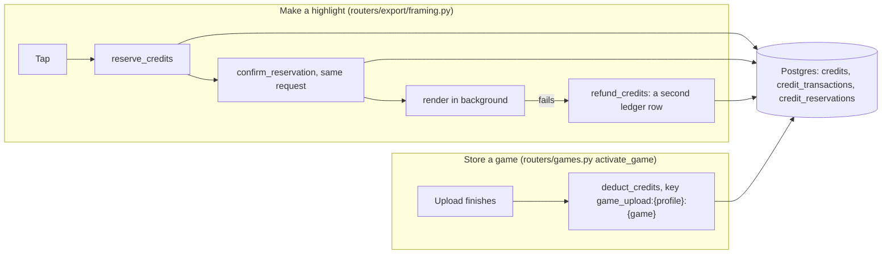
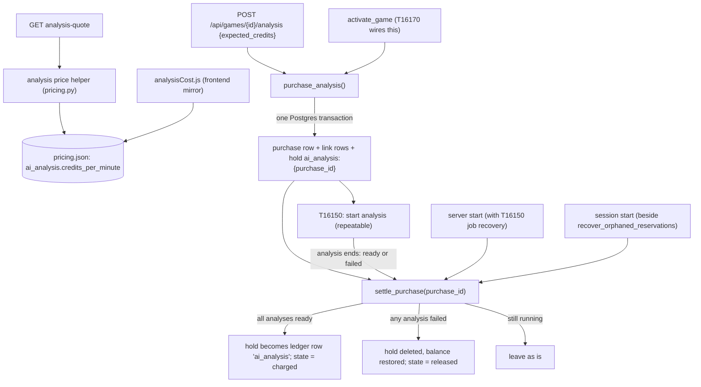
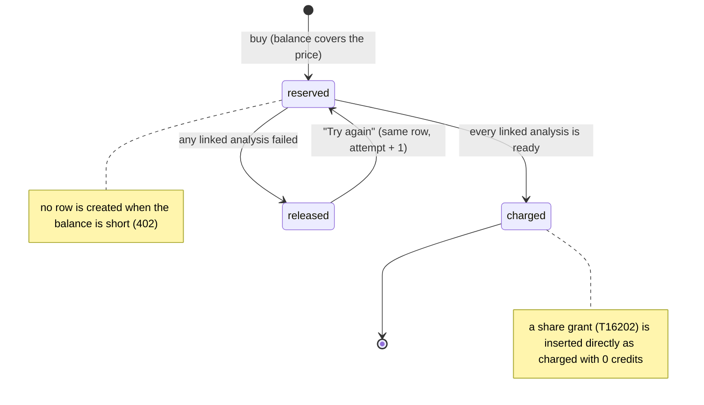

# T16160 Design: AI analysis price and charge

**Status:** PICKS RECORDED 2026-11-19 (see task file "## Ruling"); Q5 ruled (anonymise), Q6 reword approved; design follow-ups listed in task file
**Author:** Architect agent
**Date:** 2026-11-19
**Approved:** not yet
**Task:** [T16160](mark-plays-with-ai/T16160-ai-analysis-price-and-charge.md), epic [AI Coach](mark-plays-with-ai/EPIC.md), task 4 of 10
**Examined:** master at `d93c550fe` (working tree, read only). No source was changed.

---

## In plain words

Today credits (the app's prepaid currency) pay for two things: storing a game, priced by file size, and making a highlight, priced by the second. AI Coach, the paid option that has a video model mark the plays in a game, has no price, no charge and no record of who bought it. This design adds all three.

What we will build, if the recommendations below are accepted:

- **The price.** 1.5 credits for each minute of video. The length is rounded to the nearest whole minute and the credits are rounded up, so a 90-minute game is 135 credits and a 25-minute game is 38. The rate sits in the one pricing file the app and the server both read.
- **The charge.** When the analysis starts, the credits are set aside: the balance drops, but nothing is written to the parent's credit history as spent. When the result is ready, the set-aside credits are taken. If the analysis does not finish, they go back and the history shows nothing. A parent is never charged twice for the same game, whatever they tap and however often the app retries.
- **The record.** One row per parent per game in the shared database says "this parent has AI Coach on this game", how much it cost and whether it is set aside, taken or returned. The free share (T16202) later adds rows of the same kind with a cost of zero.
- **The read-out.** An admin table shows, for each analysis, what the model cost us in dollars and how many credits it earned.

Three things found while reading the code that the owner should know before choosing:

1. **The task file says "set aside, then take" is what highlights already do. It is not.** A highlight is charged the moment the parent taps, and refunded if it fails. So AI Coach would be the first thing in the app whose credits stay set aside for minutes. That matters because of the next point.
2. **A safety net built for highlights would give AI Coach away for free.** Every time a parent's session starts on a server, the app returns any set-aside credits older than 60 seconds that do not belong to a running highlight. An analysis runs for ten minutes or more, so today that net would hand the credits back mid-analysis and the result would then be free. The design closes this (decision 7).
3. **A "90-minute game" is never exactly 90 minutes.** A file of 90 minutes and one second would cost 136 credits under the rule as written in the task ("rounded up"). Every screen and the epic say 135. Decision 1 picks a rounding that keeps that promise.

How we will know it worked: the price in the offer equals the credits taken; a failed analysis leaves the balance and the history exactly as they were; buying the same game twice charges once; and the admin read-out's 30-day total equals the credit ledger's.

Nothing here changes how storage or highlights are charged.

---

## The choices, at a glance

Each choice is laid out in full further down. "Rec." is the Architect's recommendation; the owner decides.

| # | Choice | Options | Rec. |
|---|---|---|---|
| 1 | How the length becomes a price | A every started 40 seconds / B nearest minute, credits rounded up / C every started minute / D nearest credit | **B** |
| 2 | When credits move, and what a failure does | A set aside in the existing holds table, take when ready / B set aside on the purchase row / C charge at the start, refund on failure / D charge only when ready | **A** |
| 3 | Where the price and the purchase record live | A pricing file plus mirrored helper, record in the shared database / B server-only price / C record in the parent's own data / D rate as an admin setting | **A** |
| 4 | What stops a double charge | A one purchase row per parent per game is the lock, one ledger key per game / B a request id per tap / C a new key per attempt | **A** |
| 5 | Shape of the new tables | A purchase row plus a link row per video / B one row per video / C list of analyses in one column / D single-video games only for now | **A** |
| 6 | The server measures a different length than the browser did | A server's number wins silently / B never more than shown, ask again if higher / C honour the shown price within one minute | **B** |
| 7 | How the 60-second safety net tells an AI Coach hold from a highlight hold | A by the hold's name, no change to the existing table / B a new column on the existing table / C lengthen the 60 seconds | **A** |

Size of the whole task with the recommended picks: about 650 lines of production code and about 600 of tests, across roughly 20 files (two new tables, one migration). It should land as reviewable slices (see "Order of work").

---

## Current state ("as is")

### How credits move today



```pseudo
highlight tap:
    credits = round_half_up(seconds)                  # highlight_transform.compute_export_credits
    reserve(user, credits, export_id)                 # balance drops, row in credit_reservations
    confirm(user, export_id)                          # SAME request: ledger row "framing_usage", key export:{id}
    start render in background
    on failure: refund(user, credits, export_id)      # ledger row "framing_refund", key refund:{id}

game activation:
    cost = storage formula by size
    debit(user, cost, key "game_upload:{profile_id}:{game_id}")   # idempotent on the key
    short balance -> 402 {message, required, balance}

every cold session start (session_init.py step 5):
    for each of this user's reservations older than 60 seconds:
        if no live export_jobs row in that profile's local SQLite: give the credits back
```

### Evidence (verified against code)

| Fact | Where |
|---|---|
| Credits are a Postgres ledger. The balance rule is `balance = sum(ledger) - sum(open reservations)`; the backfill tool depends on it. | `services/credit_ledger.py`, `services/credit_backfill.py:355-382` |
| A highlight reserves and confirms in the same request, then refunds on failure. A reservation never outlives one request today. | `routers/export/framing.py:218-236`, `:451-453`; `credit_ledger.refund_export_charge` |
| `confirm_reservation` hardcodes the source `framing_usage`, the key `export:{job_id}` and the milestone `credits_consumed`. Its only caller is `framing.py`. | `credit_ledger.py:537-562` |
| `credits_consumed` is read as "made a highlight" by the analytics. | `services/analytics.py:157` (`FIRST_HIGHLIGHT_ACTIONS`), `services/analytics_spend_readiness.py:38` |
| The credit history shows open reservations as pending rows labelled `framing_usage`. | `credit_ledger.list_transactions`, `CreditHistoryModal.jsx` `SOURCE_LABELS` |
| Recovery releases any reservation older than 60 seconds with no live export job. | `credit_ledger.recover_orphaned_reservations`, `_has_live_export_job`, `session_init.py:355-362` |
| Storage charge key names the profile because game ids count per profile. | `routers/games.py:1356-1364` (T16690) |
| Highlights are priced `round_half_up(seconds)`; the owner moved them off "round up" on 2026-09-12. | `highlight_transform.py:176-214` (T9750) |
| Storage price is mirrored in two pure helpers held together by a parity test. | `services/storage_credits.py`, `frontend/src/utils/storageCost.js` |
| Pack prices have one source, read by both sides. | `app/pricing.json`, `app/pricing.py`, `frontend/src/config/pricing.js` |
| Game lengths live in the parent's own data; the server's probe at activation is the authority and corrects a wrong browser reading. | `database.py` `game_videos.duration`, `routers/games.py:1281-1295` (T4260) |
| A game can hold several videos, including a second camera angle that overlaps the first. | `game_videos.preferred`, `routers/games.py:307-316` (T13280) |
| Game ids never repeat inside one profile. | `database.py:1471` (`AUTOINCREMENT`) |
| Postgres schema head is v050. Postgres migrations run only when an admin triggers them after a deploy. | `migrations/postgres/__init__.py`, CLAUDE.md "Migration System" |
| Account deletion and the reset scripts clear the credit tables by name. | `routers/auth.py:88-140`, `scripts/delete_user.py`, `reset-test-user.py`, `reset_all_accounts.py`, `copy_user_between_envs.py` |

### Not verified (assumptions this design rests on)

- **T16150 is not built and has no design yet.** This design assumes it provides: a way to create or find the analysis row for a video inside the caller's database transaction, a separate "start the job" call that is safe to repeat, a guaranteed end state (`ready` or `failed`) for every analysis including a deadline for a stuck one, a hook this task can call into when an analysis ends, and `cost_usd_micros` and `duration_seconds` on the row. If T16150's design differs, section "Contracts this task needs from T16150" must be revisited before implementation.
- The name of the epic's feature flag.
- Exactly which analytics tables the admin Journey inspector reads to list an event.

---

## Limitations today

- No price, no quote, no purchase record, so T16150's stored result cannot be sold and T16170's dialog has nothing to show.
- The reservation code is written for highlights only: its source, its key, its milestone and its recovery all assume a highlight.
- Nobody can see credits earned against model cost.

---

## Decision 1: how the length becomes a price

The rate is settled: 1.5 credits a minute (epic decisions 14 and 44). What is open is the rounding, the smallest charge, and what "minute" means for a file that is 90 minutes and 20 seconds long. In every option the lengths of a game's videos are added up first and rounded once (UX-FEEDBACK section 1), a video whose length is unknown is refused with a reason and never guessed, and all arithmetic is done on whole numbers (milliseconds and hundredths of a credit) so Python and JavaScript cannot disagree.

Sample prices, in credits:

| Length | A started 40 s | B nearest minute | C started minute | D nearest credit |
|---|---|---|---|---|
| 0:20 | 1 | 2 | 2 | 1 |
| 24:40 | 37 | 38 | 38 | 37 |
| 25:00 | 38 | 38 | 38 | 38 |
| 45:10 | 68 | 68 | 69 | 68 |
| 90:00 | 135 | 135 | 135 | 135 |
| 90:01 | **136** | 135 | **137** | 135 |
| 90:20 | 136 | 135 | 137 | 136 |
| 90:40 | 136 | 137 | 137 | 136 |
| 93:10 | 140 | 140 | 141 | 140 |

All four meet the two acceptance figures (90 minutes is 135, 25 minutes is 38).

### Option A: every started 40 seconds (the task file read literally)

Price is the exact length in minutes times 1.5, rounded up to a whole credit, with a floor of 1. One credit is 40 seconds, so every started 40 seconds costs a credit.

- Pros: it is the sentence already in the task file and the epic. No rounding of the length, so nothing to explain about minutes.
- Cons: a real 90-minute file is never exactly 5,400.000 seconds, so most "90-minute games" cost 136, against 135 on every screen and in the epic. The offer row reads "AI Coach, 90 min" next to 136 credits, and a parent who multiplies 90 by 1.5 gets a different number.
- Risks: support questions about one credit; the headline promise is false for most files.
- Size: about 25 lines in each language plus the shared test cases.

### Option B: nearest minute, credits rounded up (recommended)

The summed length is rounded to the nearest whole minute (30 seconds and over rounds up), with a floor of one minute. The price is that number of minutes times 1.5, rounded up.

- Pros: the number of minutes shown in the offer times 1.5, rounded up, is always the price, so the parent can check it. A 90-minute game is 135 even when the file runs a few seconds over. A small difference between the browser's reading of the length and the server's only matters near the half-minute mark. It follows the owner's 2026-09-12 ruling that moved highlights from "round up" to "round to nearest" (T9750).
- Cons: against option A it earns about a quarter of a credit less per game on average, which is under one cent. For some lengths it is one credit more than A (24:40 is 38, not 37). The smallest charge is 2 credits (one minute), not the 1 the task file states.
- Risks: none found beyond the wording change in the task file ("rounded up" becomes "length to the nearest minute, credits rounded up").
- Size: about 25 lines in each language plus the shared test cases.

### Option C: every started minute

The length is rounded up to a whole minute, then the price is rounded up.

- Pros: most revenue, about three quarters of a credit a game more than B. The minutes shown still explain the price.
- Cons: a 90:01 file is "91 minutes" and 137 credits. It is the harshest rule and the one most likely to read as nickel-and-diming, for 2 to 3 cents a game.
- Risks: the same broken "135 for a 90-minute game" promise as option A, by two credits instead of one.
- Size: same as B.

### Option D: nearest credit (the rule highlights use)

Exact length times the rate, rounded to the nearest credit, floor of 1.

- Pros: one rounding rule across the app; the existing `round_credits_half_up` helper could be reused.
- Cons: the price changes at lengths that mean nothing to a parent (90:19 is 135, 90:20 is 136) while the row still says "90 min". Reusing the highlight helper would tie two prices together that the owner may want to move apart.
- Risks: low.
- Size: slightly smaller on the server (reuse), same on the frontend.

### Also settled inside this decision

- **Smallest charge.** The model costs about 9 cents for any video plus about 1.3 cents a minute, so a video under about three minutes costs us more than it earns on the largest pack. The loss is a few cents and is bounded by T16150's per-account daily cap. Recommendation: no special floor now; put the smallest length worth analysing in T16150's guard list if the read-out ever shows it matters.
- **Rate stored as `1.5`**, converted once to hundredths (150) on each side, so a future rate such as 1.7 cannot be rounded differently by the two languages.

**Recommendation: B.** It is the only option where "90 minutes, 135 credits" is true for real files and the offer row always explains its own price.

---

## Decision 2: when credits move, and what a failure does

What the parent sees is already ruled on and is not reopened here: credits are set aside when the analysis starts, taken when the result is ready, returned in full if it does not finish, and the failure screens say "Nothing was charged" (epic decisions 18 and 19, UX-FEEDBACK section 3 state K, ruling 12). The choice is the mechanism behind it. Options C and D are listed because they are the genuinely different ways to do this and one of them is what the code does for highlights today; each would need the owner to change an approved screen.

Common to all options: a result that already exists (a second parent uploading the same video) is charged in the same request, because there is nothing to wait for. A game with several videos is charged when all of its analyses are ready and returned in full if any of them fails; the finished ones stay stored, so "Try again" only pays the model for the part that failed.

### Option A: set aside in the existing holds table, take when ready (recommended)

Use the existing `credit_reservations` table and its three operations (reserve, confirm, release). At the start the balance drops and a hold row appears; the credit history shows it as pending. When the analysis is ready the hold becomes one ledger row with the source `ai_analysis`. On failure the hold is deleted and the balance restored; the ledger never hears of it.

- Pros: matches the approved wording exactly, including in the credit history ("nothing was charged" is literally true). Keeps the one rule the ledger's tools rely on, that the balance equals the ledger minus open holds. Reuses code that already handles a short balance atomically.
- Cons: the three operations must stop assuming a highlight: confirm needs the source and key passed in, must not fire the `credits_consumed` milestone for an analysis (that milestone is read as "made a highlight"), the pending row needs the right label, and recovery must not release these holds (decision 7). The hold and the purchase row both say "in progress", so they must be written in one database transaction (see "Target state").
- Risks: the free-analysis leak described at the top if decision 7 is done wrong; covered by a dedicated test. Credits can stay set aside for as long as an analysis runs, so T16150 must guarantee every analysis ends.
- Size: about 60 lines changed in `credit_ledger.py`, about 180 in a new purchase service, 2 files; tests about 250.

### Option B: set aside on the purchase row itself

Do not use the holds table. The purchase row is the hold: creating it lowers the balance, settling it writes the ledger row or restores the balance, all in one transaction on one row.

- Pros: one row is both "has AI Coach" and "credits set aside", so the two can never disagree. The 60-second safety net never sees it, so decision 7 disappears.
- Cons: a second place where credits can be out of the balance but not in the ledger. The backfill tool's balance rule, the credit history's pending rows and the reset scripts each have to learn about it, or the parent's history shows a wrong running balance while an analysis runs, and a backfill re-run hands the set-aside credits back. It is a second copy of money logic that exists once today.
- Risks: a tool that is not taught about the second place silently credits users. This kind of gap has happened before (T5840 review found two).
- Size: about 220 lines in the new service, about 40 across the tools that sum holds, 5 to 6 files; tests about 300.

### Option C: charge at the start, refund on failure (what highlights really do)

Debit when the analysis starts. If it fails, write a refund row.

- Pros: the simplest code and the same pattern as highlights. No long-lived holds, so no safety-net problem.
- Cons: the parent's history shows a 135-credit charge and a 135-credit refund for an analysis that failed, which contradicts the approved failure screens and the approved vocabulary (UX-FEEDBACK section 8 bans "refund" here). A retry needs a different ledger key each attempt; with one key per game the second attempt's debit is treated as a repeat and the analysis is free. The admin "credits spent" figure counts the charge unless the new refund source is added to a hand-kept list (the Bug 58p class).
- Risks: owner-approved copy becomes untrue; a free-retry bug if the key rule is missed.
- Size: about 120 lines, 2 files; tests about 200. The owner would have to re-approve section 3 state K and the failure email.

### Option D: charge only when ready, nothing set aside

Check the balance at the start, debit when the result is ready.

- Pros: least code; nothing to return on failure.
- Cons: the parent can spend the credits on highlights during the ten minutes the analysis runs. We have then paid about $3 to the model and can either give the result away or withhold something that is finished. It also contradicts "set aside".
- Risks: direct loss on every such case, and an easy thing to do on purpose.
- Size: about 90 lines; tests about 150.

**Recommendation: A.** It is the only option that keeps both the approved screens and the ledger's one balance rule. Its extra work (decision 7, the four highlight assumptions) is small and testable.

---

## Decision 3: where the price and the purchase record live

The rule from CLAUDE.md is one home for each piece of data. Three things need a home: the rate, the formula, and "this parent has AI Coach on this game, for this many credits".

### Option A: pricing file plus mirrored helper; record in the shared database (recommended)

The rate is `ai_analysis.credits_per_minute` in `app/pricing.json`. The formula is one small pure function on each side (`app/pricing.py` and `utils/analysisCost.js`), held together by one file of sample lengths that both test suites read. The server's result is the one that is charged. The purchase record is a new Postgres table. The agreed price is stored once, on the purchase row, at the moment of buying; the hold and the ledger row are written from it in the same transaction.

- Pros: the same pattern as storage (`storage_credits.py` and `storageCost.js`), which has held. The offer can show a price the instant a file is picked, before a game exists and without a network call. A price change is a one-file edit, as the epic requires. Postgres is where the ledger and T16150's analyses already are, so settlement is one transaction with no file sync involved.
- Cons: the formula exists twice (this is the second mirrored helper, not yet the third that would call for an abstraction).
- Risks: the two helpers drift; closed by the shared sample file and by decision 6.
- Size: about 60 lines for rate and helpers, 4 files.

### Option B: the server is the only place that knows the formula

No frontend helper. The offer always asks the quote endpoint.

- Pros: one implementation.
- Cons: the offer needs a round trip before it can show a number, at the moment the connection is busiest with the upload. The line "AI Coach is 1.5 credits per minute of video" (UX-FEEDBACK section 11) and any landing-page copy still need the rate on the frontend. The task's acceptance criterion about the frontend helper would be dropped.
- Risks: a slow or failed quote call means no offer, and the offer during upload is the feature's main sales moment.
- Size: about 30 lines fewer than A.

### Option C: the purchase record in the parent's own data (profile SQLite)

Keep "has AI Coach" next to the game it belongs to, in the per-profile database that syncs to R2.

- Pros: the record sits beside the game; deleting the game deletes it.
- Cons: settlement happens in a background job, which would then write into a parent's database from outside their session. CLAUDE.md persistence rule 7 requires such a writer to prove its copy is current first and to refuse on a version conflict, so a finished analysis could fail to be recorded. The free share (T16202) would write into other families' databases the same way. "How many parents bought this analysis" would mean opening every user's database, so the admin read-out could not be built.
- Risks: a charge recorded in Postgres with no matching purchase in the parent's data after a sync conflict.
- Size: about 150 lines more than A, plus a per-profile migration.

### Option D: the rate as an admin setting in the database

- Pros: the owner could change the price without a deploy.
- Cons: the frontend could no longer compute a price from a file it ships with; the landing site reads the pricing file at build time. The owner plans one review after 50 paid games, which a one-line file edit serves.
- Risks: a price change mid-session with nothing in version control to show when or why.
- Size: about 120 lines plus an admin control.

**Recommendation: A.** Also part of A: "has AI Coach" is **not** copied into the parent's own data. The screens ask the server (T16170 folds it into the games list in one batched read).

---

## Decision 4: what stops a double charge

Things that can repeat: a double tap, the app resending a request that timed out, two devices, the upload-time path and the game-page path both firing, "Try again" after a failure, and the server restarting mid-settlement.

### Option A: one purchase row per parent per game is the lock; one ledger key per game (recommended)

The purchase table allows one row per (account, profile, game). Buying inserts it; if it is already there in the "set aside" or "taken" state, the call returns it and charges nothing. "Try again" after a failure moves that same row from "returned" back to "set aside" with a conditional update, so of two simultaneous retries exactly one wins. Settlement locks the row, acts only if it is still "set aside", and writes the ledger row under the key `ai_analysis:{profile_id}:{game_id}`. The ledger's own uniqueness on that key is a second, independent guard: even if the first guard had a bug, the ledger cannot hold two charges for one game.

- Pros: two independent guards, both enforced by the database, not by code paths remembering to check. Matches how storage is keyed (`game_upload:{profile_id}:{game_id}`). No value the client could get wrong.
- Cons: only works with "set aside, then take" (decision 2 option A or B), because a failed attempt must leave no ledger row for the key to stay free.
- Risks: the profile must be part of every key and every lookup, because game ids repeat across a user's profiles (the T10860 and T16690 lesson).
- Size: included in decision 2's numbers.

### Option B: a request id per tap

The client sends a fresh id with each tap and the charge is keyed on it (the storage-extension pattern, T17670).

- Pros: the standard answer for a purchase that may legitimately repeat.
- Cons: buying AI Coach for one game does not legitimately repeat. Two taps on two devices carry two ids and would both charge unless option A's row lock is added anyway. The upload-time path buys at activation with no tap at that moment, so the id would have to be invented and carried.
- Risks: a double charge across devices if used alone.
- Size: about 30 lines more than A, on both sides.

### Option C: a new ledger key for each attempt

Key the charge on game plus attempt number.

- Pros: required if decision 2 goes to "charge, then refund".
- Cons: the ledger stops being an independent guard, because a bug that bumps the attempt number opens a fresh key.
- Risks: a double charge from one bug where option A needs two.
- Size: same as A.

**Recommendation: A.**

### How this meets CLAUDE.md's persistence rules

| Rule | How it is met |
|---|---|
| Every write traces to a named gesture | The buy is the "Add AI Coach" tap (or the pack purchase tap that carries it, epic decision 39). Nothing is bought from an effect or on dialog open. |
| Background results follow an explicit contract | Settlement (take or return) is the analysis job's end, an authorised lifecycle step. It has one function and three callers (see "Target state"). |
| Single write path per datum | One function changes a purchase's state. One function writes the `ai_analysis` ledger row. |
| A writer proves its copy is current or fails loudly | Every state change is a conditional update on the current state; "no row changed" is the refusal, as in `sharing_db.repoint_share_video`. No read-then-write on a balance in application code. |
| R2 version compare-and-swap, restore-if-newer | Not involved: this task writes only Postgres. It reads the game's videos from the parent's own data inside their own request and never writes there. |
| No silent fallbacks | A missing length, a missing hold at settlement, or a purchase with no analyses is logged as critical and surfaced in the read-out; nothing is guessed or repaired quietly. |
| Credits gate | While the credit cutover gate is closed, buy returns the existing 503 `credits_unavailable`. |

---

## Decision 5: shape of the new tables

One purchase must cover every video of a game, the unique rule "one row per parent per game" must hold, and the free share (T16202) must fit as a row of the same kind.

### Option A: a purchase row plus a link row per video (recommended)

`game_analysis_purchases`: one row per (account, profile, game), holding the credits, the state and the source. `game_analysis_purchase_analyses`: one row per (purchase, analysis), nothing else.

- Pros: the unique rule is a plain unique index. The money (credits, state) lives on exactly one row. "Buyers per analysis" for the read-out and "which purchases to settle when this analysis ends" are simple joins with real foreign keys. A share grant is one more purchase row.
- Cons: two tables.
- Risks: low.
- Size: about 60 lines of schema (migration plus the mirrored fresh-install text).

### Option B: one row per video with a shared purchase key

- Pros: one table.
- Cons: the credits and the state would sit on several rows or on an arbitrary "first" row. The unique rule becomes "unique on (account, profile, game, analysis)" and no longer says "once per game". "Has AI Coach" needs a DISTINCT.
- Risks: partial settlement, where some rows of one purchase are taken and others returned.
- Size: about the same as A.

### Option C: the list of analyses in one column

A `BIGINT[]` column on the purchase row.

- Pros: one table, one row per purchase.
- Cons: no foreign keys on the list's members, and "purchases of this analysis" needs an array search with its own index. The codebase has no other array column to copy from.
- Risks: a dangling id that nothing catches.
- Size: about 15 lines fewer than A.

### Option D: single-video games only for now

One `analysis_id` column; a game with several videos is "not available yet".

- Pros: smallest schema and the simplest settlement.
- Cons: contradicts the approved offer row "AI Coach, 90 min across 2 videos" and T16150 ("each video is its own analysis"). Halves filmed as two files are common.
- Risks: a visible gap at launch for exactly the parents with the longest games.
- Size: about 80 lines fewer than A across schema and settlement.

**Recommendation: A.** Proposed columns are in "Target state".

---

## Decision 6: the server measures a different length than the browser did

The offer during upload prices the game from the length the browser reads off the file. The charge happens later, at activation, from the server's own probe, which is the authority and is known to correct wrong browser readings (T4260). They usually agree. The acceptance criterion says the price shown equals the amount charged, so the design must say what happens when they do not. The same guard also covers a price change deployed between seeing the offer and tapping.

### Option A: the server's number wins, silently

- Pros: nothing to build.
- Cons: a parent shown 135 can be charged 137 with no notice. That is the one thing the acceptance criterion exists to prevent.
- Risks: a charge the parent did not agree to.
- Size: 0.

### Option B: never more than shown; ask again if higher (recommended)

The buy request carries the price the parent saw. The server works out its own price. If the server's is the same or lower, it charges the server's price and every later screen shows what was really charged. If the server's is higher, it sets nothing aside and returns "the price is now N"; the parent confirms the new price. The client's number is never used as the amount, only as a ceiling.

- Pros: a parent is never charged more than the number they tapped. The client cannot lower its own price, because a low number only causes a refusal. Also guards a price change mid-session.
- Cons: in the rare "higher" case during an upload, the analysis does not start by itself and the game shows a waiting card with the new price. That card needs one new line of copy from the UX designer, in T16170. Strictly, "shown equals charged" becomes "never more than shown, and equal whenever the two readings agree"; the acceptance criterion should be reworded to say so.
- Risks: low. With decision 1 option B the two readings must differ across a half-minute mark for the price to differ at all.
- Size: about 25 lines on the server, about 15 on the client (T16170), tests about 60.

### Option C: honour the shown price when the lengths are within one minute

- Pros: no second question in the common small-difference case.
- Cons: the client's number becomes the amount charged, within a band. Anyone can then shave a minute off every purchase.
- Risks: small, permanent leak; a rule that is hard to explain in a test.
- Size: about the same as B.

**Recommendation: B.**

---

## Decision 7: telling an AI Coach hold from a highlight hold

This only arises if decision 2 is option A. The 60-second safety net must leave AI Coach holds alone, and AI Coach needs its own, better check: the purchase and its analyses are in the shared database, so whether a hold is still needed can be read exactly, with none of the guesswork the highlight check needs.

### Option A: by the hold's name; the existing table does not change (recommended)

An AI Coach hold is named `ai_analysis:{purchase_id}`. The highlight safety net skips names with that prefix (one constant, used on both sides). AI Coach holds are reconciled by the purchase service: for each purchase still "set aside", read its analyses and take, return, or leave.

- Pros: no change to a table the highlight money path reads and writes on every export. That matters because Postgres migrations run only when an admin triggers them after a deploy: a new column named in the export path's SQL would break every highlight between the deploy and the migration. The purchase id is unique across all users, so the database itself refuses a second hold for the same purchase.
- Cons: meaning carried in the text of an id, which is a mild smell.
- Risks: someone later creates a highlight job id starting with the same prefix; export ids are generated uuids, and a test pins the constant.
- Size: about 25 lines.

### Option B: a `kind` column on the holds table

- Pros: the kind is explicit data.
- Cons: the deploy-then-migrate window above. It can be made safe by shipping the column in one deploy, migrating, and shipping the code in a second, which is two deploys and a manual step for one column.
- Risks: a broken export path if the order is ever wrong.
- Size: about 40 lines plus a migration on a hot table and the two-step rollout.

### Option C: lengthen the 60 seconds

Raise the safety net's age limit to a few hours for everything.

- Pros: one number changes.
- Cons: a highlight hold orphaned by a crash would lock the parent's credits for hours instead of a minute. An analysis that runs longer than the new limit is still given away.
- Risks: trades a leak for locked credits and keeps a smaller leak.
- Size: 1 line.

**Recommendation: A.**

---

## Target state ("should be"), with the recommended picks

### Flow



### Purchase states



### Price

```pseudo
analysis_credits(durations_ms: list of whole milliseconds, one per video):
    if list is empty or any entry is missing or <= 0: raise LengthUnknown   # never guess
    total_ms = sum(durations_ms)
    minutes  = max(1, (total_ms + 30_000) // 60_000)        # nearest minute, half rounds up
    rate_h   = round(credits_per_minute * 100)              # 1.5 -> 150, done once at load
    return (minutes * rate_h + 99) // 100                   # credits rounded up
# returns minutes as well, so every screen shows the same number of minutes
```

### Quote

```pseudo
GET /api/games/analysis-quote?duration_seconds=..&sport=..&blake3_hash=..   (before the game exists)
GET /api/games/{id}/analysis-quote
returns:
    credits, minutes
    balance, shortfall                      # balance is the ledger's; the frontend keeps one copy, in creditStore
    owned:  none | reserved | charged, and source (purchase | share)
    stored_result: bool, running: bool      # from T16150, by video fingerprint
    available: bool, unavailable_reason:    # one of: disabled, daily_limit, account_limit,
                                            # sport_unsupported, too_long, storage_expired, length_unknown
# read only; computes on every call; nothing is stored for a quote
```

### Buy

```pseudo
purchase_analysis(user_id, profile_id, game_id, expected_credits):
    refuse if the feature flag is off, or the credits gate is closed (503)
    game, videos = read from the parent's own data (read only); game must be activated
    refuse with the reason if not available (T16150 guards, storage expired, length unknown)
    price = analysis_credits(videos)
    if price > expected_credits: return 409 price_changed {credits: price}     # decision 6

    existing = purchase row for (user_id, profile_id, game_id)
    if existing is reserved or charged: return existing                       # charges nothing

    ONE Postgres transaction:
        insert the purchase row as reserved            (or: released -> reserved, attempt + 1,
                                                        conditional on still being released)
        if no row was inserted or changed: someone else won; return the current row
        create-or-find the analysis row for each video (T16150), write the link rows
        reserve the hold "ai_analysis:{purchase_id}" for price credits
        if the balance is short: roll everything back -> 402 {required, balance}

    after commit:
        ask T16150 to start each analysis that is not ready (safe to repeat)
        record milestone ai_analysis_purchased (sport in context)
        settle_purchase(purchase_id)        # charges at once when the result is already stored
    return the purchase row and the new balance
```

### Settle (the only writer of a purchase's end state)

```pseudo
settle_purchase(purchase_id):
    ONE Postgres transaction:
        lock the purchase row
        if state is not reserved: return                    # already settled: nothing to do
        read the states of the linked analyses
        all ready  -> confirm the hold: ledger row (source ai_analysis,
                      key ai_analysis:{profile_id}:{game_id}, amount = purchase.credits,
                      video_seconds = summed length); state = charged; settled_at = now
        any failed -> release the hold (balance restored, no ledger row); state = released
        otherwise  -> leave
        hold missing, or no linked analyses: log CRITICAL, change nothing    # an internal bug; never self-repair
    after commit, only on a real change: milestone ai_analysis_ready (on charged)

called from:  T16150 when an analysis reaches ready or failed (for every purchase linked to it)
              server start, next to T16150's job recovery (every purchase still reserved)
              session start, next to recover_orphaned_reservations (this user's reserved purchases)
```

A hold is never returned while its analysis is still running. If an analysis could run forever the credits would stay set aside forever, which is why T16150 must give every analysis a deadline.

### Cancel

There is no cancel endpoint. Before the upload finishes nothing has been set aside, so cancelling is the client dropping the choice it was carrying (T16170). After the analysis starts there is nothing to call, which is the rule the owner set.

### Tables (Postgres)

`game_analysis_purchases`

| Column | Type | Note |
|---|---|---|
| id | bigserial primary key | also names the hold: `ai_analysis:{id}` |
| user_id | text not null | |
| profile_id | text not null | game ids repeat across a user's profiles, so always part of the key |
| game_id | integer not null | the buyer's own game id |
| credits | integer not null, 0 or more | the agreed price, frozen at buying; 0 for a share grant |
| status | text not null | `reserved`, `charged`, `released` |
| source | text not null default `purchase` | T16202 adds `share` |
| granted_by_purchase_id | bigint null, references this table, set null on delete | T16202 |
| attempt | integer not null default 1 | counts "Try again"; not part of any key |
| created_at, settled_at | timestamptz | |

Unique on (user_id, profile_id, game_id). Index on (user_id, status).

`game_analysis_purchase_analyses`: purchase_id (references purchases, cascade), analysis_id (references `game_analyses`), primary key on both, index on analysis_id.

Dropped from the task file's proposal: `reservation_id` (it is always `ai_analysis:{id}`, so storing it would be a second copy) and a single `analysis_id` (replaced by the link table).

No change to `credits`, `credit_transactions` or `credit_reservations`.

### Ledger changes (`credit_ledger.py`)

- Register the source `ai_analysis` in `KEY_PREFIX`. **Do not** register `ai_analysis_refund`: with "set aside, then take" no refund row is ever written, and an unused refund source is a trap for the hand-kept refund list. This departs from the task file and should be recorded there.
- `reserve_credits`, `confirm_reservation`, `release_reservation` accept the caller's open transaction, so the purchase row and the money move commit together. Called without one, they behave exactly as today.
- `confirm_reservation` takes the source, key and reference from the caller; the highlight call passes what is hardcoded today. The `credits_consumed` milestone moves to the highlight caller so an analysis is not counted as a highlight.
- `recover_orphaned_reservations` skips hold names with the AI Coach prefix.
- `list_transactions` labels a pending AI Coach hold `ai_analysis`.

### Admin read-out

`GET /api/admin/ai-coach/analyses?days=30` and a table on the admin screen. Per analysis: model cost in dollars (T16150's `cost_usd_micros`), number of buyers, credits taken, and those credits in dollars at the largest pack's rate after card fees (computed from `pricing.json` and one card-fee constant; never shown to parents). A purchase that covers several videos is split between them by length, computed when read, not stored. Totals for the window, with the estimated share paid from free credits shown separately, and two loud counters: purchases still set aside for more than an hour, and any difference between the purchases' total and the ledger's `ai_analysis` total. T16202 adds the free-receiver columns.

### Contracts this task needs from T16150

1. Create-or-find the analysis row for (video fingerprint, sport) inside the caller's transaction, returning its id and state.
2. A separate "start this analysis" call that is safe to repeat and is also run by T16150's own recovery for rows that were created but never started.
3. Every analysis ends as `ready` or `failed`, including by deadline.
4. On reaching either end state, call this task's settle function for the purchases linked to that analysis.
5. A re-run after `failed` reuses the same row.
6. One shared answer to "which of a game's videos are analysed", used by both the price and the engine (see open question 2).

---

## Files and contracts affected

| File | Change |
|---|---|
| `src/backend/app/pricing.json` | add `ai_analysis.credits_per_minute` |
| `src/backend/app/pricing.py` | load the rate; the price function |
| `src/frontend/src/config/pricing.js` | export the rate |
| `src/frontend/src/utils/analysisCost.js` (new) | mirror of the price function |
| shared sample-lengths file (new, read by both test suites) | at least ten lengths with expected minutes and credits |
| `src/backend/app/services/analysis_purchases.py` (new) | quote, `purchase_analysis`, `settle_purchase`, reconcile |
| `src/backend/app/services/credit_ledger.py` | the five changes listed above |
| `src/backend/app/routers/export/framing.py` (the only caller of `confirm_reservation`) | pass source and key; fire `credits_consumed` here |
| `src/backend/app/routers/analysis.py` (from T16150) | the two quote routes and the buy route; the fixed path `analysis-quote` must be registered before `/api/games/{game_id}` routes |
| `src/backend/app/services/game_analysis.py` (from T16150) | call settle at the end states and at startup |
| `src/backend/app/session_init.py` | call the AI Coach reconcile next to the existing recovery |
| `src/backend/app/services/pg.py`, `migrations/postgres/v0NN_game_analysis_purchases.py`, `migrations/postgres/__init__.py` | the two tables; NN is the next free number after T16150's migration lands |
| `src/backend/app/routers/auth.py` (`_purge_user_data`), `scripts/delete_user.py`, `reset-test-user.py`, `reset_all_accounts.py`, `copy_user_between_envs.py` | clear the purchase rows with the user, guarded so an environment that has not migrated yet does not fail |
| `src/backend/app/routers/privacy.py` | include the purchases in the data export |
| `src/backend/app/analytics.py` | register `ai_analysis_purchased`, `ai_analysis_ready` |
| `src/backend/app/routers/admin/` (new file), `src/frontend/src/components/admin/` (new panel), admin store | the read-out |
| `src/frontend/src/components/CreditHistoryModal.jsx`, `config/displayNames` | label for `ai_analysis` ("AI Coach"; string from UX-FEEDBACK) |
| `scripts/dead_code_baseline.json` | `analysisCost.js` has no production caller until T16170; add an entry owned by T16170, or the dead-code check fails |
| `.claude/knowledge/backend-services.md` | credits section: long-lived holds, the prefix rule, the new tables |
| T16160 task file | record the departures: rounding wording, minimum 2 credits, no refund source, no `reservation_id`, reworded "shown equals charged" criterion |

Consumers: T16170 (calls `purchase_analysis` from activation and reads the quote), T16180 (quote and buy by game id), T16190 (import requires state `charged`), T16202 (inserts share rows, extends the read-out).

## Order of work (foundation before consumers)

1. **Price.** Pricing file, both helpers, the shared sample file, quote routes. No money moves. Lands on its own.
2. **Ledger groundwork.** The `credit_ledger.py` changes with characterization tests proving highlights behave exactly as before (same ledger rows, same milestone, same recovery).
3. **Tables and migration.** After T16150's tables exist.
4. **Buy and settle.** Purchase service, buy route, the three settle callers, purge and scripts.
5. **Read-out and milestones.**

Steps 1 and 2 do not depend on T16150 and can be built first. Steps 3 to 5 wait for it. All of it is behind the epic's feature flag; with the flag off the quote says `disabled` and the buy route refuses.

Deploy note: the new tables are reached only by flagged code and by the guarded purge, so the gap between a deploy and the admin running the Postgres migration breaks nothing. The flag must stay off until the migration has run.

## Verification and failure cases

| Acceptance criterion | How it is proven |
|---|---|
| 90 minutes quotes 135, 25 minutes quotes 38, both sides agree on ten lengths | shared sample file read by a backend test and a frontend test; includes 90:01, 90:29, 90:30, 0:20, a two-video sum |
| Buying sets aside the quoted credits; ready lowers the balance by exactly that, once | real Postgres test with a fake engine: balance after buy, after settle, after a second settle |
| A failed analysis leaves the balance as before | same test, failed branch; also asserts no `ai_analysis` ledger row and no pending row |
| Few plays, charged in full | settle looks only at the analysis state, never at the play count; test with a ready analysis holding one play |
| Cancel before upload finishes charges nothing; no cancel after | no hold exists before the buy call; no cancel route exists (test asserts the route table) |
| Same game twice from one profile charges once | two sequential and two concurrent buy calls: one row, one hold, one ledger row |
| Second account, stored result, full price, no model call | fake engine asserts zero start calls; buyer two is charged in the same request |
| Short balance returns 402 with required and balance | and asserts no purchase row and no hold remain |
| Read-out lists cost, buyers, credits; 30-day total matches the ledger | seeded test comparing the read-out total with the ledger sum for `ai_analysis` |
| Milestones appear in the Journey inspector | test on the registry, plus the inspector's own listing test |

Added cases this design requires:

- **The leak:** a hold older than 60 seconds with its analysis still running survives `recover_orphaned_reservations`, and is then taken at ready. This test must fail before the prefix rule exists.
- **Highlights unchanged:** an orphaned highlight hold is still released after 60 seconds; a highlight still records `credits_consumed`; an AI Coach charge does not.
- **Same game id in two profiles** of one user: two separate purchases, two charges.
- **Try again:** failed, then bought again, then ready: one ledger row, balance down by the price once.
- **Two parents, one running analysis:** both set aside, both taken at ready; both returned on failure.
- **Two videos, one fails:** returned in full; the retry starts only the failed one.
- **Price higher than shown:** 409, nothing set aside. Price lower than shown: charged the lower amount.
- **Crash between analysis end and settle:** the startup reconcile settles it; running settle twice changes nothing.
- **Missing hold at settle:** critical log, state unchanged, counted in the read-out.
- **Credits gate closed:** 503, no row.
- **Account deleted while set aside:** rows and hold gone; a later settle call for that purchase is a no-op.

## Risks

| Risk | Mitigation |
|---|---|
| AI Coach given away by the 60-second safety net | decision 7; the leak test above, written first and seen to fail |
| Changing `confirm_reservation` breaks highlight charging | characterization tests before the change; the highlight call site passes today's values explicitly |
| An analysis never ends and credits stay set aside | T16150 deadline (contract 3); the read-out's "set aside for more than an hour" counter |
| T16150's real design differs from the assumed contracts | this design is re-checked against T16150's design before step 3 |
| Migration number collides with another branch | number assigned when the branch is cut, after T16150's lands |
| A reset test account keeps an old purchase row and can never buy again | purge and the four scripts clear the table |
| The two price helpers drift | the shared sample file; decision 6 catches any difference at the moment of charge |
| A reprice while a purchase is set aside | the price is frozen on the purchase row at buying; settlement uses that number |
| `analysisCost.js` flagged as dead code until T16170 | baseline entry owned by T16170 |

## Not in this task

Storage and highlight pricing; the offer dialog, the waiting-for-credits card and the upload hand-off (T16170); starting from a game's page (T16180); the entitlement check at import (T16190); share grants and their read-out columns (T16202); any refund of a finished analysis; any admin tool to change the rate.

## Open questions

Decisions 1 to 7 above need the owner's pick. Beyond those:

- [ ] **1. A video added to a game after AI Coach was bought** (the existing "Add video" action). Proposal: the purchase covers the videos the game had when it was bought; a later video is not analysed and not charged in this epic. Needs the owner's yes, because the alternative (a top-up charge for the new video) is a new screen.
- [ ] **2. A second camera angle of the same game** (T13280). Adding up every video's length would charge twice for the same 90 minutes and return every play twice. T16150 has to say which videos are analysed; the price must use exactly that set. Proposal: only the videos on the game's main timeline, not an overlapping extra angle. This is a product ruling, not an implementation detail.
- [ ] **3. One parent, two athlete profiles, the same game.** They would pay twice, while a different family gets it free through a share. Is that intended? If not, the simplest fix is to let a share between a parent's own profiles carry AI Coach, which T16202 already would.
- [ ] **4. Prompt version changes after a purchase.** Proposal: the parent keeps the result they paid for and is never charged again for the same game; whether they are offered a re-analysis is a later decision.
- [ ] **5. Should a deleted account's purchases stay in the read-out?** Proposal: no; they are deleted with the account like the rest of the credit ledger, and the read-out's totals follow the ledger.
- [ ] **6. Acceptance criterion wording** if decision 6 is B: "the price shown before purchase equals the amount charged" becomes "a parent is never charged more than the price shown, and exactly that price whenever the browser and the server read the same length".
