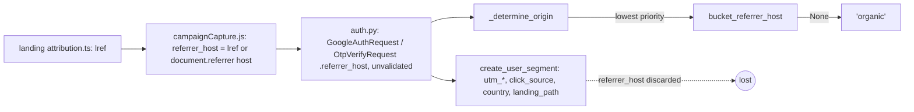
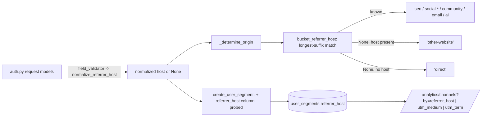

# T16900 Design: Tell direct sign-ups from unknown sources

**Status:** Approved (owner, 2026-11-17), with every Open Question recommendation accepted
**Author:** Architect Agent
**Task:** [T16900-signup-source-direct-vs-unknown.md](T16900-signup-source-direct-vs-unknown.md)
**Knowledge:** `.claude/knowledge/backend-services.md` (Channel read-out T15120, Builds v039 migration-window guard, Country v043)
**Prior art:** T15010 (`landing_path`, v045): same shape (one nullable `user_segments` column, sign-up probe, admin grouping)

## Current State ("As Is")



```pseudo
_determine_origin(..., referrer_host):
    invite -> registered campaign id -> raw ref -> utm_campaign -> share-based -> click_source_unknown
    bucket = bucket_referrer_host(referrer_host)     # strip/lower/port inside; www./m./l./lm. stripped
    if bucket: return bucket
    return "organic"                                 # no referrer AND unrecognised referrer, same label

bucket_referrer_host(host):
    exact dict hit, else FIRST key in dict insertion order where host endswith "." + key,
    else google.<tld> regex -> "seo"
```

Evidence (verified 2026-11-17):
- `analytics.py:898-903`: fallback returns `"organic"`; `referrer_host` is never passed to `create_user_segment` (`auth.py:511-522`, `:851-866`).
- `analytics.py:715-719`: suffix loop is insertion-ordered; `"google.com"` is the first key, so `foo.mail.google.com` would match seo. An exact key for `mail.google.com` would win today only because the exact lookup runs first.
- `analytics.py:788-796`: `_is_reserved_origin` = `organic` OR any `REFERRER_HOST_BUCKETS` value OR `*_unknown`.
- `services/analytics.py:88-98`: `ChannelDimension` lacks `utm_medium`, `utm_term`, `referrer_host`.
- Normalization exists in only one place (`bucket_referrer_host`); the auth request models accept any string.

### Limitations
- "No referrer" and "unrecognised referrer" share the `organic` label, so the default view hides the split.
- The host is discarded, so growing the bucket list can never relabel past sign-ups.
- Email webmail and AI assistants have no buckets; `*.google.com` subdomains fall to seo.

## Target State ("Should Be")



```pseudo
new sign-up:
    host = normalize_referrer_host(body.referrer_host)          # once, at the request model
    origin = _determine_origin(..., referrer_host=host)
        ... unchanged priority chain ...
        bucket = bucket_referrer_host(host)
        if bucket: return bucket
        return ORIGIN_OTHER_WEBSITE if host else ORIGIN_DIRECT
    create_user_segment(..., referrer_host=host)                 # stored for EVERY sign-up, whatever the origin
```

Non-goals:
- No backfill or re-label of existing `organic` rows (their host was never stored).
- No change to the priority chain above the referrer step, to `utm_medium`-based classification (see Open Question 3), or to the `origin` column's DDL default (`'organic'`; only test fixtures rely on it; production always passes origin).
- No user-detail-panel field for `referrer_host` (not in the acceptance criteria; cheap follow-up).
- No landing or `campaignCapture.js` change: the client already sends the hostname on both auth paths.

## Decisions

### 1. Normalization lives in one place: `analytics.normalize_referrer_host`

A pure function in `app/analytics.py` beside `bucket_referrer_host`. It is called by:
- a `field_validator("referrer_host")` on both `GoogleAuthRequest` and the OTP verify model in `routers/auth.py`, via a thin `_clean_referrer_host` wrapper. The wrapper adds the drop warning, like `_clean_landing_path`.
- `bucket_referrer_host` itself, which replaces its inline strip/lower/port code. The visit beacon (`telemetry.py`) passes raw input, so it still gets identical normalization.

The function stays pure: it does not log. The beacon is anonymous and high-volume, so logging there would be noise. The warning lives only in the auth wrapper.

```pseudo
_HOSTNAME_RE = r"^[a-z0-9](?:[a-z0-9.-]*[a-z0-9])?$"     # ASCII/punycode hostname chars only

def normalize_referrer_host(raw: str | None) -> str | None:
    if raw is None: return None
    host = raw.strip().lower().rstrip(".")
    if not host: return None
    host = re.sub(r":\d{1,5}$", "", host)                 # strip :port only (not other colons)
    if len(host) > 253 or ".." in host or not _HOSTNAME_RE.fullmatch(host):
        return None                                       # IPv6 literals, schemes, paths, spaces, unicode
    return host

# routers/auth.py
def _clean_referrer_host(value):
    host = normalize_referrer_host(value)
    if value and value.strip() and host is None:
        logger.warning(f"[Auth] dropped invalid referrer_host: {value!r}")
    return host
```

Rules:
- Lowercase.
- Surrounding whitespace and a trailing dot removed.
- A numeric `:port` removed.
- Maximum 253 characters.
- Hostname characters only.
- A bad value is dropped (stored NULL, origin `direct`) and never causes a 4xx.

What is stored: the full normalized host, keeping `www.` and `m.`. The leading-label strip is a matching detail inside `bucket_referrer_host` only. The column stores the raw fact, and the channel is derived on read.

Rejected alternative: validate in `auth.py` only, as `_clean_landing_path` does. That would leave two normalization copies, because the beacon also needs it. The task asks for one place.

### 2. Bucket matching is most-specific suffix first

Replace the insertion-ordered suffix loop with a walk from the longest suffix of the host to the shortest:

```pseudo
def bucket_referrer_host(host):
    host = normalize_referrer_host(host)
    if not host: return None
    host = strip one leading "www." | "m." | "l." | "lm."       # unchanged
    labels = host.split(".")
    for i in range(len(labels)):                                # "a.mail.google.com", "mail.google.com", "google.com", "com"
        bucket = REFERRER_HOST_BUCKETS.get(".".join(labels[i:]))
        if bucket: return bucket
    if host == "google" or _GOOGLE_HOST_RE.match(host): return "seo"
    return None
```

This subsumes the exact lookup, because `i = 0` is the exact host. The result no longer depends on dict order, and existing classifications are unchanged: no existing host matches two keys with different buckets. The google ccTLD regex stays last, so `mail.google.com` and `gemini.google.com` hit their exact keys before it.

New `REFERRER_HOST_BUCKETS` data:

| Bucket | Keys |
|--------|------|
| `email` | `mail.google.com`, `com.google.android.gm` (Gmail Android app referrer), `outlook.live.com`, `outlook.office.com`, `outlook.office365.com`, `mail.yahoo.com`, `mail.aol.com`, `mail.proton.me`, `mail.zoho.com`, `fastmail.com` |
| `ai` | `chatgpt.com`, `chat.openai.com`, `perplexity.ai`, `gemini.google.com`, `copilot.microsoft.com`, `claude.ai`, `chat.deepseek.com` |

`search.yahoo.com` stays seo and `mail.yahoo.com` becomes email. The longest-suffix walk makes this hold even for deeper subdomains.

### 3. Reserved origins and campaign-id collisions

- `email` and `ai` become reserved automatically, because `_is_reserved_origin` already includes every `REFERRER_HOST_BUCKETS` value.
- Add named constants `ORIGIN_DIRECT = "direct"`, `ORIGIN_OTHER_WEBSITE = "other-website"` and `ORIGIN_LEGACY_UNKNOWN = "organic"` in `analytics.py`. `_is_reserved_origin` checks all three. `_determine_origin` returns the first two, and the third stays as the `_get_user_origin` fallback.
- No generated campaign id can collide with any new value, and this is provable without querying any environment. `generate_campaign_id` draws exactly 5 characters from `CAMPAIGN_ID_ALPHABET`, which has no `i`, `l`, `o`, `0`, `1` or `-`:
  - `email` contains `i` and `l`.
  - `ai` is 2 characters.
  - `direct` is 6 characters.
  - `other-website` contains `-` and is 13 characters long.
  - The existing reserved values were already uncollidable in the same way.

  A unit test asserts these four values against the alphabet and length.
- The real (pre-existing) ambiguity is different. An unregistered raw `ref` or `utm_campaign` becomes the origin verbatim (`analytics.py:876-880`), so a link tagged `?utm_campaign=email` or `?ref=direct` produces a row that looks like the bucket. That is true of `seo` and `organic` today, and this task does not change it. To check whether it has already happened, look at the admin Campaigns table (Group by Origin, all-time window) on each environment before deploy, for rows named `direct`, `other-website`, `email` or `ai`. The owner reads this, and the AI does not query prod.

### 4. Every consumer of the literal `organic`

Grep covered `src/` (backend, frontend, landing), `scripts/`, `src/frontend/e2e/` and `.claude/`.

| Consumer | What it does with `organic` | Action |
|----------|-----------------------------|--------|
| `analytics._determine_origin` (`analytics.py:903`) | the fallback producer | Change to `direct` / `other-website` |
| `analytics._is_reserved_origin` (`:793`) | collision guard | Add `direct` and `other-website` (constants) |
| `analytics._get_user_origin` (`:638`) | returns `organic` when an inviter or sharer has no segment row | Keep the value. This is an internal data hole, not a source signal. Add `logger.warning` per the no-silent-fallback rule. See Open Question 2. |
| Invite/share inheritance (`analytics.py:864-868`, `:892-894`) | an invitee inherits its inviter's origin verbatim, including a legacy `organic` | Unchanged (root-channel semantics). Post-cutover `organic` rows will still appear from invites by legacy users. See Open Question 1. |
| `pg.py:288` DDL default `'organic'` | only test fixtures insert without origin | Unchanged (non-goal) |
| `daily_counters.origin_type` (`_counter_buffer.increment(origin, ...)`) | keyed by whatever origin string is passed; no literal check | Nothing to do. New `direct`/`other-website` counter rows appear on their own. Every consumer reads `'all'` or a caller-supplied origin. |
| Spend readiness, journey, activation report, retention, cohorts, funnel `?origin=` | group or filter by origin generically; no `organic` literal in code (only prose in `spend_readiness_constants.py`) | Nothing to do |
| Migrations v005/v009 | historical | Never edited |
| `UserTable.jsx:30` `OriginBadge` | green badge for `organic` (no-source), blue for everything else | Green for `organic`, `direct` and `other-website` via a `NO_SOURCE_ORIGINS` constant exported from `OriginLabel.jsx`, the one origin-display module |
| `OriginLabel.jsx` | shows the raw string | Unchanged |
| `ChannelsTable.jsx` | none today | Add the `organic` note (decision 6) |
| `scripts/`, `e2e/`, `src/landing` | no `organic` references | Nothing to do |
| `.claude/agents/user-acquisition.md` | "organic" used as the marketing term (unpaid), not the origin value | Nothing to do |
| Visit beacon `bucket_visit_source` | returns `direct` for no signal and for an unrecognised host | Align: unrecognised host returns `other-website` (one line, same constants). The `visit_daily` source vocabulary then matches sign-up origins. Historical `direct` visits stay as recorded. |

`scripts/copy_user_between_envs.py` copies `SELECT *` from `user_segments`. As with every past column, copying from an environment that has v050 into one that does not fails until `migrate-postgres` runs there. No code change is needed, but the risk is noted below.

### 5. Migration v050, DDL mirror, probe, deletion

- `src/backend/app/migrations/postgres/v050_user_segments_referrer_host.py`:
  - `version = 50`
  - `description = "Add user_segments.referrer_host (T16900 referring website)"`
  - `up`: `ALTER TABLE user_segments ADD COLUMN IF NOT EXISTS referrer_host TEXT`. This is idempotent and touches no existing row values.
  - Register it in `migrations/postgres/__init__.py`. If another branch has claimed 50 by implementation time, take the next free number and rename consistently (see the migration version-collision landmine).
- `_SCHEMA_DDL` (`pg.py`): add `referrer_host TEXT` to `user_segments` after `landing_path`, with a comment (T16900 (v050): normalized external referrer hostname at sign-up; NULL = no referrer, or signed up before capture; kept on deletion). Add no index: `_SCHEMA_DDL` re-runs at startup, and an index on a not-yet-migrated column breaks startup (Builds landmine).
- `analytics.segment_has_referrer_host(cur)` and `_referrer_host_column_present`: the same sticky information_schema probe as `segment_has_landing_path`. In `create_user_segment`, add `referrer_host: str | None = None`. When the column is present, append it to the INSERT. When it is absent, log `logger.error(... v050 not applied; run POST /api/admin/migrate-postgres ...)` and write the row without it. The sign-up never fails.
- Admin read (`by=referrer_host`): no probe, following the Country precedent (`by=country` fails loudly until v043). The column is read only when an admin picks that Group-by option, never on dashboard mount.
- Deletion: KEPT. The column is not added to `_DEIDENTIFY_SEGMENT_COLUMNS`, under the T15010/T15290 ruling that analytics survives deletion. Extend the comment block at `analytics.py:1100-1110` to name `referrer_host`.
- Post-deploy: `POST /api/admin/migrate-postgres` on staging, then prod. This is the operator step and is already in the deploy flow.

### 6. Admin UI

- `services/analytics.py`:
  ```pseudo
  ChannelDimension += "utm_medium", "utm_term", "referrer_host"
  _CHANNEL_GROUP_EXPR["utm_medium"]    = "COALESCE(NULLIF(s.utm_medium, ''), 'unknown')"
  _CHANNEL_GROUP_EXPR["utm_term"]      = "COALESCE(NULLIF(s.utm_term, ''), 'unknown')"
  _CHANNEL_GROUP_EXPR["referrer_host"] = "COALESCE(NULLIF(s.referrer_host, ''), 'unknown')"
  ```
  No router change is needed (`by: ChannelDimension` already widens the Literal, and an unknown value still returns 422).
- `adminStore.js`: no change. `setChannelsBy` and the fetch pass `by` through verbatim (`adminStore.js:629-645`).
- `ChannelsTable.jsx` `DIMENSIONS`: add `{utm_medium: 'Medium'}` and `{utm_term: 'Term'}` after Source, and `{referrer_host: 'Referring website'}` before Country. These rows do not filter Users, matching the existing non-origin dimensions and their caption.
- The `organic` note in `ChannelsTable`: when `by === 'origin'` and a row has `origin === 'organic'`, render a muted caption under the Group-by row:
  > organic: source unknown, for sign-ups before 2026-11-17. Newer sign-ups with no campaign show as direct (no referring website) or other-website (a website not on our list).

  The cutoff date is a named constant (`ORGANIC_RETIRED_ON`) next to the caption. See Open Question 4.
- CSV: unchanged. `channelsCsv` already keys by `by` and neutralizes formula prefixes, which matters because referrer hosts are client-supplied.

### 7. Curated test list mapped to acceptance criteria

| AC | Test (file :: what) |
|----|---------------------|
| AC1: no referrer and no campaign signal gives `referrer_host` NULL and origin `direct` | `tests/test_t16900_referrer_host.py` (new) :: OTP sign-up with no params stores NULL and `direct`. `tests/test_analytics.py` :: flip `test_organic_no_ref` and `test_unresolved_hex_no_fallback_is_organic` to `direct`. |
| AC2: unlisted website stores the host and gives `other-website` | new file :: Google sign-up with `referrer_host="Some-Blog.Example:8080"` stores `some-blog.example`, origin `other-website`. `test_analytics.py` :: flip `test_referrer_host_unknown_is_organic` to `other-website`. new file :: parametrized invalid values (`"a b"`, `"http://x.com/p"`, `"x"*254`, `"[::1]"`, `"ex..com"`) give 200, NULL, origin `direct`. |
| AC3: `mail.google.com` gives email and `chatgpt.com` gives ai, not seo | `test_analytics.py::TestBucketReferrerHost` :: add `mail.google.com`, `gemini.google.com`, `chat.openai.com`, `foo.mail.google.com` (longest suffix), `mail.yahoo.com` (email) and `search.yahoo.com` (seo). Existing rows stay green as the regression guard. New file :: end-to-end OTP sign-ups from `mail.google.com` (email) and `chatgpt.com` (ai). `tests/test_visit_beacon.py` :: unrecognised host gives `other-website`, no signal gives `direct`. |
| AC4: Campaigns groups by medium and referring website, with blanks as "unknown" | new file :: `GET /api/admin/analytics/channels?by=utm_medium` and `by=referrer_host` (and `utm_term`) over a one-day window give named rows plus `unknown`, summing to the window's sign-ups. `ChannelsTable.test.jsx` :: options Medium, Term and Referring website render; the organic note shows only for the origin view with an organic row. `adminStore.dashboard.test.js` :: existing `setChannelsBy` regression. |
| AC5: existing rows unchanged; migration idempotent | new file :: DDL mirror assert, plus `up()` run twice in a rolled-back transaction after DROP COLUMN (T15010 pattern), with a pre-seeded `organic` row keeping its origin and a NULL `referrer_host`. new file :: migration-window case (column renamed away, sign-up still writes the segment, ERROR logged). |
| Reserved origins (decision 3) | `tests/test_t13980_campaigns.py` :: `_is_reserved_origin` holds for `direct`, `other-website`, `email` and `ai`; each fails alphabet or length membership. |
| Deletion keeps the column (decision 5) | `tests/test_t15290_account_deletion_analytics.py` :: add a `referrer_host` survives assertion beside `landing_path`. |
| Regression on shared code | `tests/test_t15010_landing_path.py` (column assembly in `create_user_segment`); `tests/test_analytics_dashboards.py` channels classes; `UserTable.test.jsx` (badge). |

E2E: none required. Nothing in the browser path changes: capture and auth bodies are untouched, and the admin read is covered by API plus component tests. If this runs under /dotask, the AC4 check under `src/frontend/e2e/checks/` should be an API-level Playwright `request.get('/api/admin/analytics/channels?by=referrer_host')` as admin, asserting an `unknown` row. Post-merge, `staging-check` covers the rest.

## Implementation Plan ("Will Be")

Order: foundation before consumers.

| # | File | Change |
|---|------|--------|
| 1 | `migrations/postgres/v050_user_segments_referrer_host.py`, `migrations/postgres/__init__.py`, `services/pg.py` | Add the column and the DDL mirror |
| 2 | `app/analytics.py` | `normalize_referrer_host`; longest-suffix `bucket_referrer_host`; email/ai data; origin constants; `_is_reserved_origin`; `_determine_origin` fallback; `_get_user_origin` warning; `segment_has_referrer_host`; `create_user_segment(referrer_host=)`; `bucket_visit_source` other-website; deletion comment |
| 3 | `app/routers/auth.py` | `_clean_referrer_host` validator on both request models; pass `referrer_host=body.referrer_host` to `create_user_segment` on both paths |
| 4 | `app/services/analytics.py` | Three `ChannelDimension` values and their group exprs |
| 5 | `components/admin/ChannelsTable.jsx`, `OriginLabel.jsx`, `UserTable.jsx` | Group-by options, organic note, `NO_SOURCE_ORIGINS` badge |
| 6 | Tests per section 7 | Written red first for AC1-AC3 (the origin flips and the bucket rows fail on current code) |
| 7 | Stage 7: `.claude/knowledge/backend-services.md` | Channel read-out `by` list; the v050 guard; origin vocabulary (`organic` legacy, `direct`, `other-website`, `email`, `ai`) |

Estimated size: about 10 production files and about 150 lines of meaningful diff, excluding tests.

## Risks

| Risk | Mitigation |
|------|------------|
| Sign-ups between deploy and `migrate-postgres` lose their host | The probe logs an ERROR per sign-up, and the origin is still computed. Run the migration right after deploy (standard flow). |
| Migration number 50 claimed by another branch | Take the next free number at implementation, and rename the class, file and test lookup together. The test finds the migration by description, not number. |
| `copy_user_between_envs.py` (`SELECT *`) fails into an environment without v050 | Migrate the destination first, as for every past column. |
| Time series break: `organic` stops growing while `direct`/`other-website` start | Intended by the ruling. The Campaigns note explains it, and the activation/cohort groupings show the new values as their own groups. |
| Raw `utm_campaign` or `ref` values equal to `email`, `ai` or `direct` look like buckets | Pre-existing class (`seo` and `organic` today). Check the Campaigns origin view per environment before deploy (decision 3). |
| A referring personal website could hint at identity after deletion | Covered by the T15290 ruling that analytics survives deletion and the email is hashed. The host is a site, not a person. The owner may reverse this by adding `referrer_host` to `_DEIDENTIFY_SEGMENT_COLUMNS`. |
| Email clients often strip the referrer, so email traffic still lands in `direct` | Expected. The `utm_medium` grouping is the read-side answer, and Open Question 3 covers the write side. |

## Open Questions

Owner ruling 2026-11-17: all four recommendations below are accepted as written. Build 1 to 3 as
recommended; for 4, ship `ORGANIC_RETIRED_ON = 2026-11-17` and adjust it at `/deploy` if prod ships later.

- [x] **1. Post-cutover `organic` from inheritance.** An invitee inherits its inviter's origin. Most existing inviters are `organic`, so new invitees will keep showing `organic` after 2026-11-17. Recommendation: keep inheritance unchanged (the origin dimension credits the root channel, and invites are visible separately in the Referral channel dimension), and word the note as "source unknown: sign-ups before 2026-11-17 and people they invited". The alternative is to relabel inherited `organic` as `direct`. That would claim a source we do not know, so it is not recommended.
- [x] **2. `_get_user_origin` no-row fallback.** It still returns `organic`, with a new warning. Recommendation: keep it. This is a data hole on our side, not a visitor's source.
- [x] **3. `utm_medium=email` (or `newsletter`) with no `utm_campaign`.** Today this falls through to the referrer step and would now read `direct`. GA4 would call it Email. Recommendation: leave it for a follow-up task. The new Medium grouping already shows these sign-ups, and changing the priority chain is outside the ruling.
- [x] **4. Note date.** The ruling fixes "2026-11-17", but `organic` actually stops on the prod deploy date. Recommendation: set `ORGANIC_RETIRED_ON` to the prod deploy date when `/deploy` ships T16900 (one-line edit), or accept 2026-11-17 if it ships within days.

**Status:** Approved (owner, 2026-11-17)
