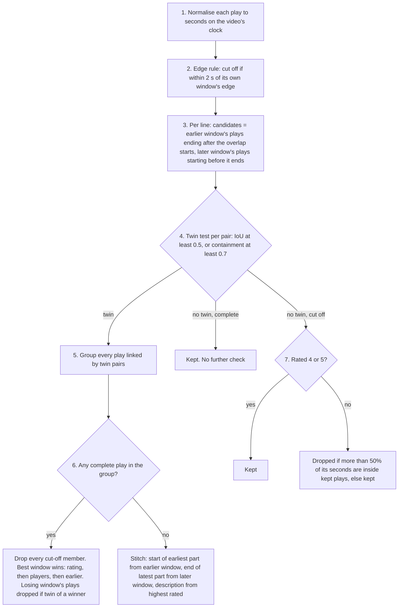

# T16145 design: joining the windows without doubles or losses

**Status:** design for the owner to review. Nothing is built or changed. The architect cannot approve this; the owner does.
**Date:** 2026-11-20
**Task:** [T16145](T16145-prototype-prompt-and-joining.md) (Solution steps 2 to 4). Consumer: [T16150](T16150-game-analysis-engine.md), which lifts the joining code unchanged.
**Evidence read:** `gemini_analysis_test/merge_windows.py` and `test_merge_windows.py` (in the worktree `c:\work\tasks\g-t16130-2`), and the run folder `outputs/runs/S1-s1-10min-colors-v2/` (both raw answers, the joined result, the joining report, the team check, the cost table).
**What I did not do:** I did not run any code or test, and I did not watch the video. Every number below is read from the files or worked out by hand from them. Where the code's own report gives the same number, I say so.

---

## 1. In plain words

The model watches a game in five-minute windows. Each window runs 30 seconds into the next, so the 30 seconds around every line between two windows are described twice. The joining is ordinary code that turns those two descriptions into one list of plays. It has two ways to fail: list the same moment twice (a double), or leave a moment out (a loss). A 90-minute game has about 18 such lines.

**What the first real run shows.** S1 is a 10-minute video with one line, at 05:00 to 05:30. The joined result there contains a double. White's attack down the left, ending with the left winger's ball toward goal at 05:14, is in the list twice: once as 04:56 to 05:17 from the first window and once as 05:07 to 05:22 from the second. Both are rated 4 for White, so a White parent would get the same run as two plays in the Team lane. Nothing rated 4 or 5 was lost.

**Why it happened.** The code decides two plays are the same by how much of their time they share. These two share 10 seconds, which is 67% of the shorter one. The rule needs 70%. So the code treated them as two different plays and kept both.

**Why it will keep happening.** The prompt asks for a play-by-play "with no gaps", and the model obeys: every second of a window belongs to exactly one play. So the 30 shared seconds are cut into plays twice, by two calls that choose different cut points (the first window cut at 04:56, 05:17, 05:29; the second at 05:00, 05:07, 05:22). Comparing how much two differently cut plays overlap, against a fixed percentage, is a coin toss near the threshold. The current code also has no backstop: a whole play with no match is kept without checking whether the other window already told those seconds.

**The two windows also disagree about what happened.** The first says the winger's shot was saved and held, the Navy goalkeeper released the ball, and Navy's attack was stopped by a flag. The second says the winger's low cross forced a corner, and White took the corner. Both cannot be true. No joining rule can tell which is right; only the video can. The joined result currently contains pieces of both stories.

**What I recommend.** Stop asking "are these two plays the same?" for every pair. Instead choose one cut per line: take the first window's plays up to the cut and the second window's plays after it. Then two kept plays from different windows can only overlap at the cut itself, at most one pair per line, and the report says exactly how many seconds are told twice or by nobody. Guards make sure a play rated 4 or 5 is never dropped unless the other window's kept plays tell it too. This needs no extra model call and no change to the prompt. On S1 it keeps the first window's 04:56 to 05:17 and the second window's corner from 05:22: one account of the attack, no double.

**How we will know.** One line is not enough to trust any design. Before approving a joining version, replay every recorded run through the candidate rules (free, the joining is pure code), count doubles, losses and bad stitches per line, and have a person check each overlap against the video. Section 6 has the metrics and the test cases.

**One thing that lowers the stakes.** A stored analysis is never recomputed because model calls cost money. The joining costs nothing. If the server keeps each window's raw answer beside the result, a better joining can be re-applied to every stored game for free. T16150's proposed tables have no place for the raw answers today. That is decision 8.

---

## 2. Current state: the pipeline step by step

All line numbers are in `gemini_analysis_test/merge_windows.py`. `merge(windows)` (lines 289 to 365) is the entry point and returns the joined result and the report.



### Constants (lines 27 to 34)

| Name | Value | Meaning |
|---|---|---|
| `WINDOW_STEP_S` | 300 | a window starts every 5 minutes |
| `OVERLAP_S` | 30 | each window runs 30 s into the next |
| `EDGE_S` | 2 | "near the edge" for the cut-off rule and the clock check |
| `TWIN_IOU` | 0.5 | shared time divided by combined time |
| `TWIN_CONTAIN` | 0.7 | shared time divided by the shorter play's length |
| `KEEP_FRAGMENT_RATING` | 4 | a cut-off play with no twin is kept at this rating or higher |
| `COVERED_FRACTION` | 0.5 | a routine cut-off play with no twin is dropped above this coverage |
| `MIN_VOTERS` | 3 | windows needed in a period before one can be called suspect |

### Step 1. Normalise the clock (`_normalize`, lines 117 to 149)

- `MM:SS` becomes whole seconds (`to_seconds`, lines 52 to 57).
- A later window that counted from zero is detected and shifted: if any play in a window that starts after 0 begins more than 2 s before the window's own start, every time in that window is moved forward by the window's start (lines 124 to 125). It is all or nothing per window.
- Each player's box time is shifted the same way. A box is removed and counted when its coordinates are malformed or its time is outside the play (lines 108 to 114, 138 to 145).
- Each play records `source_window`, the edge-rule `cut_off`, the model's own flag as `model_cut_off`, and `stitched: False`.

### Step 2. The edge rule (`_cut_off`, lines 101 to 105)

- Cut off at its start: not the first window, and the play starts within 2 s of the window's start.
- Cut off at its end: not the last window, and the play ends within 2 s of the window's end.
- The model's own flag is recorded and compared, never used (S1: 32 agree, 2 disagree).

### Step 3. Candidates at each line (lines 299 to 304)

For neighbouring windows A (earlier) and B (later): A's plays that end after B's start, and B's plays that start before A's end. Every A candidate is compared with every B candidate. Plays are never compared within one window or across windows that are not neighbours.

### Step 4. The twin test (`is_twin`, lines 80 to 81)

Two plays are twins when either holds:

- **IoU** (`iou`, lines 68 to 71): shared seconds divided by combined seconds, at least 0.5.
- **Containment** (`containment`, lines 74 to 77): shared seconds divided by the shorter play's length, at least 0.7.

The test uses times only. It does not look at the summary, the tags, the players or the box times. For every twin pair the report also records a slot score (step 8).

### Step 5. Grouping (`_groups`, lines 171 to 184)

Every play linked to another by a twin pair, directly or through a chain, lands in one group (a union-find). If A2 is a twin of B1 and B1 is a twin of A3, all three are one group even when A2 and A3 never overlap.

### Step 6. Resolving a group (`_resolve`, lines 187 to 231)

- **At least one complete play in the group** (lines 207 to 231):
  - every cut-off member is dropped with the reason "cut off, and a complete twin exists" (lines 207 to 210). The code does not check that the complete play overlaps that particular member.
  - the complete plays are split by window. One window wins the whole group by: highest rating of any of its plays, then the most players in any of its plays, then the earlier window (lines 214 to 215). `rating` is the higher of the two teams' relevance (lines 88 to 89).
  - the losing window's complete plays are dropped when they are twins of a winning play, otherwise kept (lines 217 to 226).
- **No complete play in the group** (lines 190 to 205): one stitched play is made. Its start is the start of the earliest part from the earlier window, its end is the end of the latest part from the later window, and everything else (summary, both teams' sections, players, boxes) is copied from the highest rated part. It is marked `stitched` and filed under the earlier window.

### Step 7. Plays with no twin (lines 326 to 341)

- **Complete:** kept. There is no check of any kind.
- **Cut off, rated 4 or 5:** kept ("a possible highlight is never dropped", lines 330 to 333).
- **Cut off, rated 3 or lower:** the code adds up how many of its seconds lie inside every other kept play (`_covered`, lines 234 to 237). Above 50% it is dropped, otherwise kept.

### Step 8. Direction voting, where it touches the joining (`_directions`, lines 240 to 286)

- Each window votes for the way team_0 attacks. A window whose two teams report the same direction, or `unclear`, does not vote (lines 242 to 253).
- One change of ends is placed where it explains the most votes (lines 262 to 272). Inside a period with at least 3 voting windows, a window voting against the majority is `teams_suspect` (lines 276 to 283).
- **Where it meets the joining:**
  - every joined play is stamped `teams_suspect` from its `source_window` (line 353). A stitched play is filed under the earlier window (line 198) even when its description came from the later one.
  - twins are resolved (lines 299 to 324) before directions are worked out (line 343), so a suspect window's version of a play can win a twin contest. Nothing is swapped automatically.
  - each twin pair gets a slot score: does the same team hold the higher relevance, and do the tag sets per team match, as sent and with one side's teams swapped (`_agreement`, lines 165 to 168). When swapped scores higher, the pair is `mirrored` and both windows are marked `overlap_mirrored` (lines 305 to 313). This check only sees pairs the twin test found.
  - the two kit colours are taken from the first window only (lines 345 to 349).
- **In S1:** both windows vote "right" for Navy. Two voters is below the three needed, so no window could have been called suspect whatever it said.

---

## 3. Walk-through of the real line in S1 (04:30 to 05:50)

Window 0 covers 00:00 to 05:30. Window 1 covers 05:00 to 10:00. The overlap is 05:00 to 05:30. team_0 is Navy blue, team_1 is White.

### Every play near the line

Ratings are written Navy/White. "Action times" are the box times the model gave for each player's action.

| Id | Window | Time | Length | Edge rule | Model flag | Rating Navy/White | Players | What it says | Action times |
|---|---|---|---|---|---|---|---|---|---|
| A1 | 0 | 04:24-04:56 | 32 s | none | none | 3/1 | 2 | Navy throw-in, builds from the back, long ball over the top | 04:49, 04:54 |
| A2 | 0 | 04:56-05:17 | 21 s | none | none | 3/**4** | 4 | White recycles to the goalkeeper, builds down the near side, switches left, **winger fires an angled shot saved by Navy's goalkeeper** | White: 04:59, 05:06, **05:14**. Navy keeper save: **05:16** |
| A3 | 0 | 05:17-05:29 | 12 s | **end** | end | 2/1 | 2 | Navy's goalkeeper distributes forward, the attack is halted by a whistle and a flag | Navy: 05:17, 05:21 |
| B1 | 1 | 05:00-05:07 | 7 s | **start** | start | 1/2 | 2 | White works the ball through midfield to the left midfielder, who carries and passes down the left | White: 05:01, 05:05 |
| B2 | 1 | 05:07-05:22 | 15 s | none | none | 3/**4** | 3 | **White's left winger drives into the area and fires a low cross across the goalmouth that forces a corner.** The winger's action is flagged social | White winger: **05:14**. Navy centre-back and keeper save: **05:15** |
| B3 | 1 | 05:22-05:44 | 22 s | none | none | 3/2 | 2 | White delivers a corner from the far left, Navy's centre-back clears | White: 05:38. Navy: 05:40 |
| B4 | 1 | 05:44-05:57 | 13 s | none | none | 2/3 | 2 | Navy collects the clearance, White presses and wins it back | 05:48, 05:56 |

A1 ends before the overlap and B4 starts after it, so neither is a candidate. The candidates are A2, A3 (window 0) and B1, B2, B3 (window 1).

```
time             05:00     05:10     05:20     05:30     05:40
                 |         |         |         |         |
overlap          [== watched by both windows ==]
w0 plays   A1|------ A2  r4 ------|-- A3 r2 --|  w0 stops at 05:30
w0 actions      x      x       x xx   x
w1 plays         |-B1r2-|--- B2  r4 ---|------- B3 r3 -------|B4
w1 actions        x   x        xx                      x x
```

One character is one second. `r` is the higher of the two teams' ratings. `x` is a player action time given by that window.

The two windows cut the same seconds at different places: window 0 at 04:56, 05:17, 05:29; window 1 at 05:00, 05:07, 05:22. No cut point in one window is within 2 s of a cut point in the other.

### Every pair the code compared

| Pair | Shared | IoU (needs 0.5) | Containment (needs 0.7) | Twin? |
|---|---|---|---|---|
| A2 and B1 | 7 s | 0.333 | 1.000 | **yes**, by containment |
| A2 and B2 | 10 s | 0.385 | **0.667** | **no**, short by 0.033 |
| A2 and B3 | 0 s | 0 | 0 | no |
| A3 and B1 | 0 s | 0 | 0 | no |
| A3 and B2 | 5 s | 0.227 | 0.417 | no |
| A3 and B3 | 7 s | 0.259 | 0.583 | no |

The report confirms the one twin pair it logged (IoU 0.333, containment 1.0, slot score same 1.5, swapped 0.0, not mirrored). The other five rows are my arithmetic from the raw times; the report does not print pairs that failed.

### What the code decided, and why

1. **Group {A2, B1}.** A2 is complete, so B1 is dropped ("cut off, and a complete twin exists") and A2 is kept ("complete").
2. **A3** is cut off at its end, has no twin and is rated 2. Its 12 seconds are inside kept plays (5 s inside B2, 7 s inside B3), so it is dropped ("100% covered by kept plays"; the report shows the same figure).
3. **B2 and B3** are complete and have no twin, so they are kept with no check.

Joined result near the line: A1 (04:24-04:56), **A2 (04:56-05:17)**, **B2 (05:07-05:22)**, B3 (05:22-05:44), B4.

### The verdict

**A double: yes.** A2 and B2 are the same attack. Both name White's left winger, both time his action at 05:14, both have Navy's goalkeeper dealing with it one or two seconds later (05:16 and 05:15), both rate it 4 for White, and they share 05:07 to 05:17. Plays rated 4 or 5 for the chosen team are imported, so a White parent gets this run twice. The twin test missed it by a hair (0.667 against 0.70).

**A loss: no strong play.** Two routine accounts were dropped. B1's seconds are fully inside A2, which tells the same build-up. A3 is different: its seconds are covered by B2 and B3, but those tell another story, so window 0's account of 05:17 to 05:29 (Navy keeper releases, Navy attack flagged) is nowhere in the result. It was rated 2, so no highlight is missing.

**Do the windows agree? Only partly.**

- They agree White attacked down the left and the left winger played the ball toward goal at 05:14.
- They disagree on the outcome: a shot **saved and held** ("holds the angled effort without giving up a rebound", window 0) against a **low cross that forced a corner** (window 1).
- They disagree on what came next: **Navy** in possession from the keeper's hands, stopped by a flag by 05:29 (window 0), against **White** preparing and taking a corner from 05:22, delivered about 05:38 (window 1). These exclude each other.
- They disagree on smaller things too: the player who carried and passed at 05:05 to 05:06 is a "right midfielder" in window 0 and a "left midfielder" in window 1, and the boxes for "left winger at 05:14" sit in different parts of the frame (x from 410 to 435 in window 0, x from 145 to 175 in window 1, on a 0 to 1000 scale).

I cannot say which account is true without the video. One fact favours window 1 on the outcome: it watched on to 10:00 and reports the corner being taken at 05:38, while window 0 stopped at 05:30 and had to guess what the whistle meant. That is a hypothesis, not a finding.

**What the joined list reads like today:** "the winger fires an angled shot saved by Navy's goalkeeper" (04:56-05:17), then "fires a low cross across the goalmouth that forces a corner" (05:07-05:22), then "White delivers a corner" (05:22-05:44). One attack, told twice with two different endings.

**The acceptance check would not have caught it.** T16145 and T16150 both check that "no two joined plays share more than half their time". A2 and B2 share 10 s, an IoU of 0.385, so the check passes with the double in place.

**The cut-off flag.** At this line the model's flag and the two-second rule agree on every play. The two disagreements in the whole run are the first play of the video (model says "start") and the last (model says "end"), where the rule deliberately says "none". So S1 cannot tell us whether the model's flag is better than the rule. It does show that both are positional: because the play-by-play has no gaps, the first play of a later window always starts on the line and the last play of an earlier window always ends on it.

---

## 4. Weaknesses, ranked by how likely each is to double or lose a highlight over about 18 lines

One real line has been seen, so no rate can be measured yet. "Seen" means it happened in S1. "Constructed" means I built the case from the code; the numbers in it are worked by hand. (Exactly 90 minutes of video is 18 windows and 17 lines; a recording that includes half time is longer.)

Two facts from S1 make several of these more likely than they look:

- **The play-by-play has no gaps.** The prompt asks for it and both answers obey: each play starts where the last one ended. So every line always has a cut-off tail in the earlier window and a cut-off head in the later one.
- **Strong plays are common.** 15 of the 34 plays in S1 are rated 4 or 5 for one team (9 of 17 and 6 of 17). The epic's earlier runs say 8 to 11 of 19 to 22. Roughly four plays in ten.

| Rank | Weakness | Result | Evidence | Likelihood per game |
|---|---|---|---|---|
| 1 | **The twin test compares two different cuttings of the same seconds against fixed percentages.** A partial overlap just under the threshold is treated as two plays. | Doubled highlight | **Seen**: A2 and B2, containment 0.667 against 0.70, IoU 0.385 against 0.5. | High. It happened on the only line we have. |
| 2 | **A whole play with no twin is kept with no check at all** (lines 326 to 327 only look at cut-off plays). The coverage test exists but is never applied to complete plays. | Doubled highlight | **Seen**: B2 was kept without anyone asking whether A2 already covered it. This is the missing backstop behind rank 1. | High, same event as rank 1. |
| 3 | **A cut-off play rated 4 or 5 with no twin is always kept** (lines 330 to 333), even when the other window has whole plays over the same seconds. "No whole version" is decided by the same twin test that fails in rank 1. | Doubled highlight, and of the best plays | **Constructed**: window 0 tail 05:18-05:29 rated 5 (a shot at 05:25); window 1 has 05:22-05:40 rated 5 (the same shot). They share 7 s of the tail's 11 s: 0.64, not a twin. Both kept. | High. Every line has a tail and a head, and about four in ten plays are strong. |
| 4 | **"Complete beats cut-off" ignores the rating**, and the later window's first play is always "cut off" because it starts on the line. A higher-rated later account always loses to a lower-rated whole twin. | Highlight falls below the import level of 4: a loss in practice | **Constructed**: window 0 has 04:56-05:17 rated 3; window 1's head 05:00-05:18 rated 5. Containment 0.94, twins, the 5 is dropped (lines 207 to 210). The epic records that the count of strong plays in one window moved between 4 and 7 across repeats, so two windows rating the same seconds differently is expected. | Medium. |
| 5 | **In a group, cut-off plays are dropped whenever any complete play is in the group**, even one that does not overlap them. Chains make such groups. | Seconds vanish from the result, including a play rated 5 | **Constructed**: window 0 has 04:45-05:20 (rated 2, complete) and tail 05:20-05:29 (rated 5). Window 1's head is 05:00-05:27 (rated 5), then 05:27 onward. Head and first play share 20 of the head's 27 s: 0.74, twins. Head and tail share 7 of the tail's 9 s: 0.78, twins. One group, one complete member. Both rated-5 plays are dropped and 05:20-05:27 is in no kept play. The "never drop a 4 or 5" rule does not run, because it only applies to plays with no twin. | Low to medium. Needs a head of about 25 s or more (13 of 34 plays in S1 are 20 s or longer). The worst outcome on the list. |
| 6 | **The choice between two whole accounts ignores what makes a play valuable.** The order is rating, then number of players, then earlier window. The social flag and the qualities are not considered. | The better account of a highlight is dropped | **Seen as a near miss**: had A2 and B2 been matched, A2 would have won on player count (4 against 3) and B2, the only account flagged social, would have been dropped. | Medium. |
| 7 | **Stitching fires for any group with no complete member**, not only for one long play. Under a gapless play-by-play that includes a tail matched to a head that is really a different cutting. The stitched play copies one part's description and boxes onto a different span. | A highlight listed a second time, on a span that does not contain it | **Constructed** from lines 190 to 205: window 0 has 04:40-05:12 rated 4 (a shot at 05:08) and a routine tail 05:12-05:29. Window 1's head is 05:00-05:27 rated 5 (the same shot). Head and first play share 12 s, 0.44 of the head: not twins. Head and tail share 15 of the tail's 17 s: 0.88, twins, neither complete. They are stitched into 05:12-05:27 with the head's description of a shot at 05:08. Boxes are checked before stitching, never after. | Low to medium. |
| 8 | **The joining cannot see that two windows disagree**, and "covered" means covered in time, not told. | Wrong ending on a highlight's note; contradictory neighbours | **Seen**: A3 dropped as "100% covered" by plays that say something else; the joined list holds "saved" and "forces a corner" for one attack. | Not a double or a loss by itself, but every line where it happens is a line where the parent may read a wrong note. |
| 9 | **The acceptance check is too loose.** "No two plays share more than half their time" passes S1's double. | Doubles ship unnoticed | **Seen**: IoU 0.385 passes. | Certain wherever rank 1 occurs. |
| 10 | **The overlap team check only sees twin pairs.** S1 gave it one pair, a 7-second fragment in which one team has no players. | A swapped window is less likely to be noticed | **Seen**: 1 twin pair where three pairs of plays share more than half the shorter one's seconds. | Affects team mix-ups, not doubles. |
| 11 | Smaller items: times are whole seconds, so one second moves a 7-second play's containment by 14 points; the clock shift is all or nothing per window; the code does not reject a play that ends before it starts; `_covered` can count the same second twice when kept plays overlap; a stitched play carries the earlier window's `teams_suspect` with the later window's description. | Mostly noise | Code reading only. | Low. |

---

## 5. Options

### Option 1. Tune the numbers and patch the holes

**How it works.** Keep today's design. Lower containment from 0.7 to about 0.5. Apply the coverage test to complete plays too. Drop a cut-off member only when a complete play that actually overlaps it is kept. Keep a strong fragment only when no kept strong play overlaps it.

- **Pros.** Smallest change. No new ideas for the owner to learn. Removes the specific holes in ranks 2, 3 and 5.
- **Cons.** Still compares two different cuttings pair by pair, so there will always be a pair just under whatever number we choose. Lower thresholds link more plays into chains, which feeds ranks 5 and 7. The new numbers would be tuned on one line.
- **Risk.** We approve it, and the full game shows the next near miss at 0.48. Whack-a-mole.
- **Cost.** No model calls. About 30 to 40 lines changed, 40 lines of tests.
- **S1.** A2 and B2 become twins (0.667 passes 0.5). A2 wins on player count, B2 is dropped. A3 becomes a twin of B3 (0.583) and is dropped as cut off. Result: A2 then B3, no double. The right answer by two narrow margins: 0.667 and 0.583 against 0.5.

### Option 2. One cut per line (recommended)

**How it works.** Because each window tells its seconds in order with no gaps, the natural operation is not matching pairs but choosing where to change from one window to the other. For each line the code tries every possible cut: "keep the earlier window's plays up to here, and the later window's plays from there". S1 has 12 such cuts. A cut is allowed only when:

1. **No strong play is lost.** Every dropped play rated 4 or 5 is told again by a kept play from the other window that is also rated 4 or 5 (one lies at least half inside the other).
2. **The same play is not kept twice.** The last kept play of the earlier window and the first kept play of the later window are not the same play (neither lies half or more inside the other), and no other kept plays from the two windows overlap at all.
3. **Nothing is dropped unseen.** Every dropped play has more than half its seconds inside kept plays (today's `COVERED_FRACTION`, applied to every play).

Among allowed cuts the code prefers, in order: no cut-off play left at the line; the higher rating kept; more players named (today's order, unless the owner changes it in decision 4); the fewest seconds told twice or by nobody; the earlier window.

If no cut passes all three, rule 1 is never given up. Rule 2 goes first, so the code keeps both plays and writes the pair into the report as an unresolved double. A visible double is better than a silent loss.

**Stitching** becomes one rule: when a kept play is cut off on one side, and a dropped play from the other window is the same play and reaches further on that side without being cut off there, the kept play takes that time from it and is marked stitched. Times only ever move outward. That covers the long play that crosses the whole overlap, exactly as today.

```
w0 plays   A1|------ A2  r4 ------|-- A3 r2 --|
                                  ^ cut w0 after 05:17
w1 plays         |-B1r2-|--- B2  r4 ---|------- B3 r3 -------|B4
                                       ^ start w1 at 05:22
joined     A1|------ A2  r4 ------|....|------- B3 r3 -------|B4
                                   5 s told by neither kept play
```

- **Pros.**
  - Kept plays from the two windows can only overlap at the cut: at most one pair per line, and the report states the seconds. Today any number of unmatched pairs can overlap anywhere in the 30 seconds.
  - No groups and no chains, so ranks 5 and 7 cannot occur.
  - The percentages left (half inside, half covered) are guards that fail toward keeping a play, not the main decision.
  - Fixes rank 4: a higher-rated later account can no longer be dropped for a lower-rated one.
  - The report gains numbers that can be counted: the cut, seconds told twice, seconds told by nobody, unresolved doubles.
- **Cons.**
  - **It does not make a double impossible.** The two plays at the cut may share up to half of the shorter one and still both be kept. On the constructed case in rank 7 it keeps both strong accounts, sharing 12 s. What changes is that there is at most one such pair per line and it is always listed for review, never silent.
  - A few seconds beside the cut may be told by neither kept play (5 s in S1). The stored play-by-play is then not gapless at the lines.
  - It replaces about 95 lines of approved prototype logic rather than editing them.
  - It still cannot tell which of two disagreeing accounts is true.
- **Risk.** The promise is strongest when each window's answer has no gaps and no overlaps inside itself. S1's answers are like that; if a later prompt version makes the model list a highlight inside a longer play in the same window, the "only at the cut" promise weakens. The report should state, per window, whether the answer is gapless.
- **Cost.** No model calls. No prompt or format change. About 130 new lines, about 95 removed, about 120 lines of tests.
- **S1.** Two of the 12 cuts pass all three rules: (a) window 0 through A2, window 1 from B3; (b) window 0 through A1, window 1 from B1. The first preference decides: (b) leaves B1, a cut-off play, standing on the line, so (a) wins. Result: **A2 then B3**, no double, 5 seconds (05:17-05:22) told by neither. Today's result, "keep A2 and B2", is rejected by rule 2. Cut (b) would give window 1's whole account (B1, B2, B3) with 4 seconds (04:56-05:00) untold; it only wins if the owner ranks "the window that saw what came next" above everything else (decision 5).
- **Existing tests.** I checked the ten table cases in `test_merge_windows.py` by hand against these rules and each gives the same kept spans. One expectation changes on purpose: a stitched play should report the window its description came from, not the earlier window, so that `teams_suspect` follows the description. The implementer must confirm all of this by running the tests; I have not.

### Option 3. Match by the moment of the action, not by the play's span

**How it works.** Every player's action already carries a box time. Two plays are the same moment when they contain each other's action times (within about 2 s), whatever their spans. A point in time lies in exactly one play of each window, so there is no percentage to tune. A variant adds one field to the answer format, a single "key moment" time per play.

- **Pros.** Robust to different cuttings. In S1 the signal is clean: the winger at 05:14 in both windows, the keeper at 05:16 and 05:15.
- **Cons.** Plays with no players have no action times (a team with relevance 1 often has an empty player list; the stoppage at 08:36 has none at all), so a span rule is still needed underneath. The 2-second tolerance is another threshold: in S1, A3's keeper action at 05:17 is within 2 s of B2's save at 05:15, which would link A3 to B2. Used inside today's grouping it inherits ranks 4, 5 and 7. One agreeing moment is thin evidence that the model times the same action the same way in two calls, and the two windows put the winger's box in different places.
- **Risk.** We build on a signal measured once. The variant with a new field must be decided before the format is approved, because the format is frozen with the stored result.
- **Cost.** No model calls. About 60 to 80 lines plus 80 of tests. The new-field variant also needs a prompt version bump and a rerun (the S1 run cost $0.355).
- **S1.** A2 and B2 match on 05:14. A2 wins on player count. Result: A2 then B3.

### Option 4. Ask the model

Two forms.

- **4a. A joining call per line.** Send both windows' overlap plays as text and ask for one list. One extra call per line, about 17 per game, text only. The cost is not measured. The owner ruled this out on 2026-11-14: it costs a call and cannot be tested with fixed inputs. It also cannot see the video, so it cannot settle a disagreement any better than code.
- **4b. Tell each window which plays are its own.** Each window is told to write only plays that start inside its own five minutes and to follow the last one to its end in the extra 30 seconds; the later window is told to skip a play already under way. Joining becomes putting the lists end to end.
  - **Pros.** No overlap to reconcile. No extra call.
  - **Cons.** The 30 seconds are no longer described twice, so the overlap stops being a check on swapped teams (epic decision 33 relies on it) and there is no second witness for anything near a line. If both windows decide a play belongs to the other, it is lost and nothing notices. Whether the model obeys is unmeasured. T16150's check that a window's last play reaches the window's end would have to change.
  - **Cost.** A prompt change and a new round of runs. About 60 lines removed from the joining.
  - **S1.** Unknown until run.

### Comparison

| | 1. Tune and patch | 2. One cut per line | 3. Action moments | 4a. Joining call | 4b. Ownership in the prompt |
|---|---|---|---|---|---|
| Extra model calls | none | none | none | about 17 per game | none |
| Prompt or format change | no | no | no (variant: yes) | new prompt | yes |
| Doubles | fewer, still threshold luck | at most one pair per line, at the cut, always listed | fewer, tolerance luck | unknown | none by construction |
| Lost strong play | chain path closed | guarded, never silent | same as today unless combined | unknown | possible and invisible |
| Testable with fixed inputs | yes | yes | yes | no | joining yes, model no |
| Size | about 35 lines | about 130 new, 95 removed | about 70 lines | new call and its failure paths | prompt work |
| S1 result | A2, B3 | A2, B3 | A2, B3 | unknown | unknown |

### Recommendation

**Option 2**, built in this order:

1. **Measure first.** Add the S1 line as a recorded test, the stricter double check and the per-line numbers from section 6 to the report. These work on today's code and show the double in red. This step serves whichever option is chosen.
2. **Replace the pair matching with the cut.** The ten existing cases stay; the new cases in section 6 are added.
3. **Record Option 3's signal without acting on it.** For each pair of plays at a line, the report notes whether their action times agree. If the replay over more lines shows the time-based guard keeping a double or dropping a play that the action times would have got right, promote the signal into rules 1 and 2. Not before.

Why Option 2 over Option 1: Option 1 gets S1 right by two narrow margins and leaves the design that produced the miss. Why not Option 3 alone: it improves the test for "same moment" but keeps the grouping that causes the losses, and rests on one observation. Why not Option 4: 4a is already ruled out, and 4b gives up the second witness that every other team check depends on.

**What no option fixes.** In S1 every code option keeps window 0's "shot saved" followed by window 1's "White corner". If window 1 is right, the kept note has the wrong ending. That is a model disagreement, and it belongs to the overlap review (section 6) and decision 5, not to the matching rule.

---

## 6. How we will measure it

### Metrics, per line and per run

| # | Metric | How it is counted | Target |
|---|---|---|---|
| M1 | **Doubles per line** | Machine: pairs of joined plays from different windows that share more than 3 s, or that contain each other's action time. Each pair is then confirmed by a person. Strong doubles (both rated 4 or 5 for the same team) are counted separately. | 0 strong doubles. Every machine-found pair is listed in the report. |
| M2 | **Moments lost at a line** | For each moment in the reference between 15 s before and 15 s after the overlap: is its time inside a joined play? Split three ways: in neither window's answer (the model missed it, not the joining's fault), in a window's answer but not in the joined result (a joining loss), in the joined result but rated below 4 while a window rated it 4 or 5 (a downgrade). | 0 joining losses and 0 downgrades of strong plays. |
| M3 | **Stitches that are right** | For each stitched play: is it one continuous play, are its start and end within 3 s of the reference, does its description happen inside its span, are its boxes inside its span. | All of them. |
| M4 | **Seconds told twice and by nobody** | Machine, exact, per line. | Reported. No target until the owner rules on decision 6. |
| M5 | **Lines where the windows disagree** | Machine hint: same seconds, low tag agreement or different relevance order. A person marks which account is right and whether it came from the earlier or later window. | Reported. Feeds decision 5. |
| M6 | **Cut-off plays left at a line** | Joined plays that start or end within 2 s of a line and are not stitched (the existing criterion). | 0, or each one listed with its reason. |
| M7 | **Unresolved lines** | Lines where no cut passed every rule and a double was kept on purpose. | Reported and reviewed, each one. |

### Where the truth comes from

- **The golden reference** (a top model on the same video, being researched separately). For de-duplication it is most useful if it describes each line from the middle of what it watched, not from an edge. Two cheap ways to get that: one pass over the whole test video if the reference model can take it, or the same windows shifted by 150 s so every line of the real run falls mid-window. Either costs model calls on test video only, never in production. That is a suggestion to whoever is researching the reference, not a requirement of this design.
- **The human overlap review.** T16145 already requires a person to compare every overlap with the video. Give the reviewer one sheet per line: both windows' plays, the joined plays, and the video from 20 s before the overlap to 20 s after. They mark each joined play as fine, doubled, cut or wrongly stitched; list any moment that is missing; and, where the windows disagree, say which was right. The S1 line is the first sheet (decision 10).
- **Replay.** The joining is pure code. A small script runs every recorded run folder through each candidate rule set and prints M1, M4, M6 and M7 side by side. No model cost. This is how Option 1 and Option 2 are compared on the same data.

### How many lines are enough

One line has been seen. A 20-minute file gives three. I suggest the joining is not approved on fewer than about ten reviewed lines (decision 7). At about $0.18 a window call in S1, four 20-minute files is roughly $3 and gives twelve.

### Test cases to add to `test_merge_windows.py`

Each is one row in the table: window A's plays, window B's plays, the expected result. Times are seconds; the line's overlap is 300 to 330. The expectations in bold hold for any option; the rest are what Option 2 gives, worked by hand.

| # | Case | Window A | Window B | Expected |
|---|---|---|---|---|
| 1 | **The recorded S1 line** (trimmed from the real answers) | 264-296 r3; 296-317 r4; 317-329 r2 | 300-307 r2; 307-322 r4; 322-344 r3; 344-357 r3 | **Exactly one joined play contains second 314.** Option 2: 264-296, 296-317, 322-344, 344-357. |
| 2 | Two whole accounts, partial overlap, equal rating | 296-317 r4 | 307-322 r4 | **One kept.** |
| 3 | Strong tail, told again by a whole strong play | 296-318 r2; 318-329 r5 | 300-307 r2; 307-322 r2; 322-340 r5 | **Exactly one joined play contains second 325.** Option 2: 296-318, 322-340. |
| 4 | Strong tail, the other window calls the same seconds routine | 296-318 r2; 318-329 r5 | 300-307 r2; 307-322 r2; 322-340 r2 | **The tail is kept** (owner's ruling). Option 2: 296-318, 318-329, 322-340, and the pair sharing 322-329 is listed as unresolved. |
| 5 | Higher-rated later head against a lower-rated whole twin | 296-317 r3 | 300-318 r5; 318-340 r2 | **The r5 account survives.** Option 2: its start becomes 296, taken from the earlier window, and it is marked stitched. |
| 6 | The chain that loses a 5 today | 285-320 r2; 320-329 r5 | 300-327 r5; 327-350 r2 | **Second 323 is inside exactly one joined play, rated 5. No second between 285 and 350 is untold.** Option 2: 285-320, 320-329, 327-350. |
| 7 | One long play across the whole overlap, with neighbours | 270-290 r2; 290-330 r3 | 300-345 r3; 345-360 r2 | **270-290; one stitched 290-345; 345-360.** |
| 8 | A tail and a head that are not the same play (rank 7) | 280-312 r4; 312-329 r2 | 300-327 r5; 327-345 r2 | **No play 312-327 is created.** Option 2: 280-312, 300-327, 327-345; the pair sharing 300-312 is listed as a possible double. |
| 9 | The earlier window's answer stops early | 250-280 r2 (nothing after) | 300-312 r3; 312-335 r2 | **Both B plays kept; nothing dropped.** The head is listed as starting on the line. |
| 10 | The windows disagree about the same seconds | 317-329 r2, Navy tags only | 322-344 r3, White tags | **One kept.** The pair is in the report with its agreement score. |
| 11 | Ratings differ by 2 or more for the same seconds | 305-315 r2 | 306-316 r5 | **The r5 kept.** The pair shows both ratings in the report. |
| 12 | A short last window that sits almost inside the overlap | video of 640 s, three windows; window 1 has 590-612 r3, 612-630 r2 | window 2 (600-640) has 600-613 r3, 613-640 r2 | **Nothing strong lost.** Option 2: 590-612, 613-640. |
| 13 | One second of jitter | case 2 with every B time moved by +1, then by -1 | | **The same decision all three times.** |
| 14 | Mirrored pair still flagged | as the existing mirrored test, with spans that only partly overlap | | **`mirrored` is true in the report; nothing is swapped.** |
| 15 | A window that is not gapless | 296-310 r3; 314-329 r2 (a 4 s gap) | 300-322 r3; 322-340 r2 | **A valid result, and the report says window A has a gap.** |

Plus one check run over every case and every recorded run, replacing the loose one in `test_no_cut_play_at_a_line_unless_stitched_and_no_doubles`:

- no two joined plays from different windows share more than 3 s unless the report lists the pair;
- every play rated 4 or 5 in either window is either in the joined result or lies at least half inside a joined play rated 4 or 5;
- every keep, drop and stitch has a reason.

---

## 7. Decisions for the owner

1. **Which option.** I recommend Option 2 (one cut per line), with the measurement step first. Approve, or choose another.
2. **When a clean answer is impossible, which mistake do we prefer?** I recommend: keep both plays and list the pair, never drop a play rated 4 or 5 on a guess. This follows your rule that a missed highlight is the worst mistake.
3. **What "no whole version" means in your ruling of 2026-11-14** (a cut-off play is kept only when rated 4 or 5). Today it means "the twin test found no match". I recommend it mean "the other window has no kept play rated 4 or 5 over the same seconds". Without this, rank 3 doubles the best plays.
4. **Should a complete play still beat a cut-off one when the cut-off one is rated higher?** Today yes, always. I recommend no: the higher-rated account is kept and takes its missing start or end from the complete one. And should the social flag or the qualities count before "more players" when two accounts tie on rating? I recommend yes (S1's dropped account was the only one flagged social).
5. **When both windows saw a play whole and tell it differently, should the later window's account be preferred because it saw what came next?** S1 is exactly this case. Today the order is rating, players, earlier window. Preferring the later window would have to rank above the other preferences to change S1's result. I recommend leaving the order as it is until the overlap review has counted which window was right more often, and recording it per line from now on.
6. **Are a few seconds told by neither kept play acceptable at a line** (5 s in S1, routine play)? I recommend yes, reported per line. Only plays rated 4 or 5 are imported, so a routine gap is invisible to a parent. The alternative is to stretch a neighbouring play to close the gap, which invents times the model did not give.
7. **How many reviewed lines before a joining version is approved?** I suggest about ten. Also: replace the acceptance wording "no two joined plays share more than half their time" in T16145 and T16150 with the stricter checks in section 6, since the current wording passes S1's double.
8. **Keep each window's raw answer beside the stored result, with a joining version number.** Then a better joining can be re-applied to every stored game with no model call, and "never recomputed" applies only to the prompt and format. T16150's proposed tables have no place for the raw answers. Plays a parent already imported would keep pointing at the result they came from; how a re-join is rolled out is T16150's design to settle, not this one. I recommend yes; it is the cheapest insurance on this list.
9. **Nothing is added to the answer format for de-duplication.** The box times already carry the moment of each action. I recommend adding no field unless the replay shows box times are missing or unreliable. Confirm, because the format freezes when you approve a version.
10. **Please watch 05:10 to 05:45 of `s1-10min.mp4`** and say whether the keeper held the ball or it went for a corner. It settles which S1 account is true and is the first entry in the overlap review.

---

## For the implementer

### Target behaviour (Option 2) in pseudocode

```
SAME_PLAY = 0.5        # one play lies at least this far inside the other
LISTED_S  = 3          # kept plays from different windows sharing more than this are listed

strong(p)   = rating(p) >= KEEP_FRAGMENT_RATING
same(p, q)  = containment(span(p), span(q)) >= SAME_PLAY

for each line (A earlier, B later):
    a = A's plays ending after B.start_s, in order        # as line 302 today
    b = B's plays starting before A.end_s, in order       # as line 303 today
    for i in 0..len(a), j in 0..len(b):                   # keep a[:i] and b[j:]
        drop    = a[i:] + b[:j]
        last_a  = last kept A play (a[i-1], or A's last play before the overlap)
        first_b = first kept B play (b[j], or B's first play after the overlap)
        ok_strong  = every strong dropped play is same() as a strong kept play of the other window
        ok_same    = not same(last_a, first_b)
                     and no kept A play other than last_a overlaps any kept B play
                     and no kept B play other than first_b overlaps any kept A play
        ok_covered = every dropped play has > COVERED_FRACTION of its seconds inside kept plays
    choose among cuts passing all three, by
        (cut-off plays kept at the line, fewest first;
         highest rating among kept plays in the overlap;
         [decision 4: social or qualities];
         most players;
         fewest seconds told twice plus told by nobody;
         earlier window keeps more)
    if none passes: require ok_strong; give up ok_same first (record the pair as unresolved), then ok_covered;
                    among those, fewest seconds told twice
    for a kept play cut off on one side, and a dropped play that is same() and not cut off on that side:
        if the dropped play reaches further out on that side: take its time there; stitched = True
        source_window stays the window the description came from
    report: the cut (i, j), seconds told twice, seconds told by nobody, any kept pair sharing more than
            LISTED_S, every same() pair with its slot scores (this fills `twins` and feeds `mirrored`),
            every keep/drop/stitch with a reason
```

### Files and contracts

- `gemini_analysis_test/merge_windows.py`: `merge(windows, prompt_version)` keeps its signature and the shape of `joined`. `_groups`, `_resolve` and the no-twin loop (lines 171 to 231, 326 to 341) are replaced. `is_twin`, `TWIN_IOU` and `TWIN_CONTAIN` go; `SAME_PLAY` and `LISTED_S` are added. `_normalize`, `_directions`, `_agreement` are untouched.
- Report, per line: `twins` keeps its name and fields and now holds every `same()` pair; new `cut`, `told_twice_s`, `told_by_nobody_s`, `listed_pairs`, `unresolved`. Per window: `gapless`, with the seconds of any gap or overlap inside the answer.
- `gemini_analysis_test/report_run.py`: print the new report fields in `joining-report.md`, with the per-line counts in a small table.
- `gemini_analysis_test/test_merge_windows.py`: the cases in section 6 and the S1 fixture.
- T16145 and T16150 task files: acceptance wording (decision 7), raw answers kept (decision 8). The orchestrator owns those edits.
- No prompt, schema or prompt-version change. No model calls.

### Order

1. S1 fixture, the stricter check, and the per-line numbers, on today's code. The S1 case must fail for the right reason (two joined plays contain second 314) before anything else changes.
2. The replay script over recorded run folders.
3. The cut, with the ten existing cases unchanged apart from the stitched play's `source_window`.
4. Replay and overlap review on the 20-minute runs; the counts go into `PROMPT_CHANGES.md` beside the run.

### Failure behaviour

- No cut passes every rule: keep both plays, list the pair as unresolved, count it. Never drop a strong play to make the list tidy.
- A play that ends before it starts, or lies wholly outside its window by more than `EDGE_S`: the model's answer is outside input, so T16150's "trust nothing" step should reject the window and ask again. `merge` itself should raise rather than guess. Not in scope here beyond naming it.
- An answer with gaps or self-overlaps: joined as usual, flagged per window in the report.

### Non-goals

Deciding which of two disagreeing accounts is true. The settle call for suspect windows. The direction logic. Anything the model missed in both windows. The import rules.

### Risks and open points

- **One line of evidence.** Every likelihood in section 4 is reasoning from the code and one sample. The replay over more lines may reorder the list.
- **Hand-checked, not run.** The Option 2 rules were checked by hand against S1, the ten existing cases and the fifteen new ones. An implementer should expect at least one case where the preference order needs adjusting; the tests decide, not this document.
- **A double under the half-inside line.** Case 8 shows two strong accounts of one moment kept because they share 44% of the shorter play. Option 2 lists the pair; it does not remove it. If the replay shows this is common, the action times (Option 3's signal) are the next guard to add.
- **Clock agreement between windows.** Every time-based method assumes two calls put the same action at the same second. S1 shows agreement within 1 s on two actions. A window that drifts by several seconds would defeat all options; the report should print the offset it sees between matched action times at each line.
- **Gapless answers are a property of this prompt version.** The prompt also says "give each highlight its own play entry; never bury it inside a longer passage". If a future wording makes the model list a highlight inside a longer play in the same window, rule 2's "only at the cut" promise needs revisiting.
- **Decision 8 reaches into T16150 and T16190** (`ai_source.play_index` points into a stored result). It is raised here because it changes how much the joining decision matters, not designed here.
