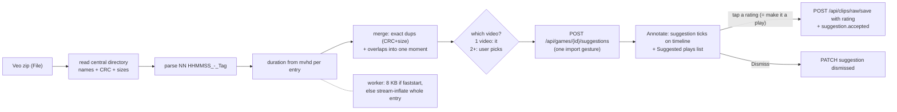

# Epic: Veo Highlights Import

**Status:** TODO (decisions V1-V6 DECIDED 2026-10-18: every recommendation accepted, plus the inline rate-to-keep amendment; decision artifact: https://claude.ai/artifact/DKcPVToRyxy2qAG5AwbtY1)
**Started:** 2026-10-18
**Completed:** -
**Impact:** 7 **Complexity:** 6 **Priority:** 1.2

## Goal

A parent who downloaded the "Veo highlights" zip for a game can bring it into ReelBallers:

- **Path A, game present (the common case for Veo owners):** the zip turns into **suggested plays**
  on the full game in Annotate. Veo already found ~40 moments (shots, goals, attacks); the parent
  reviews them and promotes the ones featuring their athlete to plays, instead of scrubbing 90
  minutes. The zip is read locally (seconds) for names and durations. **Nothing from the zip is
  uploaded.**
- **Path B, no game (the parent only has the zip, for example sent by a coach):** the parent picks
  the clips they want and they arrive as clips on the Clips tab, through the existing pre-cut clip
  upload (T8370). No new storage model.

## Why

Veo is one of the most common cameras in our audience (`src/landing/src/data/cameras.ts`). Its
highlights export is the one artifact every Veo parent can download, and today it is unusable here:
dropping the zip anywhere is rejected, and unzipping it by hand then uploading 40 files through Add
Clip produces 40 untagged, unordered drafts named after filenames like `06 001444_-_Goal.mp4`.

## Legal boundary (T2680)

T2680 removed Veo/Trace **link** import because our server fetched content from their platforms.
This epic stays inside the profile T2680 chose (CapCut: the user brings files from their own
device; the app never contacts the content source). **Hard rule for every task here: no request to
any Veo domain, no Veo API, no Veo credentials, no scraping.** We only read a file the user picked.
Whether the UI may name Veo ("Veo highlights zip detected") is decision V5.

## The format (measured 2026-10-18 on `formal annotations/u14 phillips/Veo highlights WCFC vs.  Rebels SC.zip`)

| Fact | Evidence |
|---|---|
| Zip of N mp4 entries plus an empty `.veo-zip` marker entry | `unzip -l`: 41 mp4 + `.veo-zip`, 554 MB |
| Entry name = `{NN} {HHMMSS}_-_{Tag_with_underscores}.mp4` | `06 001444_-_Goal.mp4`, `01 000252_-_Shot_on_goal.mp4`. Tags seen: Goal, Shot on goal, Attack, Highlight |
| **`HHMMSS` = clip START in the Veo recording timeline**, truncated to whole seconds | Frame match vs the full Veo download `wcfc-vs-rebels-sc-2025-10-11.mp4` (5855 s): clip 01 frame 0 = game 172.2 s (stamp 172); clip 06 mid frame = stamp + 12.5 s exactly (MSE 0.0). Script: frame-diff at 64x36 gray, 10 fps |
| Clip length VARIES (9 to 25 s) | ffprobe: Goal/Shot ~25.0 s, Attack 15.0 s and 9.0 s, Highlight 13.0 s |
| Media: 1920x1080 H.264 29.97 fps + AAC, ~4.5 Mbps, `Lavf60` | ffprobe |
| **Two encoder layouts in one zip.** The 6 short clips (Attack, Highlight) are faststart (`ftyp, moov, ...`); the 35 full-length clips are `ftyp, free, mdat, ..., moov` (moov at the END) | box walk of every entry's inflated bytes (scratch script, 2026-10-18) |
| Entries are DEFLATE-compressed (0% ratio), not stored | `unzip -v`: `Defl:N` on all 42 |
| Byte-identical duplicates exist when Veo tags one moment twice | `33 012027_-_Shot_on_goal` == `34 012027_-_Goal` (`cmp`, same CRC-32 in the central directory) |
| Near-duplicates overlap heavily | `05 001443 Shot`, `06 001444 Goal`, `07 001445 Attack`: three files covering one goal |

Consequences for the design:

1. **Path A uploads nothing, but must read the zip locally once.** Names, CRC and sizes come from the
   zip central directory (read from the end of the File with `Blob.slice`). Duration needs `mvhd`:
   for faststart entries the first ~8 KB suffices; for moov-at-end entries the whole entry must be
   stream-inflated (DEFLATE is sequential) keeping only the tail. Measured: all 41 entries in 1.8 s
   with native zlib; budget a few seconds in a browser Web Worker (fflate), with a progress bar.
   Never assume a fixed 25 s (no silent fallback: lengths really vary 9 to 25 s).
2. **Exact duplicates are detectable from the central directory alone** (CRC-32 + uncompressed size).
   Measured on the Rebels zip: 41 entries -> 40 after exact dedupe -> **35 after overlap folding**
   (the 4 folded groups are exactly the 4 goals, each with its "Shot on goal"/"Attack" siblings).
3. **Path B must faststart the moov-at-end clips** (or confirm the existing clip upload path already
   does: `uploadManager._hashAndAnalyze` runs faststart analysis for games; verify it covers
   `kind='clip'`), or they will not stream in Focus (the T1450 Trace moov-at-end class).
4. Timing maps directly: `game_time = video.offset_seconds + stamp_seconds + import_shift`, where
   `import_shift` defaults to 0 and is user-nudgeable (Veo truncates to whole seconds; observed
   true start is stamp + 0.2 to 0.9 s, inside play-editor trim tolerance).

### Survey of 7 real zips (2026-10-18; the Rebels zip plus 6 in the user's Downloads)

| Zip | Entries | After dedupe -> fold | Tags | Lengths (s) | moov-at-end |
|---|---|---|---|---|---|
| WCFC vs. Rebels SC | 41 | 40 -> 35 | Goal 4, Shot on goal 31, Attack 5, Highlight 1 | 9-25 | 35 |
| WCFC B2012 vs. SD Surf | 88 | 87 -> 73 | Goal 8, Shot on goal 36, Highlight 44 | 5-30 | 88 |
| WCFC B2012 vs. Beach FC | 44 | 43 -> 35 | Goal 5, Shot on goal 21, Highlight 18 | 5-**56** | 38 |
| Scrimmage Game 10_4_25 | 59 | 59 -> 45 | Goal 10, Shot on goal 45, Attack 4 | 7-25 | 53 |
| WCFC vs. Legends FC San Diego (1st Half) | 32 | 31 -> 27 | Goal 2, Shot on goal 15, Attack 8, **Defence 7** | 5-25 | 20 |
| WCFC vs. Legends FC San Diego (2nd Half) | 30 | 30 -> 25 | Goal 1, Shot on goal 18, Attack 10, Defence 1 | 5-27 | 20 |
| WCFC vs. LA Breakers FC Long Beach | 35 | 35 -> 30 | Goal 1, Shot on goal 29, Attack 5 | 7-30 | 31 |

What the survey settled:

- **Name pattern held on all 329 entries** (zero skipped besides `.veo-zip`); the index follows stamp order
  (ties on the same second keep index order). All entries DEFLATE.
- **Tag set seen:** Goal, Shot on goal, Attack, Highlight, Defence (British spelling). The parser keeps
  unknown labels verbatim; never assume a closed set.
- **Stamp = clip start, confirmed on 4 games** by frame match (MSE 0.0): Rebels, Beach FC (stamp + 0.6 s),
  LA Breakers (+0.9 s), Legends 2nd half (+0.7 s).
- **Halves are separate Veo recordings and separate zips, each on its own timeline** (2nd-half stamps
  restart at 0:13). The zip name carries `(1st Half)` / `(2nd Half)` and the user's downloads are
  `...-1st-half-....mp4` / `...-2nd-half-....mp4`. V6(a) holds; the import sheet PRESELECTS the video whose
  filename or sequence matches the zip's half marker.
- **Short clips are a different render of the same moment.** The faststart, shorter clips (Attack,
  Highlight, Defence, some Goals) show a zoomed virtual-camera view, not a crop of the full download, so a
  frame diff cannot verify them (side-by-side checked: same players, same instant, tighter framing).
  Their stamps sit at the same moments as their full-length siblings; treat them identically. For Path B
  this means some uploaded clips are already zoomed (fine; Focus works on any frame).
- Lengths run 5 to 56 s, confirming no fixed-length assumption.

Fixtures for T13200: the 7 manifests above (names + CRC + sizes + durations, no media).

## What already exists (do not rebuild)

From the 2026-10-18 code survey; docs: `.claude/knowledge/backend-services.md` "Pre-cut clip upload
(T8370)", `.claude/knowledge/annotate.md` T10300 and T8370 sections.

| Building block | Where | Used by |
|---|---|---|
| Batch clip upload: game-less `raw_clips` rows (`source='upload'`), per-profile `raw_clips/{blake3}.mp4`, one credit per batch on summed bytes, 500 MB / 600 s caps, per-item `name/rating/tags/notes/my_athlete` | `POST /api/clips/upload` (`clips.py` ~2320), `useClipUpload.js`, `uploadManager.uploadClipsBatch` | Path B, unchanged |
| Link an upload clip to a game (attribution) | `POST /api/clips/raw/{id}/link` (`clips.py` ~1884), `LinkClipToGameModal` | Path B "these are from game X" (after T13150) |
| Multi-video games on one timeline: `game_videos.offset_seconds`, `sequence` | `database.py` ~1602, `useVirtualTimeline.buildFullVideoTimeline` | Path A time mapping |
| Mark play = `POST /api/clips/raw/save`, natural key `(game_id, end_time, video_sequence)` | `clips.py` ~1486 | Path A rate-to-keep |
| Soccer tags (Goal, Assist, Dribble, Pass, Chance Creation, ...) | `tagRegistry.js`, `soccerTags.js` | Tag mapping (V3) |
| Universal intake / Add footage | `GameFootagePicker.jsx`, `useFootageIntake` | Path A entry (T13240) |

## Found while designing (bug, filed separately, bugs first)

**T13150:** a linked upload clip exports the GAME's first seconds instead of its own file.
`framing.py` ~261 and `multi_clip.py` ~2284 select `COALESCE(gv.blake3_hash, g.blake3_hash)`;
a linked upload clip has `video_sequence NULL`, so the `game_videos` join misses and the game's
hash wins; `resolve_clip_source` step 1 then returns the game video over `0..duration`. No export
path checks `rc.source`. Live since T10300 (prod 2026-09-21). Path B's "link to game" depends on it.

## Design

### Path A: suggested plays on a game (no upload)



- **Merge rule (memory-only, at parse time):** sort by stamp; moments whose spans overlap by
  more than half the shorter one fold into one suggestion spanning the union, labels unioned,
  display label by priority Goal > Shot on goal > Attack > Defence > Highlight > other. The Rebels zip folds
  41 entries into 35 suggestions (measured; asserted in T13200's fixture test).
- **Persistence (V1 decided):** a new profile_db table, written only by named gestures:

  ```sql
  CREATE TABLE play_suggestions (
    id INTEGER PRIMARY KEY,
    game_id INTEGER NOT NULL REFERENCES games(id) ON DELETE CASCADE,
    source TEXT NOT NULL,              -- 'veo_zip'
    import_id TEXT NOT NULL,           -- one per import gesture; scopes Shift and re-import
    video_sequence INTEGER NOT NULL,   -- which game_video the stamps belong to
    start_time REAL NOT NULL,          -- seconds in that video's own timeline (stamp + shift)
    end_time REAL NOT NULL,
    labels TEXT NOT NULL,              -- JSON list, display order
    state TEXT NOT NULL DEFAULT 'open',-- open | accepted | dismissed
    raw_clip_id INTEGER REFERENCES raw_clips(id) ON DELETE SET NULL,
    created_at TEXT NOT NULL
  );
  ```

  Gestures: **Import** (one batch insert, idempotent on `(game_id, source, start_time, labels)` so
  re-dropping the same zip adds nothing), **Shift all** (one surgical UPDATE of `start/end` for an
  `import_id`), **Rate to keep** (existing `raw/save` WITH the chosen rating, then `state='accepted', raw_clip_id`),
  **Dismiss / Undo**, **Remove import**. Times live in the video's own timeline, never the virtual
  timeline, so `offset_seconds` edits (T8900 Fix timing) never desync them.
- **Rate to keep (user amendment 2026-10-18: "make it very simple to make it a play and rate it
  within the UI, same screen, no switching cost").** Making a play and rating it is ONE tap on the
  same screen, and the suggestions list never goes away:
  - Tapping a suggestion row seeks the Annotate video to it and plays; the row expands in place to show
    the existing `PlayRatingRow` (five labeled cells, presentational, `modes/annotate/components/PlayRatingRow.jsx`)
    plus **Not my player** (dismiss).
  - **Tapping a rating cell IS "Make it a play":** one gesture -> one `raw/save` creating the play
    `[start, end]` with that rating and the mapped tag (V3), then the suggestion is marked accepted.
    No play editor opens, no screen change, no modal.
  - The expanded row also shows **name** (prefilled "{Label} {mm:ss}"), **tags** and **notes** (the shared
    `DetailsFields`), editable before keeping (in-memory draft, sent with the keep tap) and after
    (surgical per-field writes via `PUT /api/clips/raw/{id}`).
  - **After keeping, the row stays open** for edits (second user amendment 2026-10-18: name, notes and
    tags must be easy to edit); a **Next** button (or Down) moves to the next open suggestion. Nothing
    auto-advances, so an edit is never cut off.
  - "Edit play" on an accepted row opens the normal play editor for trimming or details, as an option, never
    a required step. Annotate's own Mark play controls stay on screen and keep working throughout.
  - Undo (toast) on rate-to-keep deletes the just-created play and reopens the suggestion; on dismiss
  it reopens the suggestion.

- **Alignment check:** after import, Annotate seeks to the first suggestion and the sheet asks
  "Does the play start here?" with **-1 s / +1 s / custom** Shift controls (reusing T8900's nudge
  pattern). A wrong-file import (zip from another game) is caught here too: the "Remove import" row
  undoes it in one tap.
- **Plays-only games** (Keep Only Marked Plays epic): import is refused like any clip write.

### Path B: clips without a game (T8370 path)

1. Add Clip accepts a `.zip`. The client reads the central directory (same reader as Path A) and
   shows a **pick list**: one row per merged moment with label, `mm:ss` stamp and duration, a poster
   frame lazily decoded from the entry (inflate one entry into a Blob, `<video>` seek), and label
   filter chips ("Goal 4", "Shot on goal 27", "Attack 3", "Highlight 1").
2. Selection default is decision V2. Exact duplicates are already collapsed; for a folded overlap
   group, Path B uploads only the highest-priority file (overlap clips are the same footage).
3. **Upload:** inflate selected entries one at a time (fflate streaming inflate into a `File`;
   peak memory = one ~15 MB clip) and feed them to `useClipUpload` / `POST /api/clips/upload`
   with per-item `name`, `tags`, `notes` (V3). Moov-at-end entries (35 of 41 measured) must come out
   faststart (format consequence 3). One credit for the batch, as today
   (554 MB worst case = 1 credit under T8370's formula).
4. Optional "These are from game ..." picker that links every created clip after upload (T10300
   link gesture; requires T13150).
5. Also accept the **loose mp4 files** (Windows/macOS auto-extract zips): files matching the Veo name
   pattern get the same naming/tagging, no pick list needed.

### Routing (T13240)

A Veo zip can be dropped on Add footage (game intake), Annotate's Add footage, or Add Clip. Detection:
`.veo-zip` entry OR >= 80% entries matching the name pattern. If the user owns a game whose
duration covers the last stamp (and, as a hint, whose opponent matches the zip name's `vs. X`),
offer **"Add as suggested plays to {game}"** first and **"Upload as clips"** second. No game:
straight to Path B.

## Decisions (DECIDED 2026-10-18: user accepted every recommendation)

| # | Question | Options | Recommendation |
|---|---|---|---|
| V1 | How are Path A moments stored? | (a) new `play_suggestions` table, promoted by gesture; (b) create unrated plays directly, no schema; (c) memory-only, re-drop the zip each session | **(a).** (b) dumps 35 team-wide moments into the play list, Watch plays, recap and Keep Only Marked Plays; deleting 25 of them is worse than scrubbing. (c) loses work on reload. |
| V2 | Path B pick list default selection | (a) nothing selected, filter chips + Select all; (b) all selected; (c) Goals selected | **(a).** Veo highlights are team-wide; a parent wants their athlete's moments, and each upload is a permanent draft. |
| V3 | Veo label to our tags / name / rating | Goal -> tag Goal; Shot on goal, Attack, Defence, Highlight -> no tag; name `"{Label} {mm:ss}"`; notes `"Veo: {labels}"`; rating = the parent's tap (Path A rate-to-keep) / unset (Path B, overriding T8370's default 5) | **As listed.** Only Goal matches our vocabulary; inventing "Shot" would break `CURATED_COMBOS` parity. Rating stays the parent's judgment, never Veo's. |
| V4 | Which path ships first | (a) Path A then B; (b) B then A | **(a).** The measured user workflow keeps the full Veo game next to the zip (`formal annotations/u14 phillips/*`): A saves a 554 MB upload and the scrub, B only saves unzipping. B is smaller (no schema), so it can run in parallel if wanted. |
| V5 | May the UI name Veo? | (a) yes, factual ("Veo highlights zip"); (b) generic ("highlights zip") | **(a)**, factual and nominative, describing a file the user owns, never implying partnership (`SEO.md:109` forbids claiming an integration). User's call given T2680 history. |
| V6 | Halves recordings (Veo zip stamps vs a game uploaded as 2 files) | (a) user picks the video the stamps belong to; (b) map stamps across `offset_seconds` cumulatively | **(a)**, confirmed by the survey: each half is its own zip on its own timeline. Preselect the video matching the zip's `(1st Half)`/`(2nd Half)` marker. |

## Tasks

| # | ID | Task | Status | Tier |
|---|---|---|---|---|
| 0 | T13150 | (bug, Release check bugs section) Linked upload clip exports the game video | TODO | M |
| 1 | T13200 | [Veo zip reader + manifest parser (client library)](T13200-veo-zip-reader-and-parser.md) | STAGING | M |
| 2 | T13210 | [Backend: play suggestions table + import/shift/accept/dismiss endpoints](T13210-backend-play-suggestions.md) | STAGING | L |
| 3 | T13220 | [Annotate: import a Veo zip as suggested plays](T13220-annotate-suggested-plays-ui.md) | STAGING | L |
| 4 | T13230 | [Add Clip: import Veo highlights as clips (no game)](T13230-add-clip-veo-zip-pick-list.md) | STAGING | M |
| 5 | T13240 | [Route a dropped Veo zip to the right path](T13240-veo-zip-routing.md) | STAGING | M |
| 6 | T13245 | [A Veo zip with no game becomes one game of the picked clips](T13245-veo-zip-as-game.md) | STAGING | L |
| 7 | T13246 | [Game details step when making a game from a Veo zip](T13246-veo-game-details-step.md) | TODO | M |

Order: T13200 first (both paths need it). Then T13210 -> T13220 (Path A) and T13230 (Path B, needs
only T13200 and, for its link option, T13150). T13240 last.

## Risks

| Risk | Mitigation |
|---|---|
| Veo changes its name format or stamp meaning | Parser is strict and fails visibly ("This zip doesn't look like a Veo highlights export"), never guesses; T13200 fixture set from several real zips; the alignment check catches a semantic shift on first use |
| Full game the user uploaded is not the Veo full-match download (trimmed, re-encoded, other camera) | Alignment check + Shift; Remove import |
| Browser zip handling on phones (554 MB File) | Both paths stream one entry at a time in a Web Worker (peak memory = one ~15 MB entry). Path A reads the whole zip once locally for moov-at-end durations (seconds, with progress); nothing is uploaded |
| 40 drafts flood the Clips tab (Path B) | V2 default selects nothing; overlap folding |
| ZIP64 / data descriptors in other exports | Use a maintained reader (fflate `Unzip` or `@zip.js/zip.js`), not a hand-rolled one; fixture with a >4 GB-offset synthetic zip in T13200 |
